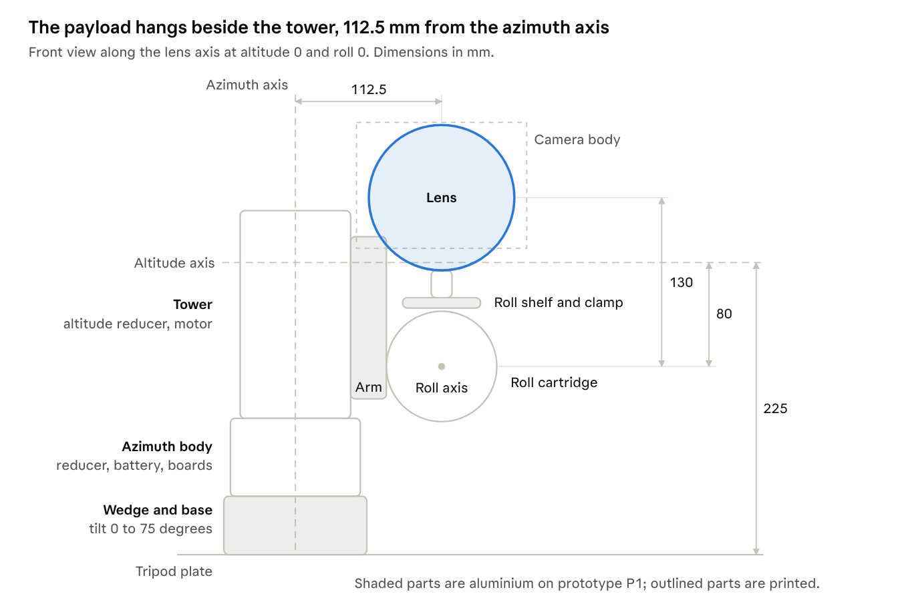
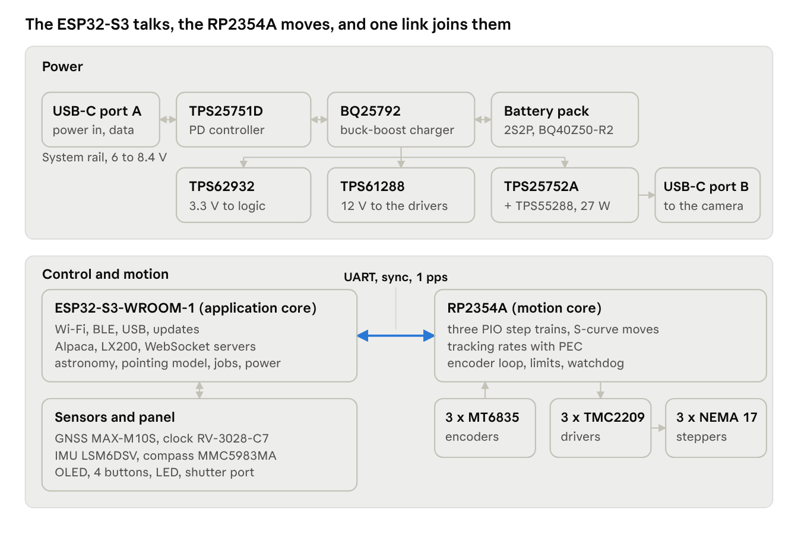
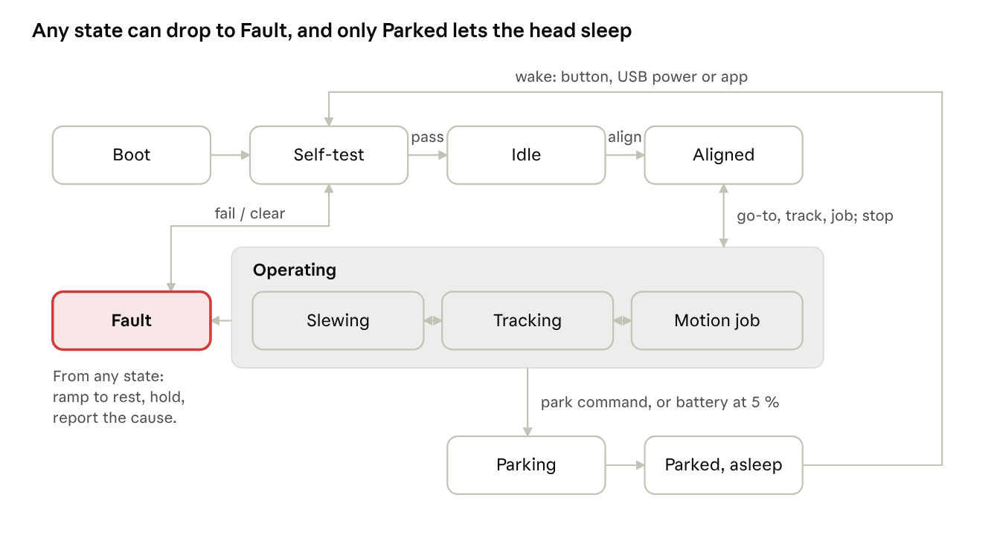

# Phase 2 — Engineering Spec

20 Nov 2026 · Bruno · Star Tracker Project, Phase 2 · Revision B (size 17 on azimuth, D17)

Live copy: [Phase 2 — Engineering Spec](https://claude.ai/artifact/HrJ3eDJexNkq9QpU9hBu8x) · Parts list: [Sheet](https://claude.ai/artifact/9T9Gpvm2vWPRYqJtPChJa8) and `hardware/bom/master-parts-list.csv` · Calculations: `docs/calc/phase2_calcs.py`

## Summary

The design meets the tracking targets on paper: 2.2″ RMS in EQ-wedge mode and 2.7″ RMS in alt-az mode at 300 mm over 5 minutes, but only with periodic error correction (PEC) trained on each head. Without PEC the same budget gives about 14″ (EQ) and 17″ (alt-az).

Five findings change the design or the plan:

1. **The output encoders need hollow-shaft reducers.** A solid cup-type reducer blocks the axis, so an on-axis MT6835 cannot see the output. Hollow units fix this and also carry the cables through the axes.
2. **The head is heavy.** Three housed reducers put prototype P1 at about 6.0 kg and production at about 5.2 kg, against 1.5 kg for a Polaris and 4.1 kg for a ZWO AM3.
3. **Two parts must be metal from the first prototype.** A printed altitude arm bends 120″ under the reference rig; in aluminium it bends 7″.
4. **Reducers are 43–58 % of the material cost.** Landed cost at 1,000 units is about €1,090 with catalogue reducer prices, or about €770 if we buy component sets at OEM prices.
5. **The camera stays put with power off for the reference rig** in every pose (safety factor 1.1 at worst, 2.0 or more in normal poses). It can still creep with a 7 kg load left unbalanced. No brake is planned; the firmware parks the head before the battery runs out.

**Change request CR1 (touches D2): size 17 on azimuth.** In EQ-wedge mode gravity loads the azimuth axis, which D2 sized as the smallest. With the payload hanging beside the tower, the reference rig puts 4.1 N·m on it. A 7 kg load rolled outward at latitude 15° puts 17.6 N·m on it, above the size-14 average-torque limit of 11 N·m. Size 17 on azimuth costs 0.3 kg and about €36 and lifts that margin from 0.6× to 2.1×. Approved as D17: this revision uses size 17 on azimuth throughout, and the ±30° roll limit at 7 kg is gone.

All numbers come from `docs/calc/phase2_calcs.py`. Prices were read on 20 Nov 2026 at USD 1 = EUR 0.91.

## Decisions from this phase

**Approved by Bruno on 20 Nov 2026 (“Approve all”).** CR1 and Q1–Q14 are now decisions D17–D31 in the decisions log. Revision B, the same day, reruns the calculations, mass budget, cost model and parts list with size 17 on azimuth (D17).

None of these was covered by D1–D16. Q1–Q14 are now D18–D31, and only Q15 is open. The spec uses the recommended option for each; an open one is marked *pending approval*.

| # | Question | Recommendation | Why |
| --- | --- | --- | --- |
| Q1 | Reducer format | Hollow-shaft housed units: Laifual LHT-17-100-U-III (azimuth, altitude) and LHT-14-100-U-III (roll) | On-axis encoder and cables through the bore; costs about 0.7 kg over solid units |
| Q2 | Where the electronics sit | Battery, boards and azimuth motor all above the azimuth bearing | Azimuth turns without limit and needs no slip ring |
| Q3 | Roll geometry | Roll axis parallel to the lens axis, 130 mm below it, with an L-shaped shelf and Arca clamp | A lens on its foot cannot sit on the roll axis; the offset only adds a known torque |
| Q4 | Wedge range | Tilt 0–75° (latitudes 15–90° N and S), fine adjust 34′ per turn, locks flat for alt-az | Covers Portugal, Spain and the 2028 Kimberley eclipse at 15° S |
| Q5 | Motion MCU | Raspberry Pi RP2354A | PIO step timing, lowest cost, open tools; reasons in section 6 |
| Q6 | Motor and belt | StepperOnline 17HE15-1504S on all axes; 20T:60T GT2, 9 mm wide, 200 mm belt | 2.3× torque margin at 8°/s and 20 °C with 7 kg in alt-az mode; the 9 mm belt has 1.5× tension margin |
| Q7 | Metal parts on P1 | Altitude arm and roll shelf CNC-machined in 6061 from the first prototype | Finding 3 |
| Q8 | Brake | None; low-battery park, end-stop bumpers | Finding 5 |
| Q9 | Slew speed in the cold | 8°/s down to 0 °C, 6°/s at −20 °C | Grease drag leaves only 1.2× margin at 8°/s and −20 °C |
| Q10 | Power chips | BQ25792 + TPS25751 (charge port), TPS25752A + TPS55288 (27 W camera port), TPS61288 (12 V), BQ40Z50-R2 in the pack | TI reference pairing that needs no PD firmware; pack shows its own charge on LEDs |
| Q11 | Weight target | P1 ≤ 6.1 kg, production ≤ 5.1 kg (restated for the size-17 azimuth, to confirm), with a weight-cutting pass in Phase 8 | Finding 2 |
| Q12 | Printer, dryer, services | Bambu Lab H2S + AMS HT; JLCCNC for aluminium, JLC3DP for MJF PA12, Xometry Europe as backup | Confirms D15 with current prices |
| Q13 | Arca clamp on the prototype | Buy a standard 60 mm clamp | Saves a machined part while the layout is still moving |

**Q14, found while checking clearances: roll travel with long lenses.** With the 200–600 on its foot the roll axis has 155° of travel, not 380°, because the tower is in the way on one side (section 2.4). I recommend accepting this for prototype P1 and studying two alternatives in the Phase 3 CAD: moving the payload 23 mm further out, which gives a camera on an L-bracket its full turn but adds 20 % to the azimuth load in EQ mode; or raising the roll axis level with the altitude axis, which opens about 42° toward the tower but unbalances the altitude axis.

**Q15, new in revision B: a longer motor on azimuth.** The size-17 reducer drags more than the size 14 did. At −20 °C a 7 kg load in the EQ extreme now has a margin of 0.84 at 8°/s and 1.08 at 6°/s, so it would slew at 4°/s. I recommend the 48 mm 17HS19-2004S1 on azimuth only: it fits the same mount, adds 110 g, and gives 1.23 at 8°/s and 1.55 at 6°/s. Until you decide, the spec keeps the 38 mm motor of D23 on all three axes.

Two things I could not do from here:

- **Repo access.** Done after you granted access: the Phase 2 files are on the branch phase-2-engineering-spec of bmonte777/start-tracker-project.
- **Your app code.** I could not open bmonte777/Benro-Polaris-Controller, so the app section assumes the shell technology your current app already uses.

## 1. Product requirements

The head is a 3-axis motorised mount (azimuth → altitude → roll) with a built-in latitude wedge, rated for 7 kg, that tracks, points and runs motion jobs on its own.

### 1.1 Functions

| Group | Function |
| --- | --- |
| Astro | Sidereal, lunar, solar, half-speed and custom-rate tracking; alt-az tracking with roll de-rotation; EQ-wedge tracking on one axis |
| Astro | Go-to, 1/2/3-star and N-point alignment, plate-solve sync, polar-alignment helper with polar-error compensation |
| Astro | PEC training and playback, pulse guiding, dithering, satellite and comet tracking from TLE or rates |
| Day | Panorama (single row, multi-row, 360° sphere), time-lapse with keyframes, Holy Grail moves, video moves, focus-stack and HDR triggers |
| System | GNSS position and time, levelling by IMU, compass heading, battery gauge, soft limits, stall and tip detection, low-battery park, updates over Wi-Fi with rollback |
| Stand-alone | OLED, 4 buttons and LED run alignment, tracking and park without a phone (D7) |

### 1.2 Performance targets

Refined from the starting list in the Phase 2 brief. *Expected* is what the calculations in sections 3–5 predict.

| Requirement | Target | Expected | Conditions |
| --- | --- | --- | --- |
| Tracking, EQ-wedge mode | ≤ 3″ RMS over 5 min | 2.2″ | 300 mm, reference rig, PEC on, polar error ≤ 2′, wind ≤ 3 m/s |
| Tracking, alt-az mode | ≤ 5″ RMS over 5 min | 2.7″ | As above, altitude ≤ 60° |
| Go-to | ≤ 2′ (2σ) after alignment | 59″ RMS, 1.97′ at 2σ | N-point model and gear-error map applied |
| Go-to after plate-solve centring | ≤ 20″ | — | One solve-and-correct cycle |
| Backlash at the output | ≤ 20″ | 12″ azimuth and altitude, 26″ roll raw; ≤ 10″ with encoder correction | Friction reversal of ±0.3 N·m |
| Rated payload | 7 kg | Lowest margin 1.1 (roll reducer against its average-torque limit); bearings 2.4 or more | Any pose, either mode, wedge up to 75° |
| Reference payload | 3.2 kg | — | A7R V + 200–600 on its foot |
| Slew speed | 8°/s | 8°/s to 0 °C, 6°/s at −20 °C *(D26); 4°/s at −20 °C for 7 kg in the EQ extreme unless Q15 is approved* | 12 V motor rail |
| Settle after a slew | ≤ 2 s to within 2″ | 0.9–2.1 s | Tripod mode at 10 Hz, damping 2–5 % |
| Operating temperature | −20 to +40 °C | Internal air 46.5 °C at 40 °C ambient | Tracking, charging and powering the camera |
| Sealing | IPX4 prototype, IPX6 production | — | D9 |
| Runtime, alt-az tracking at 20 °C | ≥ 12 h | 23 h | 2S2P P50B |
| Runtime, tracking + camera power | ≥ 7 h | 7.7 h | Camera drawing 5 W |
| Weight with wedge and battery | P1 ≤ 6.1 kg, production ≤ 5.1 kg (D28, restated; to confirm) | 5.97 kg and 5.23 kg | Section 3.9 |
| Azimuth range | Unlimited | — | No slip ring *(D19)* |
| Altitude range | −10° to +95° | — | Soft limits, bumpers at −15° and +100° |
| Roll range | ±190° mechanical | +5° to −150° with the reference rig | The tower on one side and the tripod on the other limit a long lens; its rotating collar covers the gap (D31) |
| Wedge range | Tilt 0–75° *(D21)* | — | Latitudes 15–90° |

### 1.3 Interfaces

| Interface | Requirement |
| --- | --- |
| Camera side | Arca-Swiss clamp, 60 mm, on the roll shelf |
| Tripod side | 3/8″-16 socket in the base plate, stainless bushing |
| USB-C port A | Runs the head and charges the pack from USB PD (5–20 V, up to 45 W); USB data to the app and for updates |
| USB-C port B | USB PD output for the camera: 5 V and 9 V at 3 A (27 W) |
| Shutter port | 2.5 mm jack, opto-isolated focus and shutter |
| Wireless | Wi-Fi 2.4 GHz (access point or joins a network), BLE 5 for setup |
| Protocols | ASCOM Alpaca Telescope + Rotator, LX200 over TCP, WebSocket JSON, BLE GATT (D11) |
| On the head | 1.3″ OLED, 4 buttons, RGB status LED with red night mode (D7) |
| Battery | Tool-free pack, 5-way blade connector, charge shown on the pack’s own LEDs |
| Service | 2 / 2.5 / 3 mm hex keys only; M3, M4, M5 screws only; one 15-way plug per axis cartridge (D13) |

## 2. Kinematic layout

The head is a single-arm fork: a tower on the azimuth body carries the altitude axis, and the payload hangs beside the tower on the roll stage so a long lens can swing past the head. *(Layout: D18–D21.)*



The lens sits 130 mm above the roll axis and 70 mm from the tower. The altitude axis runs 80 mm above the roll axis, through the combined centre of gravity of the roll stage and the reference rig.

### 2.1 Axis stack

| Axis | Reducer | Range | Limited by | What crosses the axis |
| --- | --- | --- | --- | --- |
| Wedge | Manual hinge and arc | Tilt 0–75° | Clamp bolts | Nothing |
| Azimuth | Size 17 (D17) | Unlimited | — | Nothing; all electronics ride above it |
| Altitude | Size 17 | −10° to +95° | Soft limits; bumpers at −15° and +100° | Roll harness, 15 wires, through the hollow shaft |
| Roll | Size 14 | ±190° mechanical; +5° to −150° with the 200–600 on its foot | Soft limits; the camera cable; the tower and tripod for long lenses | Encoder tube only |

In EQ-wedge mode the wedge tilts the azimuth axis to the celestial pole. Azimuth becomes right ascension, altitude becomes declination, and roll frames the shot.

### 2.2 Slip ring or cable wrap

No slip ring is needed. The battery, both boards and the azimuth motor sit above the azimuth bearing, so no wire crosses the one axis that turns without limit. The altitude harness twists ±52.5° inside its hollow shaft, and the roll axis carries no wires.

If a power bank is plugged into port A and sits off the head, the firmware limits azimuth to ±270°.

### 2.3 Key dimensions

These are the assumptions behind every calculation in section 3. Phase 3 may move them by a few millimetres.

| Dimension | Value | Set by |
| --- | --- | --- |
| Payload plane to azimuth axis | 112.5 mm | Tower half-width 42.5 + lens radius 56 + 14 clearance |
| Roll axis to clamp seat | 45 mm | Roll cartridge radius |
| Lens axis to roll axis, 200–600 on its foot | 130 mm | 45 + foot height 85 mm (to be measured on your lens) |
| Roll axis below altitude axis | 80 mm | Puts the altitude axis through the combined centre of gravity |
| Altitude axis above the azimuth body | 120 mm | Camera swing at high altitude |
| Altitude axis above the tripod plate, wedge flat | 225 mm | Body 60 + wedge and base 45 |
| Azimuth body radius on the payload side | ≤ 50 mm | Camera swing at high altitude |
| Altitude arm, bearing to payload plane | 85 mm | Lens clearance |
| Roll shelf cantilever to the lens foot | 75 mm | Foot length |

### 2.4 Clearance for the A7R V + 200–600

The reference rig clears the head and tripod up to 85° altitude. The lens is 111.5 mm in diameter, 318 mm long and 2,115 g. Mounted by its foot and balanced, the camera back swings on a radius of about 190 mm and the front on 215 mm (325 mm with the hood).

| Check at 80° altitude | Value | Clearance |
| --- | --- | --- |
| Lowest point of the camera below the altitude axis | 210 mm | 15 mm above the tripod plate |
| Nearest point of the camera to the azimuth axis | 94 mm | 44 mm outside the body |

Above 85° the camera body meets the azimuth body by about 3 mm, so this rig gets a soft limit at +85°. Each rig has its own envelope in the app. Alt-az tracking stops at 80° anyway, because azimuth and roll rates run away near the zenith.

**Roll travel with a long lens is one-sided.** The lens axis sits 130 mm from the roll axis and 70 mm from the tower, so rolling toward the tower brings the barrel against it after about 6° (130 mm × sin 6° = 14 mm, the whole clearance), so the soft limit is +5°. Rolling away is free until the lens drops toward the tripod at about −150°. That leaves 155° of travel. A camera frame repeats every 180°, so the firmware picks the start angle that keeps a night of de-rotation inside the window, and the 200–600’s rotating collar re-clocks the camera by hand for the 25° of framings that fall outside it. *(D31.)*

### 2.5 Centre of gravity and balance

You balance one thing: slide the lens foot in the Arca clamp until the rig sits level on the altitude axis. The firmware checks it by rocking altitude ±5° and comparing motor load each way.

| Axis | Pose | Reference rig | 7 kg |
| --- | --- | --- | --- |
| Altitude | Balanced within 10 mm | 0.58 N·m | — |
| Altitude | Off balance (60 mm reference, 100 mm at 7 kg) | 1.95 N·m | 7.26 N·m |
| Roll | Camera upright (roll 0°) | 0 | 0 |
| Roll | Rolled 90°, lens level | 4.2 N·m | 9.05 N·m |
| Azimuth | Alt-az mode, head level | 0 | 0 |
| Azimuth | EQ mode, latitude 37°, roll 0° | 4.1 N·m | 7.44 N·m |
| Azimuth | EQ mode, latitude 37°, rolled 90° outward | 7.35 N·m | 14.57 N·m |
| Azimuth | EQ mode, latitude 15°, rolled 90° outward | — | 17.63 N·m |

The roll offset cannot be balanced out, because a lens on its foot cannot sit on the roll axis. The body gets two M5 bosses on the far side for an optional counterweight bar in EQ mode.

## 3. Load and stiffness calculations

All three axes carry the rated 7 kg now that azimuth is size 17 (D17). Roll has the least margin, 1.13 against its average-torque limit. Each result below shows formula → numbers → result.

### 3.1 Assumptions

- Payloads: reference rig 3.2 kg; rated 7 kg. Roll stage 1.38 kg (reducer 0.70, motor 0.28, housing 0.12, shelf 0.16, clamp 0.12). Tower 1.5 kg.
- Geometry from section 2.3. Gravity 9.81 m/s².
- Slew 8°/s reached in 0.5 s, so α = 0.1396 rad/s ÷ 0.5 s = 0.279 rad/s².
- Moments of inertia at 7 kg: azimuth 0.265, altitude 0.18, roll 0.128 kg·m² (rod and offset estimates).
- Wind: F = ½ρv²CₙA with ρ = 1.225 kg/m³ and Cₙ = 1.1. Reference rig: A = 0.062 m², arm 60 mm. 7 kg class: A = 0.10 m², arm 100 mm.
- Reducer efficiency 70 %, belt 95 %. No-load drag at the wave generator: 0.04 N·m (size 14) and 0.06 N·m (size 17) at 20 °C, assumed four times higher at −20 °C. To be measured.

### 3.2 Torque on each axis

| Load case | Azimuth | Altitude | Roll |
| --- | --- | --- | --- |
| Reference rig, typical pose | 4.10 N·m (EQ, lat 37°) | 0.58 N·m | 0 |
| Reference rig, worst pose | 7.35 N·m | 1.95 N·m | 4.20 N·m |
| 7 kg, worst pose | 17.63 N·m | 7.26 N·m | 9.05 N·m |
| Acceleration, 7 kg (Jα) | 0.07 N·m | 0.05 N·m | 0.04 N·m |
| Wind 10 m/s, 7 kg class | 0.67 N·m | 0.67 N·m | 0.67 N·m |
| **Design torque** | **18.37 N·m** | **7.98 N·m** | **9.76 N·m** |

Working for the three worst static cases:

- **Altitude, 7 kg, 100 mm off balance:** T = g·√\[(m·(130−80) − 1.38·80)² + (m·100)²\] = 9.81 × √(0.240² + 0.700²) kg·m = **7.26 N·m**.
- **Roll, 7 kg, rolled 90°:** T = g·(m·0.130 + 0.28·0.045) = 9.81 × 0.923 = **9.05 N·m**.
- **Azimuth, 7 kg, EQ at latitude 15°, rolled outward:** T = g·\[m·(0.1125+0.130) + 1.38·0.1125 + 1.5·0.005\]·sin 75° = 9.81 × 1.860 × 0.966 = **17.63 N·m**.
- **Wind:** F = 0.5 × 1.225 × 10² × 1.1 × 0.10 = 6.74 N; × 0.10 m = **0.67 N·m**.

In alt-az mode the azimuth axis is vertical and carries no gravity torque at all.

### 3.3 Strain-wave reducers

|  | Roll | Azimuth and altitude |
| --- | --- | --- |
| Model *(D18)* | Laifual LHT-14-100-U-III | Laifual LHT-17-100-U-III |
| Type | Hollow-shaft housed unit with crossed-roller output bearing | Same |
| Ratio | 100:1 | 100:1 |
| Rated torque at 2,000 rpm input | 7.8 N·m | 24 N·m |
| Limit for average torque | 11 N·m | 39 N·m |
| Limit for repeated peak torque | 28 N·m | 54 N·m |
| Limit for momentary peak torque | 54 N·m | 108 N·m |
| Backdriving torque | 1.8 N·m | 3.3 N·m |
| Torsional stiffness K1 / K2 / K3 | 0.47 / 0.61 / 0.71 ×10⁴ N·m/rad | 1.0 / 1.4 / 1.6 ×10⁴ N·m/rad |
| Backlash (maker’s figure) | ≤ 20″ | ≤ 20″ |
| Transmission accuracy (catalogue) | 1.5′ | 1.5′ |
| Bearing: allowable moment / stiffness | 33.6 N·m / 3.6 ×10⁴ N·m/rad | 52.5 N·m / 6.4 ×10⁴ N·m/rad |
| Weight | 0.70 kg | about 1.0 kg (to confirm) |
| Price each at 1 / 100 / 1,000 heads | €237 / €209 / €168 (estimate) | €273 / €241 / €196 (estimate) |
| Second sources | Leaderdrive LHSG hollow type; Harmonic Drive SHF-14-100-2UH | Leaderdrive; Harmonic Drive SHF-17-100-2UH |

Torque ratings and weight are from Laifual’s tables. Stiffness, backdriving torque and bearing data are Harmonic Drive’s figures for the same size (CSF-2UH-LW), used as a stand-in until Laifual sends its datasheet. Supplier listings for these units range from USD 180 to USD 588, so the prices need a quote.

| Margin = limit ÷ design torque | Azimuth, size 17 | Azimuth with size 14, before D17 | Altitude | Roll |
| --- | --- | --- | --- | --- |
| Against the average-torque limit | 2.12 | 0.60 | 4.89 | 1.13 |
| Against the repeated-peak limit | 2.94 | 1.52 | 6.77 | 2.87 |
| Against the momentary-peak limit | 5.88 | 2.94 | 13.53 | 5.53 |

Size 17 on azimuth takes the 17.63 N·m worst case at 45 % of its 39 N·m average limit. With size 14 the same load passed the 11 N·m limit at 30° of roll.

### 3.4 Output bearings

The crossed-roller bearing inside each reducer is the output bearing; no separate bearings are needed. Tilting moment M = weight × lever arm; tilt = M ÷ moment stiffness.

| Bearing and case | Moment | Margin | Tilt |
| --- | --- | --- | --- |
| Roll, reference rig | 4.71 N·m | 7.1 | 27″ |
| Roll, 7 kg | 10.31 N·m | 3.3 | 59″ |
| Altitude, reference rig | 3.82 N·m | 13.8 | 12″ |
| Altitude, 7 kg, rolled 90° | 15.91 N·m | 3.3 | 51″ |
| Azimuth, reference rig, alt-az | 5.13 N·m | 10.2 | 16.5″ |
| Azimuth, reference rig, EQ at 37° | 7.99 N·m | 6.6 | 26″ |
| Azimuth, 7 kg, alt-az, rolled 90° | 18.25 N·m | 2.9 | 59″ |
| Azimuth, 7 kg, EQ at 15°, rolled 90° | 22.30 N·m | 2.4 | 72″ |

Example: roll, 7 kg: M = 7 × 9.81 × √(0.075² + 0.130²) = 10.31 N·m; tilt = 10.31 ÷ 36,000 = 2.86 ×10⁻⁴ rad = 59″.

### 3.5 Belt stage

A 9 mm GT2 belt on 20 and 60 teeth gives the 3:1 stage with 1.5× tension margin. *(D23.)*

| Item | Formula → numbers | Result |
| --- | --- | --- |
| Pitch diameters | z × 2 mm ÷ π | 12.73 mm and 38.20 mm |
| Centre distance, 200 mm belt | L = 2C + π(D+d)/2 + (D−d)²/4C | 58.62 mm |
| Wrap on the small pulley | 180° − 2·asin\[(D−d)/2C\] | 154.9°, 8.6 teeth in mesh |
| Belt pull at the design torque | 0.177 N·m ÷ 6.37 mm | 27.8 N |
| Working tension, 6 mm belt | Generic GT2 figure | 27.8 N → margin 1.00 |
| Working tension, 9 mm belt | 27.8 × 9/6 | 41.7 N → margin 1.50 |
| Static tension per span | Chosen | 14 N |
| Radial load on the motor shaft | 2 × 14 × sin(154.9°/2) | 27.3 N |
| Tension check by plucking the span | f = √(T/μ) ÷ 2L, μ = 12.6 g/m, L = 57.2 mm | about 290 Hz |
| Error from pulley run-out of 0.04 mm | (0.02 mm ÷ 19.1 mm) ÷ 100 | ±2.2″ at the output |

Pulleys are specified with run-out of 0.03 mm or less. At the highest current the firmware allows, belt pull is 46.7 N, above the working figure; the current limit in section 3.6 keeps it out of that range.

### 3.6 Stepper motor at 12 V

The StepperOnline 17HE15-1504S drives every axis: 42 N·cm holding torque, 1.5 A, 2.3 Ω, 4.0 mH, 38 mm long, 280 g. *(D23.)*

- Torque constant: Kₜ = 0.42 ÷ (√2 × 1.5) = 0.198 N·m/A.
- Speed at 8°/s: 8 × 300 ÷ 360 × 60 = 400 rpm; back-EMF = 0.198 × 41.9 rad/s = 8.3 V of the 11.5 V available.
- Step rate at 400 rpm with 256 microsteps: 341 kHz. At sidereal rate: 178 microsteps/s, each 0.084″ at the output.

Speed–torque curve, calculated from the winding data (pull-out = highest torque that fits the 11.5 V and 1.5 A limits; usable = 70 % of it):

| Motor speed | Output speed | Pull-out torque | Usable torque |
| --- | --- | --- | --- |
| 100 rpm | 2°/s | 0.297 N·m | 0.208 N·m |
| 200 rpm | 4°/s | 0.297 N·m | 0.208 N·m |
| 300 rpm | 6°/s | 0.272 N·m | 0.191 N·m |
| 400 rpm | 8°/s | 0.212 N·m | 0.148 N·m |
| 500 rpm | 10°/s | 0.171 N·m | 0.120 N·m |
| 600 rpm | 12°/s | 0.144 N·m | 0.100 N·m |

Torque needed at the motor: T = \[Tₒᵤₜ ÷ (100 × 0.70) + drag\] ÷ (3 × 0.95) + Jα·300. Example, altitude at 7 kg and 20 °C: (7.98 ÷ 70 + 0.06) ÷ 2.85 + 0.0006 = 0.062 N·m.

| Case | Needed, 20 °C | Margin at 8°/s, 20 °C | Needed, −20 °C | Margin at 8°/s, −20 °C | Margin at 6°/s, −20 °C |
| --- | --- | --- | --- | --- | --- |
| Reference rig, any pose | 0.060 N·m | 2.47 | 0.123 N·m | 1.20 | 1.55 |
| 7 kg, alt-az mode | 0.063 N·m | 2.33 | 0.125 N·m | 1.19 | 1.53 |
| 7 kg, EQ extreme (azimuth) | 0.114 N·m | 1.30 | 0.177 N·m | 0.84 | 1.08 |

Current settings with a 2× torque margin: tracking 0.30 A RMS at 20 °C and 0.75 A at −20 °C; slewing 0.81 A; ceiling 1.06 A. The 48 mm 17HS19-2004S1 fits the same mount and gives 0.218 N·m at 400 rpm, for 110 g more per axis, if the bench test shows less than the calculated curve.

The size-17 reducer on azimuth drags more than the size 14 did, so the cold margins are lower than in the first issue of this spec. At −20 °C the 7 kg EQ extreme slews at 4°/s (margin 1.18). The 48 mm motor on azimuth alone gives 1.23 at 8°/s and 1.55 at 6°/s. *(Pending Q15.)*

### 3.7 Deflection under load: printed or aluminium

The two cantilevers must be aluminium; the housings can be printed. *(D24.)*

| Part and section | Formula | Reference rig, printed | Reference rig, aluminium | 7 kg, printed | 7 kg, aluminium |
| --- | --- | --- | --- | --- | --- |
| Altitude arm: box 60 × 40, 5 mm wall, 85 mm long, I = 207,500 mm⁴ | θ = FL²/2EI + ML/EI | 120″ | 7″ | 250″ | 15″ |
| Roll shelf: 60 × 8 plate with two 6 × 22 ribs, 75 mm long, I = 51,500 mm⁴ | θ = FL²/2EI | 84″ | 5″ | 184″ | 11″ |

E = 4.2 GPa for dry printed PAHT-CF (assumed) and 69 GPa for 6061. Printed nylon also creeps under a standing load and softens as it takes up moisture, which the formula does not show.

Adding the reducer wind-up (azimuth 83″, altitude 12″ in the typical EQ pose) and the bearing tilts gives a static sag of 93″ RSS with aluminium arms and 174″ with printed arms. This sag is repeatable, so the pointing model removes it. What smears a star is its change as the sky turns 1.25° in 5 minutes: 93″ × sin 1.25° = 2.0″ of drift, or 0.59″ RMS (printed arms: 3.8″ and 1.10″). With size 14 on azimuth, its wind-up alone was 159″.

### 3.8 Settle time after a slew

The head settles faster than the tripod. Natural frequency f = (1/2π)√(K1/J):

| Axis | Reference rig | 7 kg | Ringing from a hard stop, 7 kg (α/ω²) |
| --- | --- | --- | --- |
| Azimuth | 47 Hz | 31 Hz | 1.5″ |
| Altitude | 60 Hz | 38 Hz | 1.0″ |
| Roll | 45 Hz | 31 Hz | 1.6″ |

On a tripod whose lowest mode is 10 Hz, the same stop excites 14.6″. It decays below 1″ in 0.85 s at 5 % damping or 2.1 s at 2 %. The firmware uses S-curve ramps and waits 2 s (adjustable) before it opens the shutter.

### 3.9 Power off: does the camera stay put?

Holding torque = reducer backdriving torque + motor detent × 300 = 1.8 + 0.016 × 300 = 6.6 N·m on roll, and 3.3 + 4.8 = 8.1 N·m on azimuth and altitude. The 1.6 N·cm detent is a typical figure, not on the datasheet page; it will be measured.

| Margin = holding ÷ load | Azimuth (EQ mode) | Altitude | Roll |
| --- | --- | --- | --- |
| Reference rig, typical pose | 2.0 | 14 | No load |
| Reference rig, worst pose | 1.1 | 4.2 | 1.6 |
| 7 kg, worst pose | 0.5 | 1.1 | 0.7 |

No brake is fitted. *(D25.)* The firmware parks the head at 5 % charge in a balanced pose (roll 0°, altitude level), TPU bumpers stop the altitude axis before the camera can reach the tower, and a pulled pack leaves the gear friction to slow any motion.

### 3.10 Mass budget

| Group | Prototype P1 | Production |
| --- | --- | --- |
| Reducers (2 × size 17, 1 × size 14) | 2.70 kg | 1.60 kg (simple hollow units in our own housings) |
| Stepper motors × 3 | 0.84 kg | 0.84 kg |
| Pulleys and belts | 0.14 kg | 0.14 kg |
| Battery pack | 0.34 kg | 0.34 kg |
| Electronics and harness | 0.17 kg | 0.17 kg |
| Housings and covers | 0.56 kg (printed) | 0.95 kg (aluminium + moulded covers) |
| Aluminium parts: wedge, base, arm, shelf, clamp | 1.08 kg | 1.08 kg |
| Fasteners, inserts, seals | 0.15 kg | 0.12 kg |
| **Total** | **5.97 kg** | **5.23 kg** |

Solid cup-type reducers would save 0.85 kg on P1 but leave no place for the on-axis encoders.

## 4. Accuracy budget

The predicted tracking error is 2.19″ RMS in EQ-wedge mode and 2.71″ RMS in alt-az mode, against targets of 3″ and 5″. Periodic error of the reducers is the largest term in both, and PEC is what brings it down.

**What is measured.** RMS displacement of a star about its mean position during one 5-minute exposure, at 300 mm (2.59″ per pixel on the A7R V), reference rig, aluminium arms, wind up to 3 m/s. A steady drift of d arc-seconds counts as d ÷ √12. The tripod and the ground are outside the budget.

### 4.1 EQ-wedge mode

| Error source | RMS | How it was derived |
| --- | --- | --- |
| Reducer periodic error, RA axis | 1.70″ | ±20″ typical raw = 14.1″ RMS; PEC leaves 12 % |
| Belt and pulley run-out | 0.26″ | ±2.16″ per pulley, two pulleys; PEC leaves 12 % |
| Stepper microstep non-linearity | 0.76″ | ±5 % of 1.8° ÷ 300 = ±1.08″ |
| Differential flexure | 0.59″ | Section 3.7: 2.0″ drift ÷ √12 |
| Polar alignment error of 2′, not corrected | 0.76″ | 120″ × 0.0219 rad = 2.63″ drift ÷ √12 |
| Wind gusts at 3 m/s | 0.33″ | 0.023 N·m ÷ K1 = 0.47″ on RA and on Dec |
| Encoder loop noise | 0.30″ | Allowance |
| Low-speed friction ripple | 0.30″ | Allowance |
| Thermal drift of the structure | 0.20″ | Allowance |
| Refraction left after the model, 45° altitude | 0.06″ | 2.04″ per degree of altitude; model removes 90 % |
| Clock and step timing | 0.04″ | 30 ppm crystal = 0.135″ in 5 min; GNSS pulse trims it |
| **Total (root sum of squares)** | **2.19″** |  |

### 4.2 Alt-az mode

| Error source | RMS | How it was derived |
| --- | --- | --- |
| Reducer periodic error, altitude | 1.70″ | As above |
| Reducer periodic error, azimuth | 1.20″ | 1.70″ × cos 45° altitude |
| Pointing-model rate error | 1.00″ | 1′ model error, altitude up to 60° |
| Stepper microstep non-linearity, two axes | 0.94″ | 0.76″ and 0.76″ × cos 45° |
| Roll axis error at the corner of the frame | 0.71″ | 14.1″ × (21.6 mm ÷ 300 mm) × 0.7; no PEC needed |
| Altitude reversal at the meridian | 0.50″ | 12″ lost motion, corrected by the encoder |
| Wind gusts at 3 m/s | 0.29″ | As above, azimuth × cos 45° |
| Belt and pulley run-out, two axes | 0.32″ | As above |
| Differential flexure | 0.30″ | Azimuth is vertical, so less changes |
| Encoder loop noise | 0.30″ | Allowance |
| Thermal drift of the structure | 0.20″ | Allowance |
| Refraction left after the model | 0.06″ | As above |
| Clock and step timing | 0.04″ | As above |
| **Total (root sum of squares)** | **2.71″** |  |

### 4.3 What moves the result

| Change | EQ-wedge | Alt-az |
| --- | --- | --- |
| Baseline | 2.19″ | 2.71″ |
| PEC switched off | 14.4″ | 17.4″ |
| Reducer at the catalogue limit of 1.5′ instead of ±20″ | 4.06″ | — |
| Printed altitude arm and shelf | 2.38″ | — |

A reducer at its catalogue limit misses the 3″ target even with PEC. Each reducer is therefore measured on arrival, and the best one goes on azimuth.

Without PEC the reducer error moves the star at up to 2π × 20″ ÷ 431 s = 0.29″/s, which is one pixel at 300 mm in 9 seconds.

### 4.4 Periods that PEC must cover

At sidereal rate the motor turns once in 287 s, the wave generator once in 862 s, and the main reducer error repeats every 431 s. One PEC table spanning 862 s, indexed by motor angle over three turns, captures the reducer and both pulleys.

### 4.5 Encoders, backlash and go-to

- **Encoder role.** The MT6835 resolves 0.62″, but its linearity is ±0.07° (±252″). It gives absolute position at power-up, catches slipped steps and corrects lost motion. Fine tracking comes from the gear train with PEC. Each encoder is mapped against motor steps once at assembly.
- **Backlash.** The gear mesh has none. A friction reversal of ±0.3 N·m winds the reducer by 2 × 0.3 ÷ K1 = 26″ (size 14) or 12″ (size 17); belt tooth clearance adds 2.2″. The encoder loop takes this below 10″.
- **Go-to.** Gear-error map 10″ per axis, flexure left by the model 30″, alignment model 45″, level and polar error 20″: 59″ RMS, 1.97′ at 2σ. Without the gear-error map it is 73″ RMS, 2.4′ at 2σ.
- **600 mm.** The same 2.2″ is 1.7 pixels RMS at 1.29″ per pixel, so 600 mm needs shorter subs or drift correction between frames, as D5 expects.

## 5. Power and battery

The 2S2P P50B pack runs alt-az tracking for about 23 hours at 20 °C and about 6 hours in the worst cold case, on 62.9 Wh of usable energy.

### 5.1 Power and runtime by mode

| Mode | Power from the pack | Runtime |
| --- | --- | --- |
| Idle, Wi-Fi on, motors off | 1.2 W | 52 h |
| EQ tracking, 20 °C (one axis moving, two holding at 0.15 A) | 2.0 W | 31 h |
| Alt-az tracking, 20 °C (three axes at 0.30 A) | 2.7 W | 23 h |
| Time-lapse or panorama, 20 °C (slewing 10 % of the time) | 4.0 W | 15.6 h |
| Alt-az tracking, −20 °C (three axes at 0.65 A) | 7.8 W | 6.4 h |
| Alt-az tracking and powering the camera, 20 °C | 8.1 W | 7.7 h |
| Slewing three axes at once, peak (1.06 A) | 20.8 W | Seconds at a time |

Working:

- **Energy.** Nominal 4 × 5.0 Ah × 3.6 V = 72 Wh. Usable at 20 °C: 4 × 4.85 Ah (minimum) × 3.6 V × 0.90 = 62.9 Wh. At −20 °C an assumed 80 % of that: 50.3 Wh.
- **One motor.** Loss = 2·I²·R + 0.1 W for the driver. At 0.30 A: 2 × 0.09 × 2.3 + 0.1 = 0.51 W.
- **Electronics.** ESP32-S3 0.45 W, RP2354 0.10 W, encoders 0.20 W, GNSS + IMU + clock 0.05 W, OLED dimmed 0.05 W, gauges 0.05 W = 0.90 W.
- **Alt-az tracking.** (3 × 0.51 W) ÷ 0.90 boost efficiency + 0.90 W ÷ 0.90 = 2.7 W; 62.9 Wh ÷ 2.7 W = 23 h.
- **Camera.** 5 W assumed for the A7R V, ÷ 0.92 = 5.4 W.

### 5.2 Pack and power chain *(D27)*

| Function | Part | Key data |
| --- | --- | --- |
| Cells | 4 × Molicel INR-21700-P50B, 2S2P | 5,000 mAh typical, 4,850 mAh minimum; discharge −40 to 60 °C, charge −20 to 60 °C; 70 g each |
| Gauge, protection, balancing (in the pack) | TI BQ40Z50-R2 | Drives the pack’s charge LEDs and button; SMBus to the head. Lower-cost option without LEDs: BQ28Z610 |
| Second-level protection (in the pack) | 2S over-voltage protector + three-terminal fuse | Opens the pack for good if the first protector fails |
| Pack connector | 5-way blade, 6 A | Power +, power −, SMBus clock, SMBus data, pack present |
| Charger and power path | TI BQ25792 | 1–4 cell buck-boost, 3.6–24 V input, up to 5 A; runs the head while it charges |
| USB-C port A (in, or out to a phone) | TI TPS25751D | Controls the charger over I²C with no PD firmware to write. TI’s reference design pairs it with the sibling BQ25798, so the BQ25792 pairing is to be confirmed in Phase 4 |
| USB-C port B (camera) | TI TPS25752A + TPS55288 | Source only: 5 V and 9 V at 3 A (27 W), from the 6–8.4 V system rail |
| 12 V motor rail | TI TPS61288 boost | Peak load 1.48 A at 12 V |
| 3.3 V logic rail | TI TPS62932 buck | 2 A |

Charging at 4 A (0.4 C) from a 45 W supply fills the pack in about 3 hours. The charger holds off below 0 °C and above 45 °C.

### 5.3 Thermal check

| Check | Formula → numbers | Result |
| --- | --- | --- |
| Heat inside the head, worst steady case (tracking, charging at 20 W, powering the camera) | 3 × 0.51 + 1.0 + 0.45 + 1.7 W | 4.7 W |
| Thermal resistance of the housing | 1 ÷ (h·A) = 1 ÷ (8 W/m²K × 0.09 m²) | 1.39 K/W |
| Inside air at 40 °C ambient | 40 + 4.7 × 1.39 | 46.5 °C (cells allow 60 °C) |
| Motor case above inside air at 0.65 A | 1.94 W × 12 K/W | +23 K |
| Motor case above inside air at the 1.06 A ceiling | 5.17 W × 12 K/W | +62 K |
| Pack current at the slew peak, pack nearly empty | 20.8 W ÷ 6.0 V | 3.5 A, 1.7 A per cell |

The 1.06 A ceiling is limited to 60 seconds at a time. Each cartridge board carries a thermistor beside its motor, and the firmware lowers the current above 80 °C.

## 6. Electronics architecture

Two processors split the work: an ESP32-S3 handles everything that talks, and an RP2354A handles everything that moves. Five boards carry it, as D10 and the brief set out.



Power enters at port A or comes from the pack, and the system rail feeds the three converters. The encoders report to the RP2354A, which steps the drivers; nothing in the motion chain waits on Wi-Fi.

### 6.1 Motion MCU: RP2354A *(D22)*

The RP2354A (an RP2350A with 2 MB of flash in the package, A4 stepping) is the pick over the STM32G474.

| Criterion | RP2354A | STM32G474 |
| --- | --- | --- |
| Step timing | Three PIO state machines make three step trains, exact to one 150 MHz clock cycle (6.7 ns), whatever the CPU is doing | Hardware timers do this equally well |
| Step rate needed: 341 kHz per axis | Yes | Yes |
| Processor | Two Cortex-M33 cores with FPU: one for motion, one for the link and the encoders | One Cortex-M4F core |
| Price | RP2350A: USD 1.10 single, 0.80 on a reel | Several times more (not quoted) |
| Tools | Open Pico SDK; firmware can also be dropped onto it as a file over USB, which suits recovery without a terminal | Vendor tools and a debug probe |
| Known issues | The A2 GPIO fault (erratum 9) is fixed in the A4 stepping, on sale since July 2025 | None relevant |
| Where the STM32 is stronger | — | Better ADCs, op-amps, CAN FD: none is needed, because the TMC2209 drivers control the motor current |

Pin budget: 27 of 30 GPIO. Step and direction 6, driver enable 1, driver UART 2, driver diagnostics 3, encoder SPI 6, link to the ESP32-S3 4, thermistors 3, rail monitor 1, LED 1.

### 6.2 Main ICs

| Function | Part number | Interface | Note |
| --- | --- | --- | --- |
| Connectivity MCU | Espressif ESP32-S3-WROOM-1-N16R8 | — | Wi-Fi, BLE 5, USB; 16 MB flash, 8 MB PSRAM |
| Motion MCU | Raspberry Pi RP2354A | UART + sync + 1 pps to the ESP32-S3 | Programmed by the ESP32-S3 over SWD, so one Wi-Fi update covers both |
| Stepper drivers × 3 | ADI Trinamic TMC2209-LA | Step/dir + shared UART | 256 microsteps, StealthChop, StallGuard; 0.15 Ω sense resistors give 1.35 A RMS full scale |
| Output encoders × 3 | MagnTek MT6835GT | SPI | 21-bit; 6 × 2.5 mm diametric magnet at 1–2 mm |
| IMU | ST LSM6DSV | I²C | Levelling and tip detection |
| Magnetometer | MEMSIC MMC5983MA | I²C | Coarse heading only |
| GNSS | u-blox MAX-M10S + 25 mm patch antenna | UART + 1 pps | Position, time, clock discipline |
| Clock | Micro Crystal RV-3028-C7 | I²C | 0.1 F capacitor keeps time with the pack out |
| Display | 1.3″ OLED, 128 × 64, SH1106 | I²C | Red-only mode in firmware |
| Charger and power path | TI BQ25792 | I²C | Section 5.2 |
| USB-C PD, port A | TI TPS25751D | I²C | With its configuration EEPROM |
| USB-C PD, port B | TI TPS25752A + TPS55288 | I²C | 27 W to the camera |
| 12 V motor rail | TI TPS61288 | Enable pin | Off when the motors sleep |
| 3.3 V logic rail | TI TPS62932 | — |  |
| Pack gauge and protection | TI BQ40Z50-R2 | SMBus | On the battery board |

### 6.3 Connectors

| Connector | Type | Carries |
| --- | --- | --- |
| USB-C port A | Sealed receptacle | Power in or out, USB 2.0 data to the ESP32-S3 |
| USB-C port B | Sealed receptacle | Power out; data pins brought to pads for onboard camera control in v2 (D6) |
| Axis cartridge × 3 | JST-GH, 15-way | Motor phases on doubled contacts (8), encoder SPI and supply (6), thermistor (1) |
| Motor, on the cartridge board | JST-PH, 4-way | Two motor phases |
| Battery | 5-way blade, 6 A | Section 5.2 |
| Shutter | 2.5 mm jack | Focus and shutter through two optocouplers |
| Debug | Tag-Connect pads, 6-pin | SWD and UART for both processors |

A JST-GH contact is rated 1 A, so each motor phase wire uses two contacts. That keeps the single plug per cartridge that D13 asks for.

### 6.4 Board split

| Board | Qty | Size and layers | Holds |
| --- | --- | --- | --- |
| Mainboard | 1 | About 100 × 60 mm, 4 layers | Both processors, three drivers, the power chain, sensors, GNSS, OLED, buttons, both USB-C ports |
| Cartridge (encoder) board | 3 | About 30 mm round, 2 layers | MT6835, thermistor, 15-way plug, motor plug |
| Battery board | 1 | Inside the pack, 2 layers | Gauge, protection FETs, fuse, LEDs, blade connector |

The mainboard stands upright behind the front bezel, so the OLED, the buttons and the GNSS antenna need no board of their own.

## 7. Firmware and software architecture

The firmware is two programs with one narrow link between them: the application core decides where the axes should be, and the motion core puts them there on time. Everything is written from scratch (D12).

### 7.1 Modules

| Core | Module | Job | Talks to |
| --- | --- | --- | --- |
| Motion (RP2354A, C, Pico SDK) | `stepgen` | Three PIO step trains; rate updated 1,000 times a second | `profile`, `track` |
| Motion | `profile` | S-curve moves with limited jerk | `stepgen` |
| Motion | `track` | Rate tracking with PEC lookup by motor angle | `stepgen`, `encoders` |
| Motion | `encoders` | Reads three MT6835 at 1 kHz, applies the linearity map | `loop`, `safety` |
| Motion | `loop` | Slow lost-motion correction (5 Hz); slip detection | `track` |
| Motion | `drivers` | TMC2209 set-up, current schedule, StallGuard | `safety` |
| Motion | `safety` | Limits, watchdog, thermal and rail checks | All |
| Motion | `link` | Framed messages to the application core | Application `link` |
| Application (ESP32-S3, C++17, ESP-IDF) | `astro` | Time, coordinates, refraction, Sun, Moon, planets, satellites | `tracker` |
| Application | `kinematics` | Azimuth/altitude/roll ↔ RA/Dec/rotation with quaternions, wedge tilt included | `tracker`, `pointing` |
| Application | `pointing` | Star and plate-solve alignment, N-point model with flexure terms | `kinematics` |
| Application | `tracker` | Sends each axis a position, rate and acceleration 10 times a second | `link` |
| Application | `pec` | Trains and stores the PEC table | `link` |
| Application | `jobs` | Panorama, time-lapse, Holy Grail and video moves | `tracker` |
| Application | `protocols` | Alpaca, LX200, WebSocket, BLE servers | `tracker`, `jobs` |
| Application | `power` | Charger, both USB-C ports, pack gauge, low-battery park | `ui`, `tracker` |
| Application | `ui` | OLED menus, buttons, LED | All |
| Application | `system` | Settings, logs, Wi-Fi, updates with rollback for both processors | All |
| Both | `hal` | The only code that touches hardware; swapped out in the simulator | — |

**Link between the cores.** UART at 921,600 baud, plus a sync line and the GNSS 1 pps pulse to both. Frames are COBS-encoded: type, sequence, payload, CRC-16.

| Message | Direction | Rate | Content |
| --- | --- | --- | --- |
| `SETPOINT` | App → motion | 10 Hz | Time-tagged position, rate and acceleration for each axis; valid 500 ms |
| `MOVE`, `STOP` | App → motion | On demand | S-curve target, or ramp to rest |
| `CONFIG`, `PEC_TABLE` | App → motion | On demand | Currents, limits, maps |
| `STATE` | Motion → app | 100 Hz | Step counts, encoder angles, currents, load, temperatures, faults |
| `HEARTBEAT` | Both ways | 10 Hz | Watchdog |

### 7.2 Message formats

**ASCOM Alpaca**: HTTP on port 32323, discovery on UDP 32227. Devices `telescope/0` (the head) and `rotator/0` (the roll axis).

```
GET /api/v1/telescope/0/rightascension?ClientID=1&ClientTransactionID=42
<- {"Value": 5.58814, "ClientTransactionID": 42, "ServerTransactionID": 1071,
    "ErrorNumber": 0, "ErrorMessage": ""}

PUT /api/v1/telescope/0/slewtocoordinatesasync
    RightAscension=5.58814&Declination=-5.3911&ClientID=1&ClientTransactionID=43
<- {"ClientTransactionID": 43, "ServerTransactionID": 1072,
    "ErrorNumber": 0, "ErrorMessage": ""}

UDP 32227  -> alpacadiscovery1
           <- {"AlpacaPort": 32323}
```

**LX200** over TCP port 4030, for Stellarium and SkySafari.

```
:GR#            -> 05:35:17#       read right ascension
:GD#            -> -05*23'28#      read declination
:Sr05:35:17#    -> 1               set target right ascension
:Sd-05*23:28#   -> 1               set target declination
:MS#            -> 0               slew to the target
:CM#            -> Coordinates matched.#   sync
:Q#                                stop
:Mn# :Ms# :Me# :Mw#                move north / south / east / west
:RG# :RC# :RM# :RS#                guide / centre / find / slew rate
```

**WebSocket JSON** at `ws://<head>/ws/v1`, for the apps. Requests carry an `id`; state events arrive 5 times a second.

```
-> {"v":1,"id":17,"op":"goto","args":{"ra_h":5.58814,"dec_d":-5.3911,"epoch":"J2000"}}
<- {"v":1,"id":17,"ok":true}
<- {"v":1,"id":18,"ok":false,"err":{"code":"limit","msg":"altitude limit +85"}}

<- {"v":1,"ev":"state","t":"2026-11-20T22:14:03.120Z","mode":"tracking","frame":"eq",
    "axes":{"az":{"pos_d":123.4567,"enc_d":123.4571,"rate_dps":0.00418,
                  "i_ma":300,"load":12,"temp_c":21.5},
            "alt":{},"roll":{}},
    "radec":{"ra_h":5.58814,"dec_d":-5.3911,"rot_d":12.4},
    "batt":{"soc":83,"v":7.71,"i_ma":-410,"temp_c":18.5,"ext":false},
    "faults":[]}
```

Operations: `goto`, `sync`, `track`, `stop`, `park`, `jog`, `align.*`, `pec.*`, `job.*`, `config.get`, `config.set`, `update.*`.

**BLE GATT**, for first set-up only. Pairing uses a 6-digit code shown on the OLED.

| Characteristic | Access | Payload |
| --- | --- | --- |
| Wi-Fi set-up | Write | `{"ssid":"...","psk":"...","mode":"sta"}` |
| Status | Notify | `{"ip":"192.168.1.42","soc":83,"mode":"idle","fw":"0.1.0"}` |
| Command | Write | The WebSocket request format, limited to `stop`, `park` and `wifi.*` |

### 7.3 State machine and safety behaviour



A cleared fault goes back through the self-test, never straight to tracking. Each axis has its own small machine inside Operating: disabled, holding, moving on a profile, tracking at a rate, stopping, faulted.

| Event | What the head does |
| --- | --- |
| Link heartbeat missing for 500 ms | Slewing axes ramp to rest; tracking carries on at its last rates for 60 s, then stops |
| Soft limit or rig envelope reached | Ramp to rest and report |
| Encoder and step count differ by more than 0.05° | Stop that axis, re-sync from the encoder, report |
| StallGuard trips during a slew | Stop, back off 1°, report |
| IMU tilt changes by more than 3° in 0.5 s | Stop all axes (the tripod is going over) |
| Motor thermistor above 80 °C / 95 °C | Lower the current / stop the axis |
| 12 V rail below 10.5 V | Stop and report |
| Pack at 5 % or below 6.2 V | Finish the exposure, park balanced, sleep |
| Update image fails its check, or the new firmware does not start | Keep or return to the previous firmware |
| Two buttons held for 1 s | Ramp all axes to rest and hold |

### 7.4 Simulator mode

The same firmware source builds for a PC, with `hal` replaced by a simulated head: three axes with inertia, reducer stiffness, periodic error, encoder noise and a battery model. It runs the real Alpaca, LX200 and WebSocket servers on the PC, so NINA, Stellarium and your app connect to it as if it were hardware. Time can run faster than real, and the automated tests use it. You get it as `StarTrackerSim.exe` from a GitHub Actions run.

### 7.5 App architecture (Android and Windows)

One shared web UI in your Blue Hour design, with Day, Night and Red modes, runs inside a thin native shell on each platform.

| Layer | Content | Source |
| --- | --- | --- |
| Shared UI | Screens, state, the device client | Your UI, extended |
| Reused modules | Sony USB-C camera control with live view; Holy Grail, astro sequence, star trails, HDR, focus stack, panorama; plate solver; Night planner; gallery; shot log | Your Benro-Polaris-Controller code (D12) |
| New: device client | WebSocket connection; finds the head by mDNS and Alpaca discovery | Replaces the Polaris BLE protocol and the ogecko driver |
| New screens | Alignment wizard, PEC trainer, rig envelope and balance check, encoder and battery health | New |
| Native shell | USB access, files, background running | Same technology your current app uses, to be confirmed when I can read that repo |

### 7.6 Repo structure

```
start-tracker-project/
  docs/            01-research-report.md, 02-decisions-log.md, 02-engineering-spec.md, calc/, img/, prompts/
  website/         product website (planned)
  hardware/        cad/, drawings/, bom/master-parts-list.csv, print-profiles/
  electronics/     mainboard/, cartridge-board/, battery-board/, harness/
  firmware/        motion/ (RP2354A), app/ (ESP32-S3), common/ (link protocol), sim/, tests/
  app/             ui/, android/, windows/, shared/
  tools/           calibration and test scripts
  .github/workflows/
```

### 7.7 CI: GitHub Actions, started by hand only

Every workflow has `workflow_dispatch` as its only trigger, so nothing runs on a push.

| Workflow | Produces |
| --- | --- |
| Firmware build | Update files for both processors |
| Firmware tests | Maths and protocol test report, run against the simulator |
| Simulator build | `StarTrackerSim.exe` |
| Android app | Installable APK |
| Windows app | Installer |
| Phase 2 calculations | Re-runs `phase2_calcs.py` and the parts-list CSV |

To run one: open the repo on github.com, click **Actions**, pick the workflow on the left, click **Run workflow**, then download the result from the finished run’s **Artifacts** box.

## 8. Prototype manufacturing plan

Housings are printed, the load-carrying cantilevers and the wedge are machined, and everything that turns or computes is bought. *(Equipment and services: D29.)*

### 8.1 Process for each part group

| Parts | Prototype P1 | Prototype P2 (final quality) | Production |
| --- | --- | --- | --- |
| Azimuth body ST-310, tower ST-311, cartridge housings ST-210/211 | Printed PAHT-CF on the H2S | MJF PA12 from JLC3DP | 6061 CNC, hard anodised |
| Covers, bezel, battery tray and door, pack shell ST-212, 315, 317–319, 605, 606 | Printed ASA | MJF PA12 | Injection-moulded PA66-GF30 or PC/ABS |
| Button caps, cable guides, bumpers, gaskets ST-316, 320, 322, 610 | Printed TPU 95A | Printed TPU 95A | Moulded silicone or TPU |
| Altitude arm ST-312, roll shelf ST-313 | 6061 CNC at JLCCNC | Same | Same |
| Base and wedge ST-301–303, 305; motor plates ST-207 | 6061 CNC at JLCCNC | Same, anodised | Same, hard anodised |
| Encoder tubes ST-208 | Stainless 304, turned, at JLCCNC | Same | Same |
| Reducers, motors, pulleys, belts, clamp, pins, screws, seals | Bought | Bought | Bought |
| Three board types ST-501, 520, 602 | Made and assembled by JLCPCB | Same | Same |
| Battery pack ST-050 | Cells spot-welded by a battery shop | Same | Pack assembler |

Machined parts: general tolerance ISO 2768-m; H7 on the reducer registers and bearing bores; bead-blasted and anodised.

### 8.2 Print settings

Starting values, to be tuned on the first test pieces.

| Material | Used for | Layer | Walls | Infill | Nozzle / bed / chamber | Drying |
| --- | --- | --- | --- | --- | --- | --- |
| PAHT-CF | Structural housings | 0.16–0.20 mm | 6 | 50 % gyroid | 290 / 100 / 60 °C | 80 °C for 8–12 h; print from the dryer |
| ASA | Covers, tray, door | 0.20 mm | 4 | 25 % | 260 / 100 / 60 °C | 80 °C for 4 h |
| TPU 95A | Seals, bumpers, buttons | 0.20 mm | 3 | 100 % seals, 30 % bumpers | 230 / 45 °C / off | 70 °C for 8 h |
| PETG | Fit-check drafts only | 0.24 mm | 3 | 15 % | 250 / 75 °C / off | 65 °C for 6 h |

Use a hardened 0.4 mm nozzle for PAHT-CF. Print bores 0.2 mm under size and ream them. Threads in printed parts are brass heat-set inserts. Orient each part so that layers do not pull apart across a bolt boss.

### 8.3 Equipment to buy

| Item | Why | Price |
| --- | --- | --- |
| Bambu Lab H2S printer | 350 °C nozzle and a 65 °C heated chamber for PAHT-CF; 340 × 320 × 340 mm build volume | €1,173–€1,300 with VAT |
| Bambu Lab AMS HT dryer | Dries nylon at up to 85 °C and feeds the printer from the sealed box | €149 |
| Filament: PAHT-CF 1 kg, ASA 1 kg, TPU 0.5 kg, PETG 1 kg | First two rounds | To price at purchase |
| Hand tools: reamers, insert tip for a soldering iron, torque hex driver, caliper, dial indicator (0.01 mm) | Assembly and run-out checks | To price at purchase |

The AMS HT dries only while it is connected to the printer.

### 8.4 Services

| Need | First choice | Backup | Price guide |
| --- | --- | --- | --- |
| CNC aluminium and steel | JLCCNC | Xometry Europe | 8 designs, 13 pieces per head; estimate €425 for a first set. A European shop quotes €107 for one bracket and €70 each at 100 |
| MJF PA12 housings | JLC3DP | Xometry Europe | USD 0.275 per gram: 0.56 kg of housings is about €140 a set |
| Boards, made and assembled | JLCPCB | — | Section 9 |

### 8.5 Prototype rounds

| Round | What is built | What it proves |
| --- | --- | --- |
| P0: one-axis bench rig | One size-17 cartridge on a plate, with the mainboard on the bench | Periodic error, backlash, drag at −20 °C, detent, the speed–torque curve, PEC |
| P1: full head | Printed housings, machined arm, shelf and wedge | Layout, clearances, wiring, firmware, power |
| P2: full head, final-quality parts | MJF housings, seals, anodised metal | Tracking accuracy, IPX4, cold and heat, runtime |

P0 costs one reducer and tests every assumption marked *to be measured* before the other two reducers are bought.

## 9. Cost model

One head costs about €2,050 to build as a prototype, €1,430 at 100 units and €1,040 at 1,000 units, before tooling. The three reducers are 43–58 % of the material cost, so the reducer deal sets the retail price more than anything else.

All figures are in euros without VAT, from the parts list in section 10. Prices marked *quoted* there were read from supplier pages on 20 Nov 2026; the rest are estimates until Phase 3 and 4 replace them with quotes.

### 9.1 Cost per head

| Group | 1 unit | 100 units | 1,000 units |
| --- | --- | --- | --- |
| Axis cartridges (ST-2xx), reducers included | €1,045 | €867 | €681 |
| Structure, wedge, clamp (ST-3xx) | €479 | €259 | €165 |
| Electronics (ST-5xx) | €207 | €98 | €74 |
| Battery pack (ST-6xx) | €54 | €42 | €28 |
| Fasteners and seals (ST-7xx) | €27 | €11 | €6 |
| Accessories and packaging (ST-8xx) | €13 | €7 | €5 |
| **Materials** | **€1,826** | **€1,286** | **€959** |
| Assembly and test labour | Your own time | €75 | €33 |
| Freight and import (12 %) or scrap and overhead (5 %) | €219 | €68 | €50 |
| **Cost per head** | **€2,045** | **€1,429** | **€1,042** |
| Of which the three reducers | €783 | €692 | €560 |

Assumptions: at 100 units the housings are MJF PA12 and the metal is CNC; at 1,000 units the housings are CNC aluminium and the covers are moulded. Labour is 3 hours at €25 for 100 units and 1.5 hours at €22 for 1,000.

### 9.2 Tooling for production

| Tooling | Estimate | Basis |
| --- | --- | --- |
| Injection moulds for covers, bezel, tray, door, pack shell | USD 36,000 | 6 tools at about USD 6,000; published range for a small single-cavity tool is USD 3,000–10,000 |
| Gasket and button moulds | USD 6,000 | 3 small tools |
| Assembly and test fixtures, board test jig | USD 7,000 | Estimate |
| **Total** | **USD 49,000 = €44,600** | €44.60 per head over 1,000 heads |

Die-casting is not worth it for the first 1,000 heads. Tools for four housings would cost in the tens of thousands of dollars, about the same as the CNC premium over that run. It becomes worth a quote above roughly 2,000 heads.

### 9.3 Retail price range

|  | Catalogue reducers (housed units) | OEM component sets at USD 95 each |
| --- | --- | --- |
| Landed cost at 1,000 units, tooling included | €1,087 | €771 |
| Retail at 2.0× (lean, direct sales) | €2,170 | €1,540 |
| Retail at 2.5× (direct sales with room for support and warranty) | €2,720 | €1,930 |
| Retail at 3.5× (through dealers) | €3,800 | €2,700 |

Hardware sold direct usually needs 2 to 2.5 times its landed cost; a dealer channel needs about 3.5 times. That puts the direct price between about €1,950 and €2,700 without VAT, depending on the reducer deal.

For comparison, a European dealer lists the Benro Polaris Astro at USD 1,470 and the ZWO AM3N at USD 2,190; ZWO’s own US store lists the AM3N at USD 1,499. The OEM component-set price is my assumption and is the first number to test with Laifual and Leaderdrive.

## 10. Master parts list

The skeleton lists 87 lines, each with an ID, name, quantity, prototype and production material, make or buy, supplier and price at 1, 100 and 1,000 units. It lives in the Sheet [Star Tracker — Master parts list](https://claude.ai/artifact/9T9Gpvm2vWPRYqJtPChJa8) and as `hardware/bom/master-parts-list.csv`.

| ID range | Group | Lines |
| --- | --- | --- |
| ST-000 to ST-050 | Assemblies: head, three cartridges, wedge and base, battery pack | 6 |
| ST-201 to ST-213 | Axis cartridge parts: reducers, motors, pulleys, belts, housings, encoder tubes, magnets, seals | 13 |
| ST-301 to ST-322 | Structure: base, wedge, body, tower, arm, shelf, clamp, covers | 20 |
| ST-501 to ST-532 | Electronics: boards, ICs, display, connectors, harnesses | 24 |
| ST-601 to ST-611 | Battery pack: cells, board, shell, connectors | 11 |
| ST-701 to ST-708 | Screws, inserts, pins, seals, consumables | 8 |
| ST-801 to ST-805 | Tools, cable, labels, packaging | 5 |
| ST-9xx | Reserved for tooling and test fixtures | — |

The Sheet’s line totals are formulas, and its bottom row sums materials per head: €1,825.65, €1,285.50 and €959.08. Those are the figures section 9 starts from.

Phase 3 splits the screw sets and each housing into single parts, down to the last screw. Phase 4 does the same for the passive components on each board.

## 11. Risk register and prototype test plan

The three risks that could sink the targets are reducer periodic error, cold-weather drag and weight. The one-axis bench rig (P0) tests the first two before the full head is built.

### 11.1 Risks

| # | Risk | Effect | Likelihood | What we do about it |
| --- | --- | --- | --- | --- |
| R1 | Reducer periodic error above ±20″, or not repeatable | Tracking misses 3″ (4.1″ at the catalogue limit) | Medium | Measure every unit on P0; PEC with several harmonics; best unit on azimuth; second source |
| R2 | Grease drag at −20 °C above the assumed four times | Slews stall in the cold | Medium | Freezer test on P0; low-temperature grease; 48 mm motor; 6°/s cold limit |
| R3 | The size-17 azimuth reducer drags more in the cold | At −20 °C a 7 kg load in the EQ extreme slews at 4°/s (margin 1.18), not 6°/s | High | Q15: 48 mm motor on azimuth; slew speed lowered automatically by load; freezer test on P0 |
| R4 | Weight of 5.2–6.0 kg puts buyers off | Fewer sales against a 1.5 kg Polaris | High | Phase 8 weight pass: simple hollow units, shorter motors, pocketed metal |
| R5 | Reducer cost | Retail €2,720 instead of €1,930 | High | Ask Laifual and Leaderdrive for component-set prices at 300 and 3,000 pieces now |
| R6 | Printed housings creep or swell | Belt tension and reducer alignment drift | Medium | Metal cantilevers from P1; MJF for P2; aluminium in production |
| R7 | Encoder magnet off-centre | Linearity worse than ±0.07° | Low | Magnet seated in the turned tube; map every encoder at assembly |
| R8 | Camera hits the head or tripod | Damage | Medium | Rig envelope and soft limits; bumpers; 2 s button stop |
| R9 | Heavy rig drops when power is cut | Damage | Low for the reference rig | Balance check; park at 5 %; warning in the app above 4 kg |
| R10 | Stepper noise reaches GNSS or the encoder lines | Lost fix, encoder errors | Medium | Antenna at the top of the board away from the drivers; SPI with ground between lines; StealthChop |
| R11 | Three rotating joints defeat IPX6 | Water inside | Medium | V-rings plus labyrinth; prove IPX4 on P2 first |
| R12 | Hollow reducers have long lead times | Schedule | Medium | Order the P0 unit now that D18 is approved; listings show 5–35 days |
| R13 | Swappable Li-ion pack mishandled | Safety | Low | Gauge with protection, second-level protector and fuse, keyed blade connector |
| R14 | Your app code does not drop in as assumed | Phase 6 effort | Unknown | Read the Benro-Polaris-Controller repo before Phase 6 planning |

### 11.2 Prototype test plan

| # | What | How | Equipment | Pass |
| --- | --- | --- | --- | --- |
| T1 | Backlash and lost motion | Step the axis forward and back in 5″ moves and read a dial indicator on a 200 mm arm (1 µm = 1.03″); repeat with the encoder loop on | 1 µm dial indicator, arm | ≤ 20″ raw on azimuth and altitude, ≤ 30″ on roll; ≤ 10″ with the loop |
| T2 | Periodic error | Bench: laser on the output, spot filmed on a wall 10 m away (1 mm = 20.6″) for three wave-generator turns (43 min at sidereal). Sky: 5 s frames of a star near the equator for 45 min, centroids by plate solve | Laser, camera, the app’s solver | ≤ ±20″ raw; repeatable within 3″ turn to turn |
| T3 | PEC | Train, then repeat T2 | As T2 | ≤ 2″ RMS left |
| T4 | Tracking | 20 exposures of 5 min at 300 mm, at 30°, 45° and 60° altitude, in each mode; star centroids from 5 s frames taken alongside | A7R V + 200–600, solver | ≤ 3″ RMS EQ, ≤ 5″ RMS alt-az |
| T5 | Go-to | 30 targets across the sky after alignment, plate-solve each | Solver | 95 % within 2′ |
| T6 | Speed and torque | Lift a known weight on an arm at rising speed until StallGuard trips; at 20 °C and in a freezer at −20 °C | Weights, freezer, log | At or above the section 3.6 curve; 8°/s at 20 °C with 7 kg |
| T7 | Stiffness | Hang 1 kg on the clamp at a known arm and read the dial indicator; compare with section 3.7. Tap test logged by the IMU for natural frequency | Dial indicator, IMU log | Within 30 % of prediction; settle ≤ 2 s |
| T8 | Power-off holding | Add weight until the axis creeps | Weights | ≥ 6 N·m roll, ≥ 8 N·m azimuth and altitude |
| T9 | Power | Log pack voltage and current from the gauge for 10 min in each mode; one full discharge while tracking | Gauge log | Within 20 % of section 5.1; ≥ 12 h tracking |
| T10 | Thermal | Track, charge and power the camera in a box at 40 °C for 2 h; log thermistors and pack temperature | Heated box | Inside air ≤ 55 °C; motors ≤ 80 °C |
| T11 | Wind | Fan at 3 and 5 m/s across the reference rig while tracking; encoder and star logs | Fan, anemometer | ≤ 1″ RMS added at 3 m/s |
| T12 | Sealing | Splash from all directions for 10 min (P2 only) | Spray rig | No water inside |

Every test writes a CSV into `docs/test-results/`, so each number in this spec can be replaced by a measured one.

## Sources

Pages read on 20 Nov 2026. Figures not listed here are my own calculations or estimates and are marked as such.

- Reducer ratings, stiffness, backdriving torque and bearing data: Harmonic Drive [CSF-14-100-2UH-LW](https://www.harmonicdrive.net/products/gear-units/gear-units/csf-2uh-lw/csf-14-100-2uh-lw) and [CSF-17-100-2UH-LW](https://www.harmonicdrive.net/products/gear-units/gear-units/csf-2uh-lw/csf-17-100-2uh-lw)
- Laifual ratings, backlash and weights: [LSS series table](https://aifitlab.com/products/laifual-lss-series-reducer) and [hollow-type table](https://laifualdrive.com/product/lht-high-precision-harmonic-gearbox.html)
- Reducer price listings: [Alibaba LSS tiers](https://www.alibaba.com/product-detail/High-precision-Laifual-Harmonic-reducer-for_62499927002.html), [Alibaba LHT](https://www.alibaba.com/product-detail/Laifual-LHT-series-harmonic-drive-gearbox_1600058558735.html), [GoldSupplier LHT range](https://www.goldsupplier.com/provide/p169979165.html)
- Stepper motors: StepperOnline [17HE15-1504S](https://www.omc-stepperonline.com/e-series-nema-17-bipolar-42ncm-59-49oz-in-1-5a-42x42x38mm-4-wires-w-1m-cable-connector-17he15-1504s), [5-pack price](https://www.omc-stepperonline.com/5pcs-e-series-nema-17-bipolar-42ncm-59-49oz-in-1-5a-42x42x38mm-4-wires-w-1m-cable-connector-5-17he15-1504s), [17HS19-2004S1 datasheet](https://static.maritex.eu/file/display/5sXxpHH1SP-JwnhJEZ0lhfX-xdYKZRi3/17HS19-2004S1_Full_Datasheet.pdf)
- Belt: [GT2 6 mm working tension](https://naylampmechatronics.com/img/cms/000117/000117%20gt2-belt-B.pdf), [Gates 160-2MGT-06 price](https://www.motion.com/products/sku/05694825)
- Encoder: [MT6835 datasheet](https://uploadcdn.oneyac.com/attachments/files/brand_pdf/magntek/79/27/MagnTek-MT6835.pdf), [LCSC price](https://www.lcsc.com/product-detail/Signal-Switches-Encoders-Decoders-Multiplexers_Magn-Tek-MT6835GT-A10K_C2984637.html)
- RP2350: [pricing](https://www.raspberrypi.com/news/rp2350-now-available-to-buy/), [A4 stepping](https://www.cnx-software.com/2025/07/29/raspberry-pi-rp2350-a4-stepping-fixes-e9-gpio-erratum-9-glitching-bugs-introduces-2mb-flash-variants/?amp=1)
- IC prices at LCSC: [ESP32-S3-WROOM-1-N16R8](https://www.lcsc.com/product-image/C2913202.html?whichImg=0), [TMC2209-LA](https://www.lcsc.com/product-image/C465949.html), [BQ25792](https://www.lcsc.com/product-image/C2862876.html), [TPS25751](https://www.lcsc.com/product-image/C22460852.html), [BQ28Z610](https://lcsc.com/product-detail/Battery-Management-ICs_Texas-Instruments-BQ28Z610DRZR_C157573.html)
- Power chain: TI [TIDA-050047 reference design](https://edgeworker.ti.com/jp/lit/pdf/tiduey1), [PD controller and charger pairings](https://www.ti.com/document-viewer/lit/html/SSZTD49A/GUID-C6698731-EB4D-4238-8FE2-647CF1D2B970), [TPS25752A with TPS55288](https://www.ti.com.cn/lit/pdf/SLVUDL5), [TPS55288](https://www.ti.com/product/en-us/TPS55288)
- Cells: [P50B datasheet summary](https://www.18650batterystore.com/products/molicel-21700-p50b-5000mah-50a-battery), [NKON price](https://www.nkon.nl/novat/rechargeable/molicel-inr21700-p50b-5000mah-50a.html)
- Printer and dryer: H2S at [LDLC](https://www.ldlc.com/en/product/PB00737124.html) and [MakerPoint](https://www.makerpoint.nl/en-gb/3d-printing/3d-printers/bambu-lab-all/bambu-lab-h2s-210000007724), [H2S specifications](https://3dprintingindustry.com/news/bambu-lab-launches-the-new-h2s-technical-specifications-and-pricing-243603/), [AMS HT](https://eu.store.bambulab.com/en-es/products/ams-ht)
- Services: [JLC3DP MJF PA12 price](https://jlc3dp.com/blog/drastic-material-price-cuts-and-adjusted-post-processing-service-fees), [MakerVerse CNC and MJF prices](https://www.makerverse.com/resources/on-demand-manufacturing-makerverse-prices-and-lead-times/)
- Tooling: [injection mould price list](https://zetarmold.com/?p=52613), [enclosure tooling range](https://dev.to/china-sourcing-agents/injection-mold-tooling-costs-for-electronics-enclosures-16dl), [die-casting mould cost](https://aludiecasting.com/?p=19705)
- Lens: [Sony FE 200–600 specifications](https://www.sony-asia.com/electronics/camera-lenses/sel200600g/specifications)
- Market prices: [astroshop.eu mounts](https://www.astroshop.eu/mounts-accessories/15_55/m,Benro/m,ZWO), [ZWO AM3N](https://us.zwoastro.com/products/am3n-harmonic-equatorial-mount)
- Exchange rate: [USD to EUR, 17 Nov 2026](https://therighttrader.com/convert/usd-to-eur)
