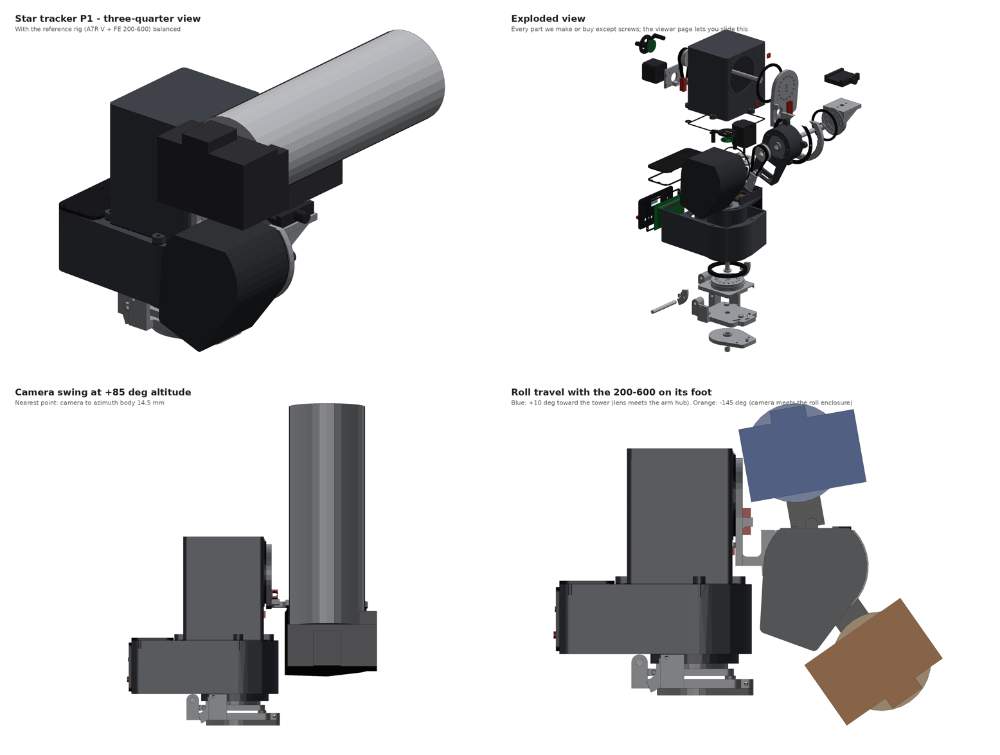
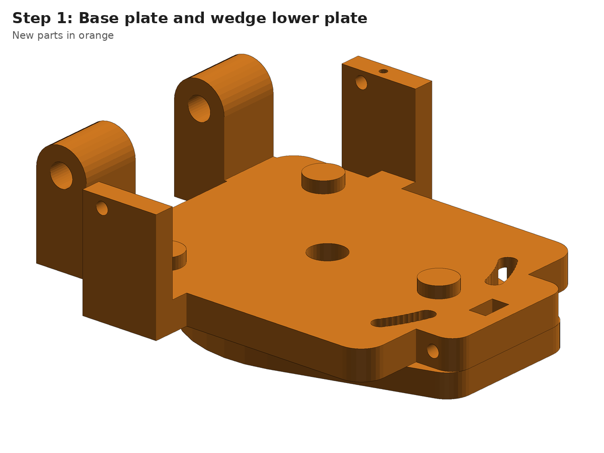
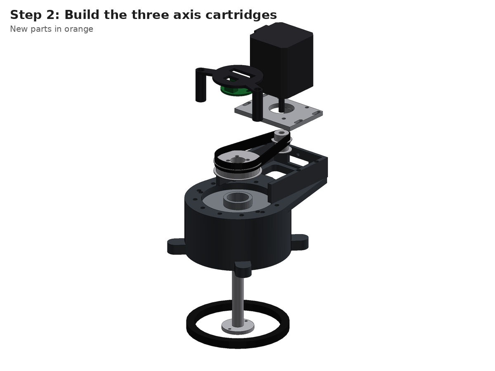
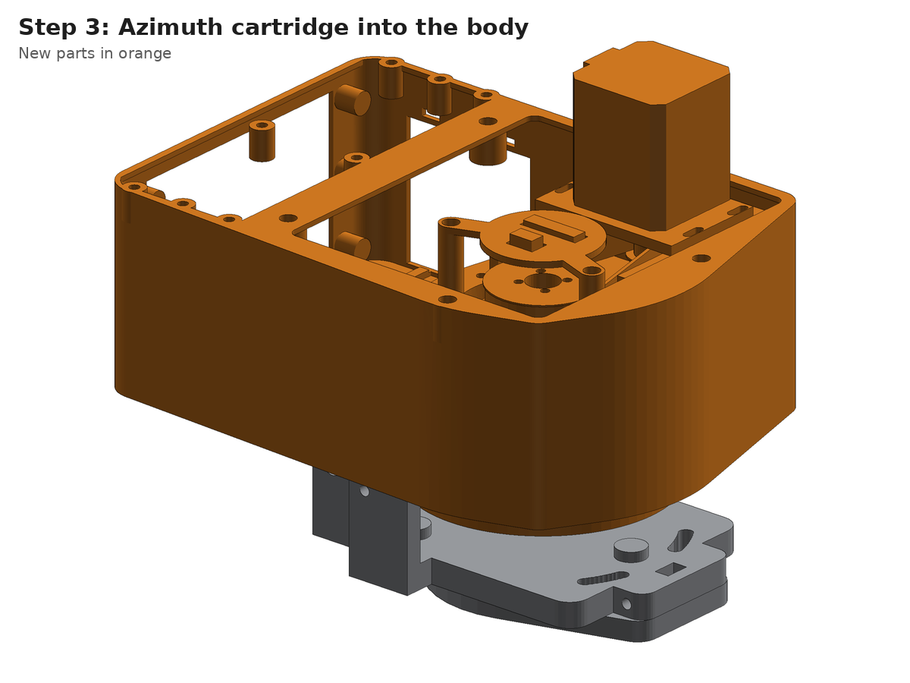
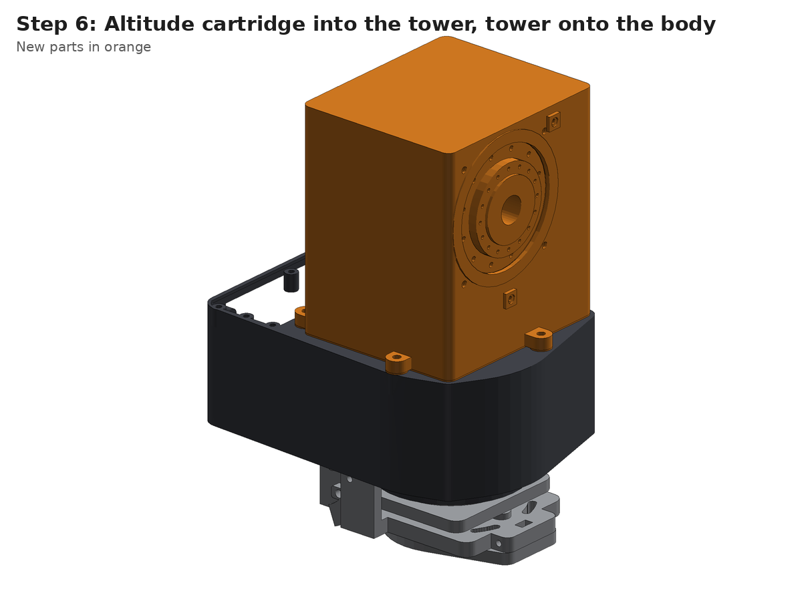
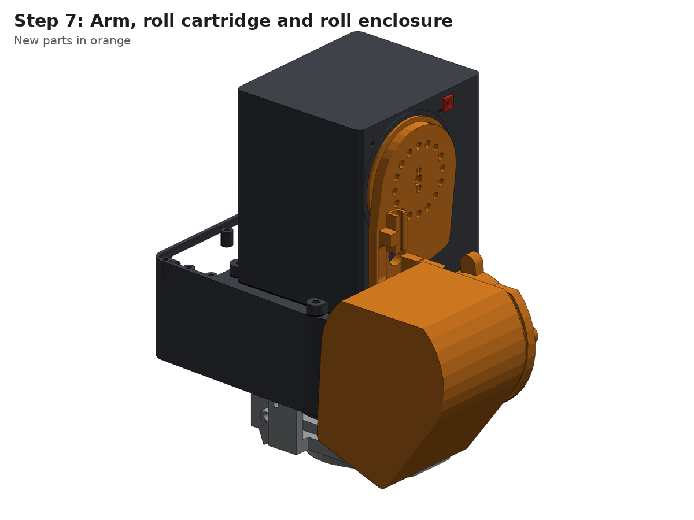
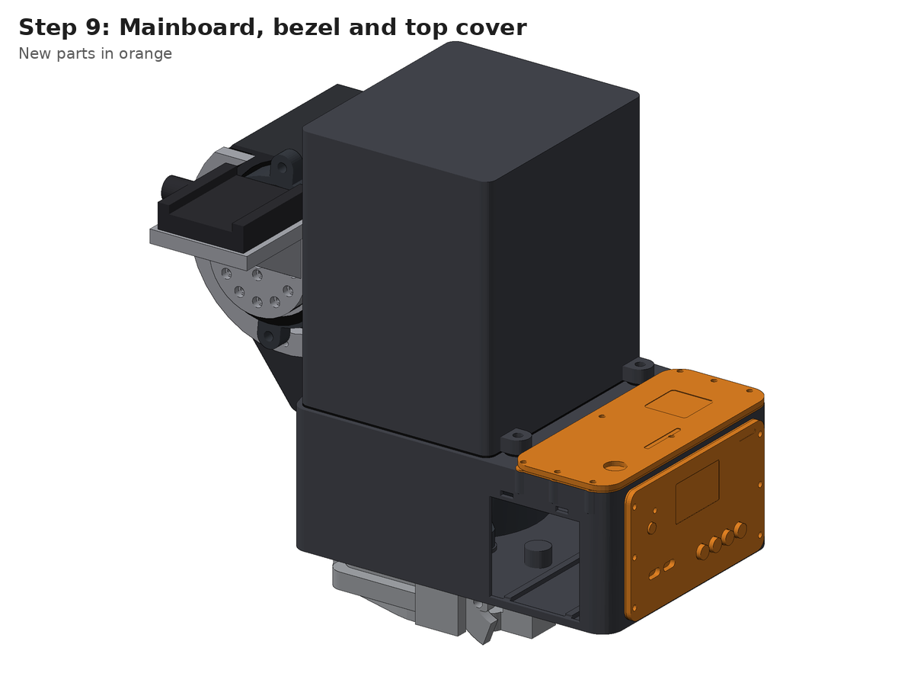
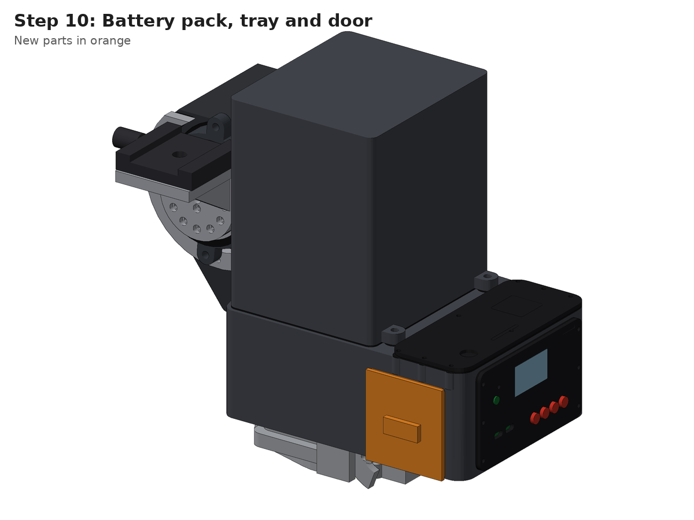

# Phase 3 — Mechanical Design

Rev A · 21 Nov 2026 · Bruno

## Summary

The P1 head is fully modelled: 87 placed parts, no clashes at home or across 0–75° of wedge tilt, and every made part has a STEP, a drawing and (if printed) a print-oriented STL. It weighs 7.21 kg calculated against the 6.1 kg D28 target, so weight is the main open issue.

| Item | Result |
| --- | --- |
| Made parts drawn | 33 (A4, ISO first angle), one combined 34-page set with index |
| CNC parts | 9 designs, 13 pieces per head, about USD 556 (€506) for one set |
| Printed parts | 7 plates on the H2S, 1,323 g filament, 87.8 h |
| Camera swing to +85° | 14.5 mm nearest gap (camera to azimuth body) |
| Roll travel (D31) | +10° toward the tower, −145° away |
| 48 mm azimuth motor | fits; 1.6 mm to the altitude cartridge housing |
| Mass | 7.21 kg calculated (D28: 6.1 kg) |
| Materials per head | €1,764.67 at 1 · €1,289.49 at 100 · €958.17 at 1,000 |

Q16 was approved as D33: the motor rail goes to 16 V. Five new decisions are carried as **pending approval** and marked in the model; the design works with the recommended option of each.

| # | Question | Recommendation (in the model now) |
| --- | --- | --- |
| Q17 | How to get roll travel toward the tower (D31) | Option A: move the roll axis 23 mm further out (X 135.5) |
| Q18 | Arca clamp fixing | One 3/8"-16 coin-slot screw, an exception to D13's metric-only rule |
| Q19 | Shelf cantilever | 30 mm instead of 75 mm (stiffer, lighter, still balances the reference rig) |
| Q20 | Wedge layout | Raised hinge with arcs below, two clamp knobs, M3 tangent screw (55′ per turn instead of D21's 34′) |
| Q21 | Weight target | Restate the P1 target as 7.2 kg; keep 5.1 kg for production (options in the Mass section) |

One measurement needed: the height of the FE 200-600 foot from the lens axis to the Arca dovetail base. The model assumes 85 mm.

## Layout and frames

The head stacks five stages on one vertical azimuth axis: ground, wedge, azimuth, altitude and roll. All dimensions below are from the world origin, which sits on the azimuth axis at the top face of the tripod plate, with Z up, the payload on +X and the lens pointing +Y at altitude 0.

| Stage | Turns about | Pivot (mm) | Range |
| --- | --- | --- | --- |
| Wedge (latitude) | Y | X −62, Z 37 | 0–75° tilt (latitude 90° down to 15°) |
| Azimuth | Z | X 0, Y 0 | unlimited, no slip ring (D19) |
| Altitude | X | Z 225 | −15° to +100° (TPU bumpers) |
| Roll | Y | X 135.5, Z 145 | +10° toward the tower to −145° away |

Key heights: wedge upper plate top Z 30, azimuth reducer output face Z 45, body Z 46.5–125, lens axis Z 275 with the reference rig.

Changes from the Phase 2 spec, all forced by the clash checks:

- Body is taller: the altitude axis now sits 100 mm above the body top instead of 120 mm.
- Body front radius is 64 mm; tower footprint is X −76 to 42.5, Y −52 to 85.
- Roll axis moved 23 mm outward (X 112.5 to 135.5) for D31 roll travel (Q17).
- Roll cartridge rotated 20° about its axis so its motor clears the body when the arm swings.
- A printed roll enclosure (ST-217) was added so the roll cartridge meets IPX4 like the other two.
- The wedge hinge was raised and the latitude arcs now hang below it (Q20).

## Parts

We make 33 different parts: 9 in aluminium or stainless steel and 24 printed. Each has a STEP file, an A4 drawing with title block, ISO 2768-m general tolerance and its fits, and a features table that locates every hole from the drawing datum O. Masses are calculated from the CAD (printed parts: 6 walls at 0.42 mm plus infill).

| Part | Name | Process, material | Qty | Mass each (g) |
| --- | --- | --- | --- | --- |
| ST-207 | Motor plate with belt-tension block | CNC, 6061-T6 | 3 | 26 |
| ST-208 | Encoder reference tube, size 17 | Turned, 304 | 2 | 34 |
| ST-215 | Encoder reference tube, size 14 | Turned, 304 | 1 | 32 |
| ST-301 | Base plate with 3/8"-16 socket | CNC, 6061-T6 | 1 | 105 |
| ST-302 | Wedge lower plate with azimuth fine adjust | CNC, 6061-T6 | 1 | 304 |
| ST-303 | Wedge upper plate (azimuth reducer mount) | CNC, 6061-T6 | 1 | 275 |
| ST-305 | Wedge latitude arc | CNC, 6061-T6 | 2 | 10 |
| ST-312 | Altitude arm | CNC, 6061-T6 | 1 | 252 |
| ST-313 | Roll shelf (L-arm) with clamp seat | CNC, 6061-T6 | 1 | 159 |
| ST-210 | Cartridge housing, size 14 (roll) | Printed, PAHT-CF | 1 | 101 |
| ST-211 | Cartridge housing, size 17 (azimuth, altitude) | Printed, PAHT-CF | 2 | 115 |
| ST-310 | Azimuth body (main housing) | Printed, PAHT-CF | 1 | 255 |
| ST-311 | Tower (altitude housing) | Printed, PAHT-CF | 1 | 263 |
| ST-212 / 216 | Cartridge rear cover and encoder-board carrier | Printed, ASA | 2 + 1 | 7 |
| ST-217 | Roll cartridge enclosure | Printed, ASA | 1 | 111 |
| ST-315 | Front bezel with OLED window | Printed, ASA | 1 | 24 |
| ST-317 / 318 | Battery bay tray / battery door with snap latch | Printed, ASA | 1 + 1 | 17 / 15 |
| ST-319 | Top cover with GNSS window | Printed, ASA | 1 | 26 |
| ST-605 / 612 | Pack shell, lower / upper half | Printed, ASA | 1 + 1 | 30 / 32 |
| ST-606 | Cell holder (end) | Printed, ASA | 2 | 2 |
| ST-611 | Pack light pipe and button | Printed, PETG | 1 | 3 |
| ST-316, 320, 322 | Button caps, cable guides, end-stop bumpers | Printed, TPU 95A | 4, 3, 2 | 1–2 |
| ST-323–325, 327, 328, 610 | Gaskets: body/tower, top cover, door, bezel, roll enclosure, pack | Printed, TPU 95A | 1 each | 1–3 |

The main bought parts are the three Laifual hollow harmonic units (two size 17, one size 14), three NEMA 17 steppers (48 mm on azimuth, D32), GT2 20T/60T pulleys and 200 mm belts, a 60 mm Arca clamp, four Molicel P50B cells, an 8 h6 hinge pin, V-rings and an O-ring. The full list, down to every screw, is in the parts list section. Bought parts are modelled as envelopes from the datasheet dimensions (reducer outline and bolt circles, NEMA 17 frame, pulley and clamp sizes); the makers' own STEP files could not be downloaded from the build workspace, so swap them in under `hardware/cad/step/bought/` when you download them.

## Checks

Every check runs automatically on the exact solids (OpenCascade distance and boolean tests), and all of them pass with option A of Q17. Results are written to `hardware/cad/out/checks.json` on every build.

| Check | How | Result |
| --- | --- | --- |
| Interference at home | All 87 parts against each other | No overlaps |
| Wedge tilt | 0°, 30°, 60°, 75° | No overlaps |
| Camera swing (reference rig) | Altitude −10° to +95° in steps | 14.5 mm at +85° (camera to azimuth body); 13.5 mm at +95° |
| Altitude arm swing | −15° to +100° | 1.0 mm running gap to the tower face; touches the TPU bumpers at −15° and +100° |
| Roll travel at altitude 0° and 45° | Step until contact | +10° toward the tower (lens to arm, 1.2 mm at +11°); −145° away (camera to roll enclosure, 1.8 mm at −150°) |
| 48 mm azimuth motor | Distance to everything outside its cartridge | 1.6 mm to the altitude cartridge housing, 2.7 mm to body and tower; motor top Z 170 |

The camera gap stays above 33 mm up to +60° altitude, then closes to 23.2 mm at +70°, 16.5 mm at +80° and 14.5 mm at +85°. Up to +40° the nearest object is the lens near the altitude reducer, about 35 mm away.

The rig dips below the tripod plate from −120° of roll at altitude 0° and from −100° at 45°; the firmware soft limit has to use the tripod plane, not just the head.

## Mass and centre of gravity

The head with wedge and battery comes to 7.21 kg, 1.11 kg over the D28 target of 6.1 kg for P1. The reducers and motors match the budget; the overrun is in printed housings, aluminium and fasteners, which the spec could only estimate before the CAD existed.

| Group | Spec 3.10 (kg) | CAD (kg) | Difference (kg) |
| --- | --- | --- | --- |
| Reducers | 2.70 | 2.71 | +0.01 |
| Stepper motors | 0.95 | 0.95 | 0.00 |
| Pulleys and belts | 0.14 | 0.12 | −0.02 |
| Battery pack | 0.34 | 0.38 | +0.04 |
| Electronics and harness | 0.17 | 0.13 | −0.04 |
| Housings and covers (printed) | 0.56 | 1.07 | +0.51 |
| Aluminium parts and clamp | 1.08 | 1.36 | +0.28 |
| Encoder tubes and magnets | — | 0.10 | +0.10 |
| Fasteners, inserts, seals | 0.15 | 0.38 | +0.23 |
| **Total** | **6.09** | **7.21** | **+1.12** |

Fasteners are counted from the joint table: 194 stainless screws, 5 thumb screws, 1 coin screw, 16 washers and 93 brass inserts make 0.36 kg; seals add 0.03 kg.

Centre of gravity of the head (no payload): X 21.9, Y −6.4, Z 128.0 mm. Everything that turns in altitude with the reference rig (4.73 kg) has its centre 2.8 mm below and 1.8 mm behind the altitude axis, so altitude is balanced to within 0.16 N·m. The roll stage plus rig (3.15 kg) sits 118 mm from the roll axis, as D20 intends: roll carries the payload's weight as a torque, which the spec already sized for.

Slicer settings barely matter (4 walls and 35 % infill saves only 26 g), because the housings are already mostly wall. Real savings need geometry or material changes:

| Option | What changes | Saving (kg) |
| --- | --- | --- |
| W1 | Body and tower walls 2.5 mm to 2.0 mm | about 0.10 |
| W2 | Housings in MJF PA12 instead of PAHT-CF (JLC3DP, D29) | about 0.10 |
| W3 | Lightening pockets under ST-302 and ST-303 | about 0.10 |
| W4 | Encoder tubes in 6061 instead of 304 | 0.065 |
| W5 | Lighter clamp (DDC-60i style) | 0.049 |

All five together bring P1 to about 6.8 kg. Getting to 6.1 kg would need a lighter azimuth reducer, which undoes D17, so the recommendation for Q21 is to restate the P1 target as 7.2 kg and keep the 5.1 kg production goal for the Phase 8 weight pass.

## Design studies

### Roll clearance (D31, Q17)

With the Phase 2 layout the roll stage could not turn toward the tower at all, and the camera hit the body from about +75° altitude. Two fixes were modelled.

| Option | Roll toward the tower | Cost |
| --- | --- | --- |
| A: roll axis 23 mm further out (X 135.5) | +10° (travel +10° to −145°, 155° in all) | Worst-case azimuth torque rises to 19.45 N·m, still 2.0× under the size-17 average-torque limit of 39 N·m; typical load +20 % (4.92 N·m) |
| B: raise the roll axis | about +38° | Altitude out of balance by 4.08 N·m with the reference rig and 8.93 N·m at 7 kg, so the power-off hold margin drops below 1 at 7 kg |

Option A keeps finding 5 of the spec (the camera stays put with power off) and gives the same 155° that D31 accepted, shifted 5° toward the useful side. It is in the model, pending approval.

### Cable path and altitude twist

No wire crosses the azimuth axis (D19): battery, both boards and the azimuth motor ride above the azimuth bearing. The 15-wire roll harness runs from the body through the tower, enters the altitude encoder tube (ST-208) and leaves through an 8 mm hole in the arm hub. Over the −10° to +95° soft range it twists ±52.5° along the 82 mm tube, which a loose bundle takes without a service loop (recommended for the Phase 4 harness: fine PTFE-insulated wire). TPU cable guides (ST-320) hold the bundle on the body, the tower and the arm, and the roll motor sits on the arm side, so no wire crosses the roll axis either.

### Sealing to IPX4 (D9)

- Rotating joints: NBR V-rings VA-75 (azimuth, on the Ø75 boss of ST-303), VA-80 (altitude, on the arm spigot) and VA-65 (roll).
- Static joints: 1 mm TPU gaskets printed to shape at body/tower, top cover, battery door, bezel, roll enclosure and battery pack; an 80 × 2 O-ring in a groove on the roll enclosure.
- Water path: the body has a drip skirt, all joints face down or sideways, and the bezel window is a bonded 1 mm polycarbonate sheet.

### Battery and board mounts

The battery is fully tool-free: the door snaps open, the pack slides into its tray and mates on a 5-way blade connector, and the pack's own LEDs show the charge. The pack is closed with 4 screws that the user never opens. Boards are not tool-free on purpose: each encoder board must stay within 0.1 mm of its magnet, so it is held by two M3 button screws (2 mm key), and the mainboard by four. A cartridge swap is 4 + 4 screws and one plug (D13); the azimuth cartridge also needs the hinge pin pulled.

Board outlines and fixings, fixed as inputs for Phase 4:

| Board | Outline (mm) | Fixing | Where |
| --- | --- | --- | --- |
| Mainboard ST-501 | 100 × 60 × 1.6, parts up to 12 high | 4 × M3, holes 4 mm in from each corner | On bosses behind the front bezel (ST-315) |
| Cartridge board ST-520 (×3) | Round Ø30 × 1.6 | 2 × M3 on PCD 23 | On the rear carrier, MT6835 on the underside, 2.0 mm above the magnet face |
| Battery board ST-602 | 32 × 40 × 1.6 | Clamped at the pack end; screw-free fixing detailed with the board in Phase 4 | +Y end of the pack, LEDs facing the light pipe (ST-611) |

Each cartridge has one plug to the head: a JST-GH 15-way socket on the cartridge board, reached through a window in the rear carrier. The motor lead plugs into the same board through a second, smaller window, so it stays inside the cartridge.

### Belt tension

Each motor sits on a plate (ST-207) that slides on the cartridge walls. One M3 × 12 screw in the tension block pushes it until each span carries 14 N, then four M3 button screws with washers lock it. Check it either way: pluck the span and read about 290 Hz on a phone tuner app, or press the middle of the 57 mm span with 2 N (a 200 g weight) and see about 2 mm of deflection.

## Parts list and cost

The parts list now has 129 lines and goes down to the last screw, washer and insert; materials per head drop slightly at prototype quantity because the CAD replaced Phase 2 allowances with counted parts.

| Per head (€) | 1 unit | 100 units | 1,000 units |
| --- | --- | --- | --- |
| Materials, Phase 2 (rev C) | 1,829 | 1,289 | 962 |
| Materials, Phase 3 | 1,765 | 1,289 | 958 |
| Cost of goods, Phase 3 | 1,976 | 1,433 | 1,041 |

The Phase 2 lines keep their cited prices; the new Phase 3 lines (screws, inserts, knobs, seals, gaskets) are priced from one cited pack price per family (bolts.co.uk M3 × 10 A2, 200 pcs; Ruthex via 3DJake) and scaled by size, marked “est (pack)”. Landed cost at 1,000 units is €1,086 (was €1,090), and the reducers are still 44–58 % of materials. The retail band at 2.5–3.5× landed stays €2,710–3,800.

What changed in the list:

- New lines: ST-215–219 (roll tube, roll carrier, roll enclosure, V-rings VA-80 and VA-65), ST-308/309 wedge knobs and tangent screw, ST-323–330 (gaskets, window, O-ring, clamp screw), ST-612 pack upper half.
- Fasteners as their own lines: ST-710–741 (19 screw sizes, 194 pieces), ST-750–752 washers, ST-760–762 Ruthex inserts (75 M3, 12 M4, 6 M5).
- D13 is met: only M3, M4 and M5, all driven by 2, 2.5 or 3 mm keys. M5 is always ISO 7380 (a 3 mm key) because ISO 4762 M5 needs 4 mm, and the 20T pulley uses M4 set screws because M3 grub screws need 1.5 mm. The one exception is the 3/8"-16 coin-slot clamp screw (Q18).
- ST-509 is now the 16 V boost converter (D33).
- ST-701–707 (Phase 2 allowances) stay in the list at quantity 0 so their history is kept.

Files: `hardware/bom/master-parts-list.csv`, `docs/calc/bom_data.py` (the cost model reads it and still runs) and the shared [parts list Sheet](https://claude.ai/artifact/9T9Gpvm2vWPRYqJtPChJa8).

## Fabrication package

Everything needed to order and print one head is in `hardware/fab/`: CNC files with a quote estimate, seven ready plates for the H2S, and a shopping list with links.

### CNC (JLCCNC, D29)

Upload the STEP and PDF pairs from `hardware/fab/cnc/`. The drawing carries the fits, finish and tolerance; the STEP is the master geometry.

| Part | Qty | Finish | Est. USD each | Est. USD line |
| --- | --- | --- | --- | --- |
| ST-312 Altitude arm | 1 | Bead-blast, clear anodise | 118 | 118 |
| ST-302 Wedge lower plate | 1 | Bead-blast, clear anodise | 80 | 80 |
| ST-303 Wedge upper plate | 1 | Bead-blast, clear anodise | 78 | 78 |
| ST-207 Motor plate | 3 | Bead-blast, clear anodise | 26 | 78 |
| ST-313 Roll shelf | 1 | Bead-blast, clear anodise | 66 | 66 |
| ST-305 Latitude arc | 2 | Bead-blast, clear anodise | 28 | 56 |
| ST-301 Base plate | 1 | Bead-blast, clear anodise | 36 | 36 |
| ST-208 Encoder tube, size 17 (304) | 2 | As turned | 15 | 30 |
| ST-215 Encoder tube, size 14 (304) | 1 | As turned | 14 | 14 |
| **One set** | **13** | | | **556 (≈ €506)** |

These are estimates from part size and complexity; the real price comes from JLCCNC's instant quote when you upload the files.

### Printing (Bambu H2S + AMS HT)

| Plate | Material | Parts | Filament (g) | Time (h) |
| --- | --- | --- | --- | --- |
| 1 | PAHT-CF | ST-310 body, ST-210, ST-211 | 541 | 39.5 |
| 2 | PAHT-CF | ST-311 tower, ST-211 | 434 | 31.7 |
| 3 | ASA | ST-217, 315, 317, 318, 319, 605, 606 | 259 | 10.5 |
| 4 | ASA | ST-612, 606, 212 × 2, 216 | 63 | 2.7 |
| 5 | TPU 95A | Gaskets, cable guides, a button cap | 21 | 2.5 |
| 6 | TPU 95A | Button caps, bumpers | 2 | 0.5 |
| 7 | PETG | ST-611 light pipe | 3 | 0.4 |
| **Total** | | **7 plates** | **1,323** | **87.8** |

The STL files are already turned to print orientation. Dry PAHT-CF at 80 °C for 8–12 h and print it straight from the dryer; print settings for each material are on every drawing. Press the heat-set inserts with a soldering iron at 230 °C before assembly.

### Shopping list

`hardware/fab/shopping-list.csv` has every bought item with quantity, supplier and link: reducers, motors, pulleys, belts, V-rings, hinge pin, thumb screws, clamp, cells, 194 stainless screws, washers, inserts and filament (2 × PAHT-CF, 1 × ASA, small TPU and PETG spools). Two links point at the seller's nearest page rather than the exact item: the 20T pulley (order the 5 mm bore) and the M4 inserts (Ruthex range page). Electronics come with Phase 4.

## P1 assembly sequence

The head goes together in ten steps, bench work first. Every screw, its key and its torque come from the same joint table that builds the parts list, so the two cannot disagree. New parts in each step picture are orange.

**Tools:** hex keys 2, 2.5 and 3 mm (a torque screwdriver covering 0.3–5 N·m is best), soldering iron with a heat-set tip at 230 °C, Loctite 243 and 638, a vice or small arbor press, a coin, a phone with a guitar-tuner app, and a 200 g weight. **Before you start:** press all heat-set inserts (75 M3, 12 M4, 6 M5) into the printed parts.

### Step 1 — Base and wedge lower plate

Press the 3/8"-16 bushing into the base, then fit the base under the wedge lower plate with the azimuth lock loose.

| Joint | Screws | Tool | Torque (N·m) | Notes |
| --- | --- | --- | --- | --- |
| 3/8in-16 bushing ST-307 into base ST-301 | - | press / arbor | - | Loctite 638 (retaining); press in, wipe off, cure 1 h |
| Base ST-301 to wedge lower plate ST-302 (azimuth lock) | 2 × M5 × 12 ISO 7380 | 3 mm key | 4.5 | with washer ST-752; leave loose until set |
| Azimuth fine-adjust push screws ST-306 | 2 × M5 × 25 thumb screw | by hand | - | finger tight, push the base boss |

### Step 2 — Build the three cartridges on the bench

Press each reducer into its housing (the crush ribs centre it), fit the 60T pulley, mount the motor on its plate with the 20T pulley (two M4 set screws on the shaft flat, 2 mm key), fit the belt and tension it, then fit the encoder carrier and board. Do all three cartridges the same way.

| Joint | Screws | Tool | Torque (N·m) | Notes |
| --- | --- | --- | --- | --- |
| Reducer size 17 to cartridge housing ST-211 (x2 axes) | 24 × M3 × 50 ISO 4762 | 2.5 mm key | 0.6 | 12 per reducer, criss-cross |
| Reducer size 14 to cartridge housing ST-210 | 8 × M3 × 45 ISO 4762 | 2.5 mm key | 0.6 | criss-cross |
| 60T pulley ST-205 to reducer input stub (x3) | 12 × M3 × 12 ISO 4762 | 2.5 mm key | 1.5 | Loctite 243; pattern to confirm on the Laifual drawing |
| Motor to motor plate ST-207 (x3) | 12 × M3 × 8 ISO 4762 | 2.5 mm key | 1 | Loctite 243 |
| Motor plate to housing walls (x3) | 12 × M3 × 8 ISO 7380 | 2 mm key | 0.6 | with washer ST-750; tighten after tensioning |
| Belt tension screw (x3) | 3 × M3 × 12 ISO 4762 | 2.5 mm key | 0.3 | turn until the span reads 290 Hz |
| Encoder board ST-520 to carrier (x3) | 6 × M3 × 6 ISO 7380 | 2 mm key | 0.3 | cuts its own thread in ASA |
| Carrier ST-212/216 posts to housing flange (x3) | 6 × M3 × 30 ISO 4762 | 2.5 mm key | 0.5 | - |

### Step 3 — Azimuth cartridge into the body

Lower the azimuth cartridge into the body from above, motor toward +Y, and screw it to the floor from below.

| Joint | Screws | Tool | Torque (N·m) | Notes |
| --- | --- | --- | --- | --- |
| Azimuth cartridge to body floor | 4 × M4 × 10 ISO 7380 | 2.5 mm key | 1.2 | from below |
| Cable guides ST-320 to body | 2 × M3 × 12 ISO 7380 | 2 mm key | 0.4 | - |

### Step 4 — Wedge upper plate onto the azimuth output

Bolt the latitude arcs to the wedge upper plate, fit the azimuth encoder tube, seat the VA-75 V-ring on the boss and screw the reducer output to the plate from below.

| Joint | Screws | Tool | Torque (N·m) | Notes |
| --- | --- | --- | --- | --- |
| Latitude arcs ST-305 to wedge upper plate ST-303 | 4 × M5 × 12 ISO 7380 | 3 mm key | 4.5 | Loctite 243 |
| Encoder tube ST-208 to wedge upper plate (azimuth) | 2 × M3 × 6 ISO 4762 | 2.5 mm key | 1 | Loctite 243; from inside the boss pocket |
| Azimuth reducer output flange to wedge upper plate ST-303 | 16 × M3 × 20 ISO 4762 | 2.5 mm key | 2 | Loctite 243; from below, criss-cross |

### Step 5 — Hinge the head onto the wedge

Stand the head on the wedge lower plate, push the hinge pin through, and fit the clamp knobs and tangent screw.

| Joint | Screws | Tool | Torque (N·m) | Notes |
| --- | --- | --- | --- | --- |
| Hinge pin ST-304 retaining screws | 2 × M3 × 6 ISO 7380 | 2 mm key | 1 | Loctite 243; with large washer ST-751 each end |
| Latitude clamp knobs ST-308 | 2 × M5 × 16 thumb screw | by hand | - | finger tight |
| Latitude tangent screw ST-309 (Q20) | 1 × M3 × 25 thumb screw | by hand | - | - |

### Step 6 — Tower and altitude cartridge

Fit the altitude cartridge through the tower's +X face, the bumpers and cable guides, then the tower onto the body over its gasket.

| Joint | Screws | Tool | Torque (N·m) | Notes |
| --- | --- | --- | --- | --- |
| Altitude cartridge to tower wall | 4 × M4 × 12 ISO 7380 | 2.5 mm key | 1.2 | from outside the +X face |
| Bumpers ST-322 to tower | 2 × M3 × 6 ISO 7380 | 2 mm key | 0.4 | - |
| Cable guides ST-320 to tower | 2 × M3 × 12 ISO 7380 | 2 mm key | 0.4 | - |
| Tower to body (with gasket ST-323) | 4 × M5 × 16 ISO 7380 | 3 mm key | 2 | even, criss-cross |

### Step 7 — Altitude arm and roll cartridge

Thread the roll harness through the altitude encoder tube, bolt the arm to the altitude output, then the roll cartridge to the arm pad and the roll enclosure over it.

| Joint | Screws | Tool | Torque (N·m) | Notes |
| --- | --- | --- | --- | --- |
| Arm ST-312 to altitude reducer output | 16 × M3 × 10 ISO 4762 | 2.5 mm key | 2 | Loctite 243; criss-cross |
| Altitude encoder tube to arm hub | 2 × M3 × 5 ISO 7380 | 2 mm key | 0.8 | Loctite 243; thread the roll harness through first |
| Roll cartridge to arm pad | 4 × M4 × 16 ISO 4762 | 3 mm key | 1.2 | from the back of the pad |
| Cable guide ST-320 to arm | 2 × M3 × 12 ISO 7380 | 2 mm key | 0.8 | - |
| Roll enclosure ST-217 to arm pad (gasket ST-328, O-ring ST-329) | 3 × M3 × 16 ISO 4762 | 2.5 mm key | 0.5 | from the pad front |

### Step 8 — Roll shelf and Arca clamp

Bolt the roll shelf to the roll output, fit the roll encoder tube and the Arca clamp.

| Joint | Screws | Tool | Torque (N·m) | Notes |
| --- | --- | --- | --- | --- |
| Roll shelf ST-313 to roll reducer output | 12 × M3 × 12 ISO 4762 | 2.5 mm key | 2 | Loctite 243; criss-cross |
| Roll encoder tube ST-215 to shelf | 2 × M3 × 6 ISO 4762 | 2.5 mm key | 1 | Loctite 243 |
| Arca clamp ST-314 to shelf (Q18) | 1 × 3/8"-16 × 12 coin-slot | coin or flat screwdriver | - | Loctite 243; coin-slot screw ST-330 |

### Step 9 — Electronics and covers

Fit the mainboard to the bezel, the bezel to the body, the battery connector, and the top cover last.

| Joint | Screws | Tool | Torque (N·m) | Notes |
| --- | --- | --- | --- | --- |
| Mainboard ST-501 to bezel bosses | 4 × M3 × 6 ISO 7380 | 2 mm key | 0.3 | - |
| Bezel ST-315 to body (gasket ST-327) | 6 × M3 × 10 ISO 7380 | 2 mm key | 0.5 | - |
| Head-side blade connector ST-609 to bracket | 2 × M3 × 8 ISO 7380 | 2 mm key | 0.4 | - |
| Top cover ST-319 to body (gasket ST-324) | 8 × M3 × 10 ISO 7380 | 2 mm key | 0.5 | criss-cross |

### Step 10 — Battery

Close the pack once at the bench, fit the tray to the door, then slide the pack in. From here on the battery is tool-free.

| Joint | Screws | Tool | Torque (N·m) | Notes |
| --- | --- | --- | --- | --- |
| Pack shell halves ST-605/612 (gasket ST-610) | 4 × M3 × 30 ISO 4762 | 2.5 mm key | 0.5 | pack stays closed: user never opens it |
| Battery tray ST-317 to door ST-318 | 2 × M3 × 8 ISO 7380 | 2 mm key | 0.3 | - |

### Final checks

1. **Belt tension, each axis:** pluck the middle of the long span; the tuner should read about 290 Hz. Or hang 200 g on the middle of the span: it should deflect about 2 mm. Tighten the four plate screws only after this.
2. **Free running:** with the motors unplugged, turn each motor pulley by hand for a few turns; it should feel even, with no tight spot or belt rub.
3. **Balance:** mount the rig, loosen the clamp, and slide the lens foot until the rig sits level on the altitude axis. The app's balance check then rocks altitude ±5° and compares motor load each way; within 10 mm of balance the residual is 0.58 N·m or less.
4. **Roll limits:** with the 200–600 fitted, roll slowly to +10° and −145° and confirm the gaps; set the soft limits a few degrees inside.
5. **Seals:** check every gasket sits in its groove all round before closing, and that the three V-rings touch their faces evenly.

## Files, viewer and rebuilding

The [3D viewer](https://claude.ai/artifact/Sw757qqspnFjuqk8EyUjpj) shows the whole head with the reference rig: an explode slider, sliders for azimuth, wedge tilt, altitude and roll, a clickable parts list grouped by assembly step (click a part to see its material, process, mass and files), and a Day/Night toggle. The same page is `hardware/viewer/star-tracker-viewer.html`; open it in any browser.

| Folder | What is in it |
| --- | --- |
| `hardware/cad/stcad/` | The parametric model (build123d): `params.py` holds every shared dimension; parts, assembly, checks, drawings, renders |
| `hardware/cad/step/` | STEP per part, bought-part envelopes, assembly and exploded assembly |
| `hardware/cad/stl/` | Printed parts in print orientation |
| `hardware/drawings/` | PDF per part, `ST-P1-drawing-set.pdf` (34 pages with index), PNG previews |
| `hardware/fab/` | CNC files and quote, print plates, shopping list |
| `hardware/bom/` | `master-parts-list.csv` |
| `docs/img/03-*.png` | Renders and assembly step pictures |
| `hardware/cad/out/` | Check results (`checks.json`) |
| `hardware/cad/PROGRESS.md` | Stage-by-stage status of Phase 3 |

To rebuild everything after changing a dimension, use the manual GitHub workflow: open the repository on github.com, click **Actions**, pick **Phase 3 CAD build** in the left list, click **Run workflow**, then **Run workflow** again. When it finishes (about 15 minutes), open the run and download **phase3-cad-output** at the bottom of the page. It never runs on its own.

The roll offset of Q17 is a single switch: if you choose another offset, only `D31_EXTRA_OFFSET` in `params.py` changes and the build redoes every part, check and drawing. Option B would instead raise the roll axis (Z_ROLL) and reshape the arm and shelf.
