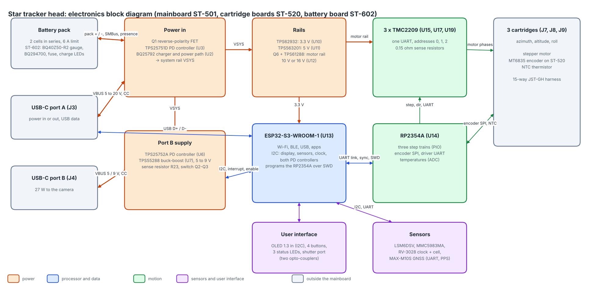
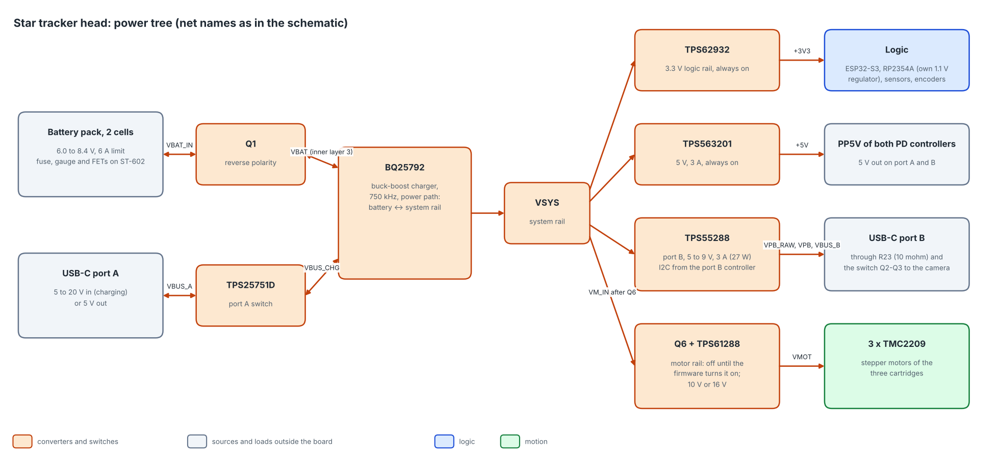
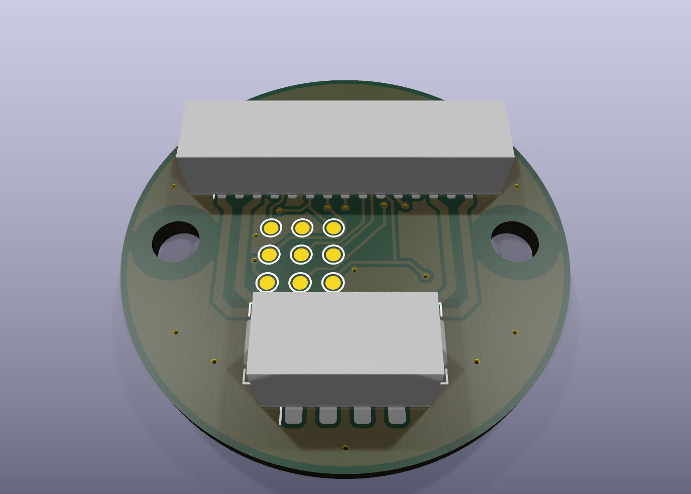
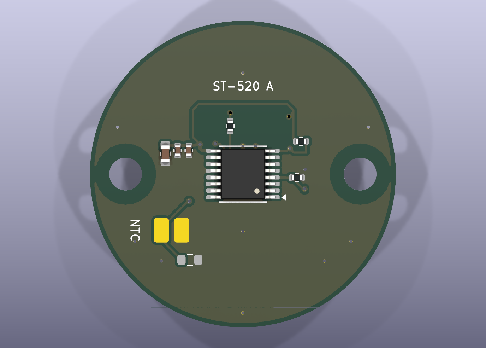
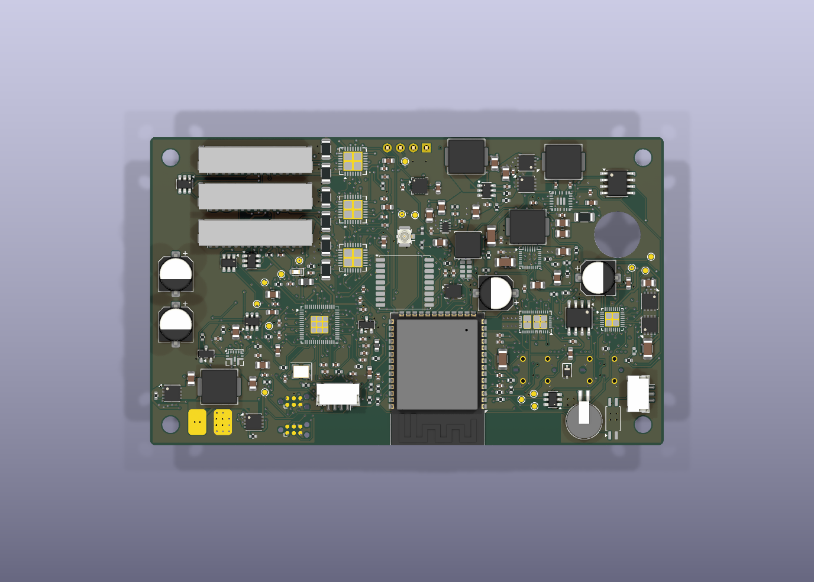
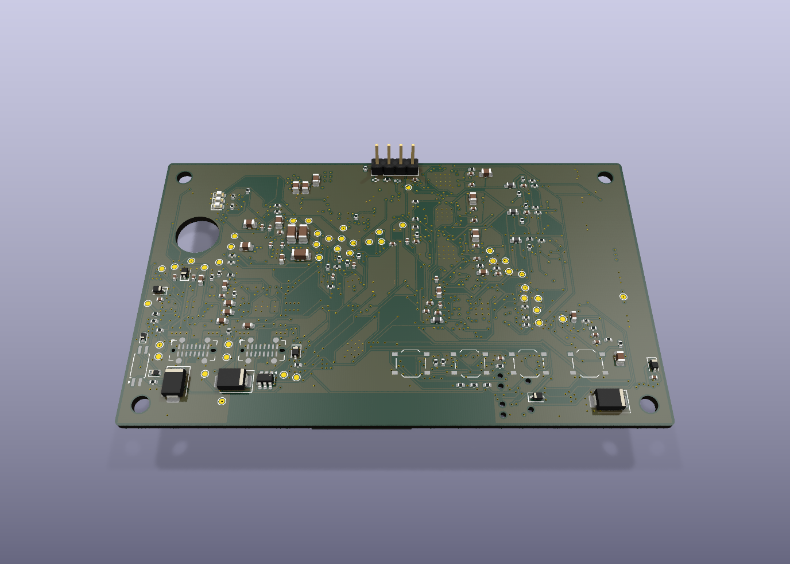
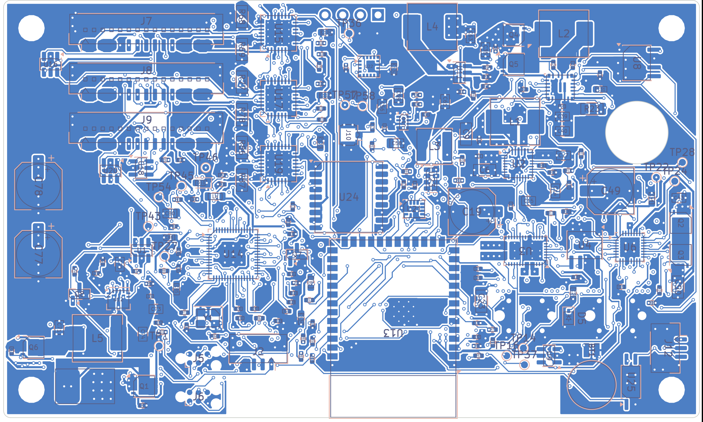
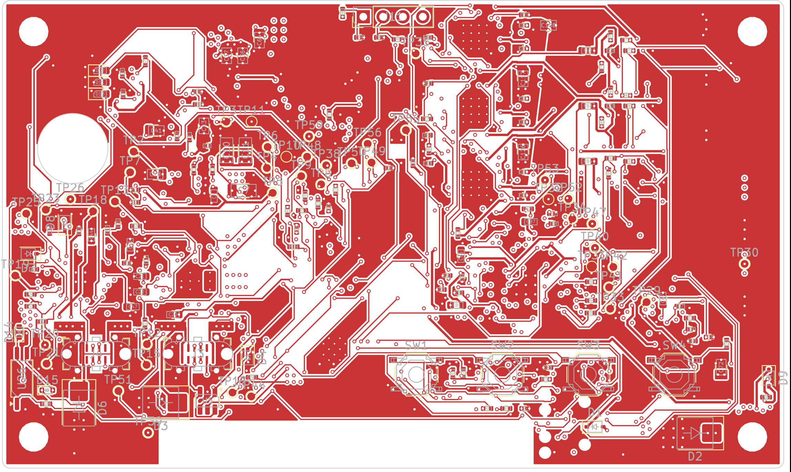
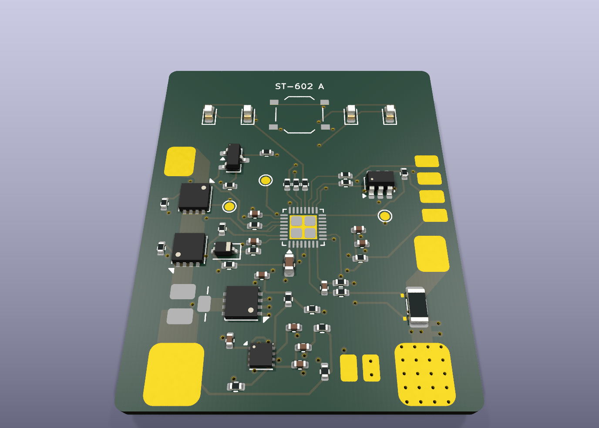
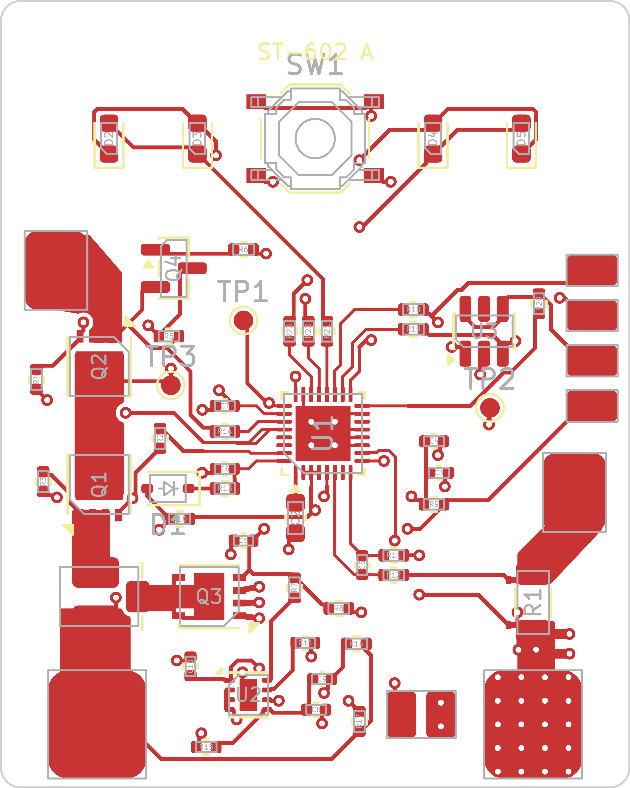

# Phase 4 — Electronics

Star Tracker Project · revision B · 23 November 2026, evening · branch `phase-4-electronics`

This document covers the electronics of the head: the calculations behind every value, the three boards, the wiring, what to order, what the firmware needs to know and how to bring the first boards up on the bench. Decisions D1–D41 are taken as fixed; D42–D61 were approved during this phase.

## 1. Where things stand

| Deliverable | State | Where |
|---|---|---|
| Calculations | Done | `docs/calc/phase4_calcs.py`, `phase4_calcs.md` |
| ST-520 cartridge board: schematic, layout, fab files | Done. ERC and DRC clean, fits the Phase 3 carrier | `hardware/electronics/cartridge-board/`, `fab/st-520/` |
| ST-501 mainboard: schematic | Done. 391 parts, 229 nets, ERC clean, netlist cross-checked | `hardware/electronics/mainboard/` |
| ST-501 mainboard: layout and fab files | **Done.** Six layers, filled and capped vias (D51), 1 oz inner copper (D61). KiCad's check: 0 errors, 0 open connections (14 warnings, all silkscreen). Power-path width check: all 17 paths at their width (three narrow pins accepted as Q42). Fabrication files, STEP model and renders made | section 5.2, `fab/st-501/` |
| ST-602 battery board | **Done.** 62 parts, 48 fitted by JLCPCB. ERC and DRC clean, every pack-current path at least 1.0 mm wide, fab files made. The fuse (no LCSC number) is bought from DigiKey or Mouser. Pack parts changed for it (D58–D60) and in the CAD | section 5.3, `hardware/electronics/battery-board/`, `fab/st-602/` |
| Fit check | Done for all three boards: no overlaps (section 6) | `hardware/cad/out/fit_boards.json` |
| Wiring harnesses | Done: 6 drawings, pin tables, purchase list | `hardware/electronics/harness/` |
| Per-board BOMs | Done for ST-520 (9 lines), ST-501 (93 lines, 321 parts) and ST-602 (19 lines, 48 parts) | each board folder |
| Master parts list, cost model, Sheet | Done and in step: CSV, `bom_data.py`, `phase4_cost_model.json` and the Sheet all give EUR 2,157.43 / 1,308.23 / 969.11 materials per head | section 9 |
| Block diagram, power tree, board renders | Done | sections 3 and 5 |
| Firmware hand-off, bring-up plan | Done | sections 10 and 11 |
| Board viewer | Done for all three boards | artifact + `hardware/electronics/doc/board-viewer.html` |
| GitHub Actions workflow | **Run on GitHub on 23 November (run 45238347825): green.** ERC and DRC clean on all three boards, all 24 power paths at width (17 on ST-501, 7 on ST-602), fab files, harness drawings and viewer built from the committed files. Started by hand only | `.github/workflows/phase4-electronics.yml` |

**What you can do today:** answer the two open questions Q42 and Q43 (section 2.3; both only concern how the width check is read, nothing on the boards changes), and order the first round of boards: the mainboard ST-501 and the cartridge board ST-520 (section 8). **What is not finished:** two points on the battery board are still unconfirmed against TI's own material (which LED positions the gauge lights with four LEDs fitted, and TI's exact fuse-drive resistor values, section 5.3); 19 mainboard lines have no confirmed LCSC number and are matched at upload or fitted by hand (section 8.3); Q42 and Q43 wait for your answer. None of these stops an order of the first round.

Board viewer (interactive BOM, Day / Night): <https://claude.ai/artifact/TntQCR18hPMWE3V6fTQ68L> · Docs version of this document: <https://claude.ai/artifact/9Y2pyZBkJu5i3eWqNy6xAx> · Parts list Sheet: <https://claude.ai/artifact/9T9Gpvm2vWPRYqJtPChJa8> · KiCad projects: `hardware/electronics/`.

Everything in the tables below that depends on a board is read from the board files by script (`hardware/electronics/tools/docgen.py`), so pin numbers and net names cannot drift from the design.

## 2. Decisions

### 2.1 Approved in this phase (recorded in the decisions log)

| No. | Decision |
|---|---|
| D42 | Slew speed 8°/s over −20…+40 °C; the 6°/s cold limit is dropped (16 V rail gives the margin) |
| D43 | Motor rail has two levels, 16 V for slewing and 10 V for tracking and holding, switched by `VM_SEL` (low = 10 V) |
| D44 | A 5 V / 3 A rail (TPS563201) feeds the PP5V pin of both USB-C PD controllers |
| D45 | A P-FET soft-start switch sits in front of the boost converter (`MOTOR_PWR_EN`); a second P-FET at the pack input blocks reverse polarity |
| D46 | Motor temperature is read by a 10 k B3950 bead thermistor glued to each motor and soldered to pads on the cartridge board |
| D47 | Cartridge plug pinout (JST-GH 15-way): 1–2 A1, 3–4 A2, 5 GND, 6 CS, 7 SCK, 8 MOSI, 9 MISO, 10 NTC, 11 +3V3, 12–13 B1, 14–15 B2 |
| D48 | The encoder board stays at its Phase 3 height: chip-to-magnet gap 0.81 mm against the datasheet's 1.0 mm minimum; the encoder error is measured on the P0 bench before any part is changed. No printed part changes |
| D49 | Prototype USB-C sockets are the upright, unsealed GT-USB-7051A, about 1.5 mm proud of the bezel; a sealed type is looked at later if needed |
| D50 | The pack pads stay at the lower right of the mainboard; the battery rail crosses the board as one copper area on an inner layer (about 10 mΩ) |
| D51 | The mainboard is a six-layer board with filled and capped vias (via-in-pad): front face, power, two signal layers, ground, back face |
| D52 | Clock backup: Seiko MS621FE rechargeable cell (about three months) instead of the 0.1 F capacitor (Q28) |
| D53 | Buttons: TS-1187A, 1.5 mm tall; the four printed button caps grow by 2 mm (Q31) |
| D54 | GNSS antenna: active patch on a coax lead (U.FL socket on the board), flat under the top cover (Q32) |
| D55 | Shutter socket: panel-mount 2.5 mm jack in the bezel, through a 9 mm cut-out in the mainboard, wired to plug J12 (Q33) |
| D56 | Status light: three single-colour 0603 LEDs behind the light pipe (Q34) |
| D57 | Battery lead soldered to two pads on the mainboard, with an in-line XT30 (Q35) |
| D58 | Battery board held in the pack by a grooved rib in each shell half (ST-605, ST-612), no screws; the board stands 1.6 mm behind the cell holder (Q38) |
| D59 | Pack light pipe ST-611 ends 2.0 mm before the board, with a boss over the gauge button; it slides 0.3 mm to press it; a TPU lip on its flange closes the window (Q39) |
| D60 | A 6 × 3 mm wire notch on each side edge of both cell holders ST-606 (Q40) |
| D61 | Mainboard ordered with 1 oz inner copper: the battery rail on inner layer 3 has about 10 mΩ (Q41) |

### 2.2 Open items carried in, now closed

| Item | Result |
|---|---|
| D33 rerun at 16 V | Worst static azimuth torque 19.45 N·m against the 20.2 N·m design figure. Torque margins at −20 °C and 8°/s: 2.10 (reference payload), 1.61 (7 kg alt-az), 1.48 (7 kg equatorial extreme). D26 is unchanged |
| D27 | Confirmed: the TPS25751D drives the BQ25792 directly over its own I²C bus (the datasheet lists BQ25790/2/8 as supported chargers, address 0x6B) |
| D32 lead order | 17HE15-1504S: A+ black, A− blue, B+ green, B− red. 17HS19-2004S1: A+ black, A− green, B+ red, B− blue. The harness table in section 7 follows this |
| Roll harness | 15 wires of 28 AWG PTFE, 680 mm, bundle about 2.8 mm in the 6.5 mm bore; the ±52.5° twist stretches a strand by 0.01 mm |
| P0 round | The first order is the cartridge board plus the mainboard; the battery board follows in a second order (section 5.3) |

### 2.3 Questions for you — carried on with the recommended option, marked "pending approval"

| No. | Question | Recommendation (used in the design) | If you say no |
|---|---|---|---|
| Q42 | The mainboard's power-path width check asks for wide copper within 0.8 mm of each pin. At three places that cannot be: the VBUS pins of both USB-C sockets (0.3 mm wide, between the shell pins and the CC and data pins) and pad 25 of the TPS55288, which lies under the chip. | Accept them, each written into the check with its reason: wide copper begins 1.5 mm from the row A VBUS pins, the row B VBUS pins reach it through the row A pin opposite (2.9 mm; each pin carries a quarter of the port current, 0.75 A at 3 A), and pad 25 is reached through pin 21 (1.1 mm, TI's own land pattern) | The USB-C sockets would need a different footprint with wider VBUS pads, and port B a different converter package |
| Q43 | Which pins count as the ends of a power path. | Leave out pins that only sense or supply the chip itself: for the charger's input the ends are its two VBUS pins (2 and 3), not the sense pin VAC2 (8); pin 7 of the boost converter (its own supply, a few milliamps) is not an end of the motor-rail input | The check would ask for 1 mm copper to pins that carry milliamps; the board does not change either way |

Q28, Q31–Q35 and Q38–Q41 were approved on 23 November and are now D52–D61 above.

## 3. How the electronics are arranged

**Power.** The 2S2P pack (6.0–8.4 V) enters through a P-FET that blocks a reversed pack. The BQ25792 buck-boost charger sits between the pack and the system rail `VSYS` and is controlled by the USB-C PD controller of port A (TPS25751D), which negotiates up to 45 W in and can also power a phone or camera from the pack. Port B (TPS25752A with a TPS55288 converter) is the source-only camera port: 5 V or 9 V at 3 A (27 W). From `VSYS`: a 3.3 V rail (TPS62932) for all logic, a 5 V rail (TPS563201) for the two PD controllers, and — through the soft-start switch — the boost converter (TPS61288) that makes the motor rail, 16 V or 10 V.

**Control.** An ESP32-S3 module runs Wi-Fi, Bluetooth, the display, buttons, sensors, power management and the camera shutter. An RP2354A runs the three motors and reads the three encoders; it does nothing else, so its timing cannot be disturbed. The two talk over a UART with a sync strobe, and both receive the GNSS time pulse. The ESP32 can reset and reprogram the RP2354A over its debug port, so one USB cable or one over-the-air update covers both.

**Per axis.** A TMC2209 driver on the mainboard, and in each cartridge a small round board with the MT6835 encoder, the motor plug and the thermistor pads. One 15-wire harness per axis carries the motor phases (two contacts each), the encoder SPI bus, 3.3 V, ground and the thermistor.

Both diagrams are drawn by `hardware/electronics/tools/diagrams.py` (SVG versions beside the PNG files in `docs/img/`).

## 4. Calculations

The full set, formula → numbers → result, is in [`docs/calc/phase4_calcs.md`](calc/phase4_calcs.md) and is produced by `docs/calc/phase4_calcs.py`. The results that fix a component value:

| Subject | Formula | Numbers | Result |
|---|---|---|---|
| Driver sense resistor | I_FS = 0.325 V / (R_S + 0.02 Ω) × 1/√2 | R_S = 0.15 Ω | 1.35 A RMS full scale; 0.75 A in the driver's high-sensitivity range |
| StealthChop lowest current, 16 V | t_blank × f_PWM × V_M / R_coil / √2 | 38 mm and 48 mm motors | 0.15 A and 0.25 A; at 10 V 0.10 A and 0.16 A — the reason for the 10 V tracking level |
| Motor rail divider | V = 0.6 V × (1 + R1 / R2) | R1 365 k, R2 23.2 k, 36.5 k switched in parallel | 10.04 V and 16.04 V |
| Boost inductor | ripple = V_IN × D / (L × f) | 6.0 V in, 16 V / 1.5 A out, 500 kHz, 4.7 µH | 4.44 A average, 5.29 A peak; inductor rated ≥ 6.9 A saturation |
| Boost compensation | TI design equations | C_OUT 228 µF effective | R_C 84.5 k, C_C 15 nF, C_P 39 pF |
| Soft start | I = C × (V_IN − V_plateau) / (R_G × C_GD) | 246 µF, 10 k, 100 nF | 1.5 A inrush instead of 62 A; rail up in 1.4 ms |
| Charger | PROG resistor table; ILIM divider | 8.2 k; 10 k / 26.7 k | 2 cells, 750 kHz; 3.3 A hardware input limit; 4 A charge |
| Charger inductor | ripple = V_BAT (1 − V_BAT / V_IN) / (L f) | 20 V in, 2.2 µH | 2.95 A ripple peak-to-peak |
| Port B converter | R_FSW = 20000 / f; I_LIM = 330 / R | 49.9 k; 44.2 k | 400 kHz; 7.5 A average inductor limit (1.5 × working current); 10 mΩ output sense, 3.3 A limit set by the PD controller |
| 5 V rail | V = 0.768 V × (1 + R_T / R_B) | 54.9 k / 10 k | 4.98 V; 4.7 µH |
| 3.3 V rail | V = 0.8 V × (1 + R_T / R_B) | 31.6 k / 10 k | 3.33 V; 6.8 µH; load 0.30 A typical, 0.62 A peak |
| Monitors | divider ratio | 100 k / 33 k; 100 k / 15 k | `VSYS` ÷ 4.03, `VMOT` ÷ 7.67 into 3.3 V ADC inputs |
| Thermal | losses × thermal resistance | 40 °C outside, 46.7 °C inside | BQ25792 holds about 3.9 A charge at 40 °C before its own thermal regulation steps in |

## 5. The boards

### 5.1 ST-520 cartridge board (three per head)

Round, 30 mm, two layers, 1.6 mm. Two M3 holes on a 23 mm circle. The MT6835 sits on the underside exactly on the axis; the 15-way harness plug and the 4-way motor plug stand on the top face inside the two windows of the carrier. Because the carrier lies flat on the top face, every other part with height is on the underside, and the thermistor pads are 6.8 mm or more from the axis so the solder joints clear the rotating encoder tube.

| | |
|---|---|
| Schematic | 22 parts, 14 nets. ERC: 0 errors, 0 warnings |
| Layout | Motor phases 0.6 mm wide, kept in pairs down the two sides, at least 4 mm from the encoder; SPI and 3.3 V routed by hand straight from the plug to the chip; ground poured on both sides and stitched. DRC (all severities, with schematic parity): clean |
| Protection | 33 Ω in series with MISO (the line shared by three boards), 10 k pull-up on chip select, 100 nF + 1 µF + 10 µF at the chip. ESD protection for this harness is on the mainboard end (SRV05 arrays), where the cable enters the body |
| Test pads | 9 on the top face: 3.3 V, ground, CS, SCK, MOSI, MISO, NTC, CAL_EN, PWM out. Probe them before the board is screwed to its carrier |
| Parts | 9 BOM lines, all with a confirmed LCSC number. The MT6835GT (C2984637) was out of stock at LCSC on 22 November: see section 8.3 |

### 5.2 ST-501 mainboard

100 × 60 mm, six layers with filled and capped vias (D51), 1.6 mm, four M3 holes 4 mm from the corners. Front face (toward the bezel): display header, four buttons, two USB-C sockets, three status LEDs. Back face: everything else, nothing taller than 12 mm.

**Schematic** — seven sheets, 391 parts, 229 nets, ERC 0 errors and 0 warnings; the netlist KiCad exports is compared with the design script on every build (0 mismatches). PDF: [`hardware/electronics/mainboard/doc/st-501-schematic.pdf`](../hardware/electronics/mainboard/doc/st-501-schematic.pdf).

| Sheet | Contents |
|---|---|
| Power | Pack input pads, reverse-polarity P-FET, pack data plug with ESD array, BQ25792 charger with 2.2 µH inductor |
| USB A | USB-C socket A, TPS25751D PD controller, its configuration EEPROM, ESD array, 24 V TVS |
| USB B | USB-C socket B, TPS25752A, back-to-back N-FET output switch, TPS55288 buck-boost with external buck FETs, EEPROM, ESD |
| Rails | 3.3 V and 5 V buck converters, soft-start switch, TPS61288 boost with level switch, rail monitors |
| MCU | ESP32-S3 module, RP2354A with 12 MHz crystal and 3.3 µH core-supply inductor, two programming pad sets (Tag-Connect TC2030), link between the two |
| Drivers | Three TMC2209 with 0.15 Ω sense resistors, three cartridge plugs each with an ESD array and a ferrite on the 3.3 V feed |
| UI | IMU, magnetometer, clock with backup cell, GNSS module with antenna supply, display header, buttons, LEDs, optocouplers and shutter plug |

**Protection and test access.** ESD arrays on both USB ports, the pack data plug and all three cartridge plugs; TVS diodes on both VBUS lines; the shutter port is isolated by optocouplers. Reverse-polarity P-FET at the pack input, soft-start switch before the boost. 59 test pads cover every rail and every bus:

| Pad | Net | Pad | Net | Pad | Net |
|---|---|---|---|---|---|
| TP1 | `VBAT_IN` | TP2 | `VBAT` | TP3 | `VSYS` |
| TP4 | `VBUS_CHG` | TP5 | `CHG_REGN` | TP6 | `CHG_STAT` |
| TP7 | `CHG_QON` | TP8 | `PACK_SCL` | TP9 | `PACK_SDA` |
| TP10 | `GND` | TP11 | `GND` | TP12 | `VBUS_A` |
| TP13 | `PDA_SDAC` | TP14 | `PDA_SCLC` | TP15 | `PDA_LDO3V3` |
| TP16 | `A_CC1` | TP17 | `A_CC2` | TP18 | `VBUS_B` |
| TP19 | `VPB` | TP20 | `PDB_SDAC` | TP21 | `PDB_SCLC` |
| TP22 | `PDB_LDO3V3` | TP23 | `B_DP` | TP24 | `B_DN` |
| TP25 | `B_CC1` | TP26 | `B_CC2` | TP27 | `+3V3` |
| TP28 | `+5V` | TP29 | `VM_IN` | TP30 | `VMOT` |
| TP31 | `GND` | TP32 | `GND` | TP33 | `+1V1` |
| TP34 | `+3V3A` | TP35 | `I2C_SDA` | TP36 | `I2C_SCL` |
| TP37 | `LINK_TX` | TP38 | `LINK_RX` | TP39 | `LINK_SYNC` |
| TP40 | `TMC_UART` | TP41 | `ENC_SCK_M` | TP42 | `ENC_MOSI_M` |
| TP43 | `ENC_MISO` | TP44 | `GNSS_PPS` | TP45 | `RP_USB_DM` |
| TP46 | `RP_USB_DP` | TP47 | `BOOTSEL_PAD` | TP48 | `IMU_INT` |
| TP49 | `ESP_IO45` | TP50 | `PWR_IRQ_N` | TP51 | `WAKE_IRQ_N` |
| TP52 | `NTC_AZ_A` | TP53 | `NTC_ALT_A` | TP54 | `NTC_ROLL_A` |
| TP55 | `GNSS_RST` | TP56 | `GNSS_SAFE` | TP57 | `GNSS_TXD` |
| TP58 | `GNSS_RXD` | TP59 | `RTC_VBAK` |

**Layout.** **Routed and checked (23 November, evening). Both checks are clean and the fabrication files are made.**

| Check | Result |
|---|---|
| KiCad design-rule check (`tools/check.py mainboard`) | 0 errors, 0 open connections. 14 warnings: 9 silkscreen overlaps at the front LEDs and buttons, 2 where the ESP32 module's outline meets the board edge, 2 footprint-library notes, 1 silkscreen over copper. None touches copper |
| Power-path widths (`tools/pathwidth.py mainboard`) | all 17 paths reach their width, listed below |
| ERC and netlist | 0 errors, 0 warnings; 229 nets, 391 parts, 0 mismatches between schematic and board |

| Net | What it carries | Wanted, mm | Found, mm |
|---|---|---|---|
| `VBAT_IN` | pack to the reverse-polarity FET, 6 A | 1.0 | 1.0 |
| `CHG_SW1`, `CHG_SW2` | charger coil, up to 5 A | 1.0 | 1.0, 1.0 |
| `CHG_PMID`, `VBUS_CHG` | charger input | 1.0 | 1.0, 1.0 |
| `VBUS_A`, `VBUS_B` | the two USB-C sockets, 3 A | 1.0 | 1.0, 1.0 (Q42 at the socket pins) |
| `PB_SW1`, `PB_SW2` | port B converter coil | 1.0 | 1.0, 1.0 (Q42 at pad 25) |
| `VPB_RAW`, `VPB`, `PB_MID` | port B output, sense resistor, output switch | 1.0 | 1.0 |
| `VM_IN` | boost converter input, up to 6 A | 1.0 | 1.0 |
| `BST_SW` | boost converter coil | 0.35 at the pins | 1.0 |
| `SW_5V`, `+5V`, `SW_3V3` | 5 V and 3.3 V converters | 0.5 | 0.5, 0.8, 1.0 |

*How the power section was built.* As on the battery board: every power part has a fixed place (charger with its coil above the chip and the input capacitors in a row; port B converter with its sense resistor R23 right below it; the port B switch Q2–Q3 at the west edge; the boost converter with Q6 and L5 beside it), every power net is a drawn copper area that no other net may enter, with vias in the pads to the inner layers, and the long rails (both USB VBUS rails, the charger input, port B's output and 5 V) are areas of their own on the power layer, each with a corridor kept free of other nets' vias. One router run then laid the signals, the closing pass joined most of what was left, and the last seven open connections and two narrow places on power paths were closed with recorded corrections (`mainboard/route_fixes.py`, applied by `tools/fixroutes.py`): the three programming lines of the RP2354A, the charger's interrupt line and its thermistor pin, the port B D+ line, a capacitor fenced in by another net, two pads with vias for the width check, and four loose vias taken out. On the USB-C sockets the data vias sit in the pads, because the footprint keeps the front face free of copper just beyond the data pins.

*Layer stack.* Front face (signal) · inner 1: 3.3 V plane with the power-rail areas · inner 2: signals, 3.3 V and system-rail areas · inner 3: signals and the battery rail (4.6 mm wide, about 10 mΩ with 1 oz copper) · inner 4: ground · back face (signal, the power converters).

*When ordering:* **Via Covering** *Epoxy Filled & Capped* and **Inner Copper Weight** 1 oz (section 8.2). The USB pairs are full-speed only (12 Mbit/s) and run as two tracks side by side, not as an impedance-controlled pair. The GNSS feed is 0.2 mm wide on the back face over the ground plane, a few millimetres long; its width can be set from JLCPCB's impedance calculator for this stack, but at that length it is not critical.

*Earlier attempts*, for the record: the first placement could not be routed (parts too close, small parts far from their chips); three four-layer router cycles reached 98 open connections; the six-layer build with in-pad vias and escape routing reached 2 open, but 12 of 17 power paths were far too thin. `hardware/electronics/PROGRESS.md` keeps the details so nobody repeats them.

### 5.3 ST-602 battery board

**Designed, routed and checked on 23 November. Fabrication files are in `hardware/electronics/fab/st-602/`.** It is not needed for the P0 bench round, which runs from a bench supply, and can go into the first order or the second. The pack parts it needs (D58–D60) are in the CAD.

**The board.** 32 × 40 mm, two layers, 1.6 mm. Every part is on the outer face; the inner face is a ground plane and lies 1.6 mm from the cell holder (D58); a sheet of polyimide tape between board and nickel strips is still good practice. Seen from outside the pack: the cell pair on the left ends in B+ at the board, the pair on the right in B−; the middle of the pack comes from the far end on a thin wire.

| | |
|---|---|
| High side | B+ tab → three-terminal fuse F1 (ITV4030L0815) → charge FET Q1 → discharge FET Q2 → PACK+ lead. Both FETs AON7400A, driven by the gauge through 5.1 kΩ with 10 MΩ gate-to-source |
| Low side | B− tab → sense resistor R1, 1 mΩ → PACK− lead. The two sense lines start on the inner edges of R1's pads through net ties, as nets of their own, and run side by side to their filter (100 Ω, 100 nF) |
| Gauge U1 | BQ40Z50-R2 for two cells: VC2 is the top of the stack, VC3 and VC4 tied to it. Supply through a BAT54 diode and 100 Ω; 2.2 µF on PBI. No pre-charge FET (the charger BQ25792 does the pre-charge). PTC input off. One 10 kΩ thermistor bead (Semitec 103AT type, which the gauge's default table fits) taped to the cells, on two solder pads |
| Second protector U2 | BQ294700: 4.35 V on either cell for 1–2 s (100 nF on CD) |
| Fuse drive | Q3 (AON7400A) pulls the fuse's heater to B−. Its gate is driven by U2 through 10 kΩ or by the gauge's FUSE pin directly, with 100 kΩ to B−: at least 4.2 V on the gate in both cases down to a 6 V pack. Heater 2.2–3.3 Ω: 1.8–3.8 A |
| Bus | SMBC, SMBD and PRES through 100 Ω each and an SRV05-4 array to three wire pads; the head pulls PRES to ground through 1 kΩ |
| Display | Button SW1 (to DISP) and four green LEDs behind the light pipe ST-611, 13 mm above the board centre: LED 1 (lowest) at the left. The LEDs are wired between pairs of the three LED pins as on TI's evaluation module; 100 Ω in each pin line keeps the current between 4 mA (6 V pack) and 16 mA (8.4 V) |
| Solder pads | B+ and B− 5.0 × 5.5 mm for the nickel tabs (folded round the bottom edge); PACK+ and PACK− 3.2 × 4.0 mm for 18 AWG leads; four pads 1.6 × 2.6 mm for the middle tap and the three bus wires; two for the thermistor |
| Test points | fuse gate, ground, FET mid-point |

**Checks.** ERC: no errors. KiCad DRC, all severities: no errors, no warnings, nothing unconnected. Power paths (`tools/pathwidth.py`): B+, fuse to FET, FET to FET, PACK+, B−, PACK− all at least 1.0 mm wide (drawn copper areas 1.6–3.6 mm), heater path 1.0 mm. Fit in the pack (`stcad.fit_boards`): no overlaps; 0.05 mm to the grooves of the shell ribs, 0.91 mm to the light pipe in the model (0.3 mm with the switch's 1.5 mm datasheet height, which is the press travel of D59), 1.6 mm to the cell holder.

**Parts.** 19 lines, 48 parts fitted by JLCPCB, all with confirmed LCSC numbers except the fuse: the 2-cell ITV4030L0815 is not in LCSC's catalogue (only the 4-cell L1415 is). It is bought from DigiKey or Mouser (`ITV4030L0815NR`) and either sent to JLCPCB as a consigned part or soldered by hand with hot air; an iron on its pads can open it.

**Checked against.** Pin table, two-cell wiring, gate-drive and FUSE-pin figures, LED pin currents: BQ40Z50-R2 data sheet SLUSCS4C. Reference values (100 Ω cell and sense resistors, 5.1 kΩ and 10 MΩ gate resistors, 10 kΩ on PACK, BAT54 and 100 Ω on BAT, 2.2 µF on PBI, 1 mΩ sense resistor): the same data sheet and the bill of materials of TI's evaluation module SLUUAV7C. BQ294700 pins, threshold, delay and input values: data sheet SLUSB15. Fuse pads and terminals: Littelfuse drawing, as read on 22 November. **Still not confirmed against TI's own material** (read again on 23 November): (1) *Four LEDs.* The technical reference manual SLUUBK0 has no setting for the number of LEDs; it says the state-of-charge thresholds "can be set according to the number of LEDs available" and gives a five-LED example. With four LEDs fitted, set threshold 5 to 100 % so the fifth step never lights. Which of the three LED pins drive which LED position is shown only in figures (data sheet figure 9-15, the evaluation module's schematic), not in text: the wiring follows TI's module, positions 1 to 4, and the first board is checked by stepping the state of charge in bqStudio. (2) *Fuse drive.* The data sheet (SLUSCS4C, 9.2.2.2.5) confirms the topology used here: the BQ294700's 7 V output is divided by two resistors for the fuse FET's gate, which also limits the current back into the BQ294700 when the gauge's FUSE pin drives the gate (typ. 8 V); the capacitor across the gate is optional. TI's values appear only in the schematic figure; its extracted text reads 5.1 k next to R18 and R19, so TI probably uses 5.1 kΩ and 5.1 kΩ (3.5 V on the gate). This board uses 10 kΩ from the BQ294700 and 100 kΩ to B− (6.4 V on the gate, and half TI's back current); both are inside the data sheet's description. The gate of Q4 is tied to B− as in TI's simple circuit, which protects only below about −2 V at PACK+ (the keyed blade connector prevents a reversed charger anyway).

**Pack parts for this board (approved as D58–D60, in the CAD since 23 November):** a grooved rib on the floor of the lower shell ST-605 and under the roof of the upper shell ST-612 holds the board's bottom and top edges (the board's edges are free of parts over the middle 7 mm); the light pipe ST-611 is 7.0 mm long, ends 2.0 mm before the board with a 5 × 5 mm boss over the button, slides 0.3 mm to press it and has a 0.5 mm TPU lip on its flange (printed in two materials or glued on; it is not a separate part); each cell holder ST-606 has a 6 × 3 mm wire notch on both side edges.

**Setting up the gauge** (TI bqStudio with an EV2400 adapter, on the blade connector): two cells in series; design capacity 10,000 mAh; chemistry for the Molicel P50B; four LEDs (state-of-charge threshold 5 at 100 %); charge and discharge over-current limits in the gauge's firmware settings at the pack's 6 A plus a margin (suggested: 6 A and 8 A; the fast hardware short-circuit limit is 0.1 V across the sense resistor, 100 A with 1 mΩ, so the firmware limits and the fuse do this job); pre-charge through the charge FET. A 1- or 2-cell pack must first be woken by a charger on PACK+, as the data sheet says.

## 6. Fit check

The boards are exported from KiCad as STEP models with their components and loaded into the Phase 3 assembly by `hardware/cad/stcad/fit_boards.py`, which reports every overlap and the nearest clearances with the same distance code the Phase 3 checks use. Result file: `hardware/cad/out/fit_boards.json`.

| Board | Overlaps | Nearest parts | Chip-to-magnet gap, mm |
|---|---|---|---|
| ST-520 Encoder board (azimuth) | none | ST-212 Cartridge cover (azimuth) 0.09 mm; ST-208 Encoder tube (azimuth) 0.82 mm; ST-209 Encoder magnet (azimuth) 0.82 mm | 0.82 |
| ST-520 Encoder board (altitude) | none | ST-212 Cartridge cover (altitude) 0.09 mm; ST-208 Encoder tube (altitude) 0.81 mm; ST-209 Encoder magnet (altitude) 0.81 mm | 0.81 |
| ST-520 Encoder board (roll) | none | ST-216 Cartridge cover (roll) 0.09 mm; ST-215 Encoder tube (roll) 0.82 mm; ST-209 Encoder magnet (roll) 0.82 mm | 0.82 |
| ST-501 Mainboard | none | ST-315 Front bezel 0.09 mm; ST-310 Azimuth body 0.39 mm; ST-316 Button cap 1 1.88 mm | — |
| ST-602 Battery board | none | ST-605 Pack shell lower 0.05 mm; ST-612 Pack shell upper 0.05 mm; ST-611 Pack light pipe 0.91 mm | — |

Reading the table: the cartridge boards rest on their carriers (0.09 mm is the copper thickness missing from the bare-board model) and nothing else is nearer than the magnet. **The chip-to-magnet gap is 0.81–0.82 mm, under the MT6835's 1.0 mm minimum. By decision D48 it stays as it is and is measured on the P0 bench.**

Mainboard: no overlaps. The board itself is 0.09 mm from the bezel's bosses (it is fixed to them). KiCad's model of the display header J11 is a loose header with 6 mm pins, which is not how the display is fitted: in the check it is cut to the header's 2.5 mm spacer and tails of 0.6 mm behind the board (cut them to that length after soldering), and the display module is added as two blocks, its board (35.4 × 33.5 × 1.2 mm) and its glass (36 × 20 × 1.6 mm, where the Phase 3 model puts it). The two thicknesses are assumed typical values: the glass then stands 0.70 mm from the bezel and the tails 0.39 mm from the azimuth body; measure the first module bought. Button caps 1.9–3.7 mm from the board face (with the switch of D53 and the caps 2 mm longer). The GNSS antenna is no longer on the board (D54); its place under the top cover is still to be drawn in the CAD.

Battery board ST-602: no overlaps; 0.05 mm to the grooves of the ribs that hold it (D58), 0.91 mm to the light pipe in the model (0.3 mm with the switch's real 1.5 mm height: the press travel of D59), 1.6 mm to the cell holder.

## 7. Wiring harnesses

Drawings, pin tables at both ends, motor lead colours and the purchase list are in [`hardware/electronics/harness/`](../hardware/electronics/harness/README.md).

| Harness | From → to | Length | Wire | Note |
|---|---|---|---|---|
| ST-530-AZ | Mainboard J7 → azimuth cartridge | 190 mm | 15 × 28 AWG | fixed at both ends |
| ST-530-ALT | Mainboard J8 → altitude cartridge | 280 mm | 15 × 28 AWG | a ready-made 305 mm lead set fits |
| ST-530-ROLL | Mainboard J9 → roll cartridge, through the altitude encoder tube | 680 mm | 15 × 28 AWG PTFE | twists ±52.5° over 82 mm; made by hand or by a cable maker |
| ST-531-PWR | Battery blade connector → mainboard pads | 90 mm | 2 × 18 AWG silicone | in-line XT30 |
| ST-531-SMB | Battery blade connector → mainboard J2 | 90 mm | 4 × 28 AWG | SMBus clock, data, pack-present, ground |
| ST-532 | Mainboard J12 → 2.5 mm jack in the bezel | 60 mm | 3 × 28 AWG | tip shutter, ring focus, sleeve common |
| Motor leads | Motor → cartridge board J2 | 80 mm | the motor's own leads | JST-PH 4-way; colours differ between the two motor types |

The three cartridge harness lengths are measured along the cable route in the CAD model; the three short leads are estimates to confirm on the first build. All cartridge harnesses are wired 1:1.

## 8. Ordering

### 8.1 What is in the fab folder

`hardware/electronics/fab/<board>/` holds, for each finished board: `<board>-gerbers.zip` (Gerbers and drill files), `<board>-bom.csv` and `<board>-cpl.csv` (bill of materials and placement file in JLCPCB's column layout), `<board>.step` (3D model), `<board>-schematic.pdf`. All three boards have one: `st-501`, `st-520`, `st-602`.

### 8.2 Ordering assembled boards from JLCPCB, step by step

1. Open **jlcpcb.com**, sign in, click **Order now**.
2. Click **Add gerber file** and choose the `…-gerbers.zip` of the board. The page shows the board outline and fills in size and layer count.
3. Set **PCB Qty** to 5 (mainboard, battery board) or 15 (cartridge board), **PCB Thickness** 1.6, **Surface Finish** ENIG (flat pads for the fine-pitch chips; lead-free HASL is fine for the cartridge and battery boards). Leave everything else as offered. For the mainboard also check that **Layers** shows 6, set **Via Covering** to *Epoxy Filled & Capped* (no extra charge on six layers: its vias sit in pads) and **Inner Copper Weight** to 1 oz (D61).
4. Switch **PCB Assembly** on. Under **Assembly Side** choose **Both Sides** for the mainboard and the cartridge board (they carry parts on two faces; the page switches to *Standard* assembly) and **Top Side** for the battery board. **PCBA Qty**: all boards. **Tooling holes**: *Added by JLCPCB*. Click **Next**.
5. On the *Bill of materials* step, upload `…-bom.csv` and `…-cpl.csv`. Click **Process BOM & CPL**.
6. The parts list appears with a tick against every line JLCPCB matched. For lines without a match (the ones listed in 8.3), either click the magnifier and pick the suggested part, or untick the line: the board then arrives with those pads empty, to be fitted by hand.
7. The next page shows every part drawn on the board. Check that pin 1 dots line up (the red dot on each chip must sit on the board's pin 1 mark); if one is turned, click it and use the rotate arrows.
8. **Save to cart**, pay. JLCPCB e-mails if anything in the files needs a decision.

### 8.3 Parts JLCPCB cannot place from stock (checked 22–23 November 2026)

| Board | Value | Part | How to get it on the board |
|---|---|---|---|
| ST-520 | MT6835GT-STD | MT6835GT-STD (C2984637) | in the library, 0 in stock on the check date: pre-order through JLCPCB Parts Manager |
| ST-501 | TMC2209-LA-T | TMC2209-LA-T (C465949) | 21 in stock, 15 needed for five sets: buy into your JLCPCB parts account before ordering |
| ST-501 | 0R01 | 0.010 ohm 1 % 1 W current sense | generic: pick a 10 mΩ 1 % 1206 current-sense resistor in the matcher |
| ST-501 | 0R15 | 0.15 ohm 1 % 0.5 W current sense | generic: pick a 0.15 Ω 1 % 1206 resistor rated 0.5 W or more in the matcher |
| ST-501 | 100u 10V | 100 uF 10 V polymer | generic: pick in the matcher for the 6.3 × 5.8 footprint |
| ST-501 | 100u 25V | 100 uF 25 V polymer hybrid | generic: pick in the matcher for the 6.3 × 7.7 footprint |
| ST-501 | 15n | 15 nF X7R 50 V 0402 | generic: pick in the matcher (same value, X7R, 50 V, 0402) |
| ST-501 | 2u2 | MWSC0630H2R2MT | charger inductor 2.2 µH: not found in the library; Global sourcing or an equal 6 × 6 mm part |
| ST-501 | 39p | 39 pF C0G 50 V 0402 | generic: pick in the matcher (C0G, 50 V, 0402) |
| ST-501 | 3u3 | AOTA-B201610S3R3-101-T | 3.3 µH for the RP2354A core supply; number not confirmed: pick the part Raspberry Pi names in its hardware design guide |
| ST-501 | 47n | 47 nF X7R 25 V 0402 | generic: pick in the matcher (X7R, 25 V or more, 0402) |
| ST-501 | 47u 25V | 47 uF 25 V polymer | generic: pick a 47 µF 25 V polymer capacitor that fits the footprint |
| ST-501 | ESD5Z5.0T1G | ESD5Z5.0T1G | number not confirmed: pick in the matcher |
| ST-501 | LSM6DSVTR | LSM6DSVTR | not in the library: Global sourcing |
| ST-501 | MAX-M10S | MAX-M10S-00B | not in the library: Global sourcing, or hand-solder (castellated module) |
| ST-501 | MS621FE | MS621FE-FL11E | not found: Global sourcing or hand-solder (2 tabs) |
| ST-501 | PESD24VS1UB | PESD24VS1UB | number not confirmed: pick a 24 V SOD-323 ESD diode in the matcher |
| ST-501 | RV-3028-C7 | RV-3028-C7 32.768kHz 1ppm TA QC | not in the library: Global sourcing |
| ST-501 | TPS25751DREFR | TPS25751DREFR | not in JLCPCB's library (the S variant, C22460852, is: different package): buy through Parts Manager → Global sourcing |
| ST-501 | TPS25752ARSMR | TPS25752ARSMR | not in the library: Global sourcing |
| ST-501 | TPS55288RPMR | TPS55288RPMR | not in the library: Global sourcing |
| ST-602 | ITV4030L0815NR | Littelfuse three-terminal fuse, 2-cell, 15 A | not at LCSC: buy from DigiKey or Mouser, consign it to JLCPCB or fit it by hand with hot air |

For those: JLCPCB's **Parts Manager → Global sourcing** buys a part from Digi-Key or Mouser into your JLCPCB parts account (2–3 weeks), after which it can be placed like any stock part. That is the recommended route for the fine-pitch chips; the GNSS module and the clock can also be hand-soldered.

### 8.4 Estimate for five sets

| Order line | Boards | Setup, stencils, part-type fees (USD) | Bare boards (USD) | Small parts + soldering (USD) | Total (USD) | Total (EUR) |
|---|---|---|---|---|---|---|
| Mainboard ST-501 | 5 | 213 | 45 | 67 | 325 | 295.46 |
| Cartridge board ST-520 | 15 | 78 | 6 | 16 | 100 | 90.70 |
| Battery board ST-602 | 5 | 88 | 4 | 5 | 97 | 88.63 |
| **Boards and small parts, 5 sets** |  |  |  |  | **522** | **474.79** |

These are estimates built from JLCPCB's public fee structure (assembly set-up about USD 50 and stencils about USD 16 per board type (8 for one side), about USD 3 per non-basic part type, USD 0.0017 per solder joint), bare boards at JLCPCB's listed prototype prices (six layers: five boards up to 100 × 100 mm from about USD 35, filled and capped vias included; 1 oz inner copper adds a little) and class prices for small parts; the order page gives the exact figure once the files are uploaded. Not included: the large ICs and modules, which have their own lines in the master parts list (about EUR 80 per head at prototype prices), the battery board's gauge, second protector and fuse (about EUR 9), harness parts (about EUR 60 for five sets), shipping and import VAT.

### 8.5 Bench equipment for bring-up

| Item | Why | Where |
|---|---|---|
| Bench supply, 0–30 V / 5 A, with adjustable current limit | Stands in for the pack; the current limit protects a faulty board | any (Korad KA3005, Riden RD6006 class) |
| Multimeter | Rails, continuity | any |
| USB-C PD tester / trigger with display | Shows the voltage and current negotiated on both ports | any (FNIRSI FNB58, Power-Z class) |
| USB-C charger, 45 W or more, and an e-marked cable | Charging tests | any |
| Raspberry Pi Debug Probe | First program load of the RP2354A, serial console | <https://www.raspberrypi.com/products/debug-probe/> |
| Tag-Connect TC2030-IDC-NL cable (6-pin, no legs) | Plugs onto the two programming pad sets J5 and J6 | <https://www.tag-connect.com/product/tc2030-idc-nl> |
| USB-to-serial adapter, 3.3 V | ESP32 console and first load through J5 if USB does not enumerate | any CP2102 / CH343 adapter |
| Oscilloscope, 2 channels, 50 MHz or more | Rail ripple, step pulses, SPI | any |
| Electronic load or power resistors (10 Ω 50 W, 3.3 Ω 10 W) | Loading the rails and port B | any |
| Crimp tool for JST GH / PH (Engineer PA-09) and fine tweezers | Roll harness, motor plugs | any |
| Soldering iron with a fine tip, hot-air station, flux, 0.3 mm solder | Hand-fitted parts, thermistor leads | any |
| Diametric magnet 6 × 2.5 mm and a NEMA 17 motor | Cartridge board test before the cartridges exist | spare from the parts list |
| TI bqStudio and an EV2400 adapter | Setting up the battery gauge | <https://www.ti.com/tool/BQSTUDIO>, <https://www.ti.com/tool/EV2400> |

## 9. Parts list

The master parts list keeps its 131 lines. The three board lines are priced from the board BOMs (`hardware/electronics/tools/costs.py`), and the lines for the clock, sockets, switches, LEDs, antenna and harness carry the Phase 4 part choices. Large ICs keep their own lines and are left out of the board lines, so nothing is counted twice.

|  | 1 head | 100 heads | 1,000 heads |
|---|---|---|---|
| ST-501 board line, EUR each | 259.05 | 14.63 | 10.18 |
| ST-520 board line, EUR each (3 per head) | 25.83 | 1.09 | 0.69 |
| ST-602 board line, EUR each | 41.55 | 1.26 | 0.76 |
| Electronics group (ST-5xx), EUR per head | 439 | 88 | 68 |
| Materials, EUR per head | 2,157 | 1,308 | 969 |
| Cost of goods, EUR per head | 2,416 | 1,452 | 1,052 |

Landed cost at 1,000 heads: EUR 1,097 (tooling EUR 44,600 spread over 1,000). Against the Phase 3 list, materials move from EUR 1,895 / 1,320 / 976 to EUR 2,157 / 1,308 / 969 per head at 1 / 100 / 1,000: one head carries the real minimum order (5 bare boards, 2 assembled, set-up fees) of three board types, while at volume the boards cost less than the Phase 2 estimate. The CSV `hardware/bom/master-parts-list.csv`, `docs/calc/bom_data.py`, `docs/calc/phase4_cost_model.json` and the Sheet are in step (checked by the Sheet's own total).

## 10. Firmware hand-off

### 10.1 ESP32-S3 (module U13, ESP32-S3-WROOM-1-N16R8)

| ESP32-S3 pin | Module pad | Net | Use |
|---|---|---|---|
| IO0 | 27 | `ESP_IO0` | boot strap (low at reset = serial download); also on the programming pads |
| IO1 | 39 | `BTN1` | button 1 (left), low when pressed |
| IO2 | 38 | `BTN2` | button 2 |
| IO3 | 15 | `IMU_INT` | LSM6DSV INT1 |
| IO4 | 4 | `BTN3` | button 3 |
| IO5 | 5 | `BTN4` | button 4 (right) |
| IO6 | 6 | `WAKE_IRQ_N` | RTC alarm, open drain, wakes from deep sleep |
| IO7 | 7 | `VSYS_MON` | system rail / 4.03 (100 k / 33 k), ADC1 |
| IO8 | 12 | `I2C_SDA` | main I2C, 2.2 k pull-up |
| IO9 | 17 | `I2C_SCL` | main I2C, 400 kHz |
| IO10 | 18 | `PACK_SDA` | battery SMBus data (100 kHz) |
| IO11 | 19 | `PACK_SCL` | battery SMBus clock |
| IO12 | 20 | `LED_R` | status LED red, high = on |
| IO13 | 21 | `LED_G` | status LED green |
| IO14 | 22 | `LED_B` | status LED blue |
| IO15 | 8 | `GNSS_PPS` | 1 pulse per second, to both MCUs |
| IO16 | 9 | `LINK_SYNC` | time-sync strobe ESP32 -> RP2354A |
| IO17 | 10 | `LINK_TX` | UART ESP32 TX -> RP2354A RX (GPIO1) |
| IO18 | 11 | `LINK_RX` | UART RP2354A TX (GPIO0) -> ESP32 RX |
| IO21 | 23 | `PWR_IRQ_N` | both PD controllers, open drain |
| IO38 | 31 | `SWCLK_E` | SWD clock to the RP2354A (firmware update) |
| IO39 | 32 | `SWDIO_E` | SWD data to the RP2354A |
| IO40 | 33 | `RP_RUN` | RP2354A reset, low = reset |
| IO41 | 34 | `SHUT_FOCUS` | optocoupler, high = focus (half press) |
| IO42 | 35 | `SHUT_REL` | optocoupler, high = shutter |
| IO45 | 26 | `ESP_IO45` | spare, test pad (strap: keep low at reset) |
| IO46 | 16 | `PORTB_EN` | enables the camera-port converter (strap: low at reset) |
| IO47 | 24 | `GNSS_TXD` | GNSS module TX -> ESP32 RX |
| IO48 | 25 | `GNSS_RXD` | ESP32 TX -> GNSS module RX |
| TXD0 | 37 | `ESP_TXD0` | debug UART on the programming pads |
| RXD0 | 36 | `ESP_RXD0` | debug UART |
| EN | 3 | `ESP_EN` | reset, 10 k / 1 uF |
| USB_D- | 13 | `A_DN` | USB D- of port A (native USB serial / JTAG) |
| USB_D+ | 14 | `A_DP` | USB D+ of port A |

Pads IO35–IO37 are used inside the module by its memory and are not connected. IO19 / IO20 are the module's USB pins, wired to port A's data lines.

### 10.2 RP2354A (U14)

| RP2354A pin | Package pin | Net | Use |
|---|---|---|---|
| GPIO0 | 2 | `LINK_RX` | UART RP2354A TX (GPIO0) -> ESP32 RX |
| GPIO1 | 3 | `LINK_TX` | UART ESP32 TX -> RP2354A RX (GPIO1) |
| GPIO2 | 4 | `LINK_SYNC` | time-sync strobe ESP32 -> RP2354A |
| GPIO3 | 5 | `GNSS_PPS` | 1 pulse per second, to both MCUs |
| GPIO4 | 7 | `TMC_TX` | UART1 TX through 1 k onto the one-wire driver bus |
| GPIO5 | 8 | `TMC_UART` | UART1 RX: the shared PDN_UART line of the three drivers |
| GPIO6 | 9 | `DIAG_AZ` | driver DIAG (stall / fault), azimuth |
| GPIO7 | 10 | `DIAG_ALT` | driver DIAG, altitude |
| GPIO8 | 12 | `DIAG_ROLL` | driver DIAG, roll |
| GPIO9 | 13 | `LED_RP` | heartbeat LED |
| GPIO10 | 14 | `CS_ALT_M` |  |
| GPIO11 | 15 | `CS_ROLL_M` |  |
| GPIO12 | 16 | `ENC_MISO` | SPI1 RX, shared by the three encoders |
| GPIO13 | 17 | `CS_AZ_M` |  |
| GPIO14 | 18 | `ENC_SCK_M` | SPI1 SCK (mode 3) |
| GPIO15 | 19 | `ENC_MOSI_M` | SPI1 TX |
| GPIO16 | 27 | `STEP_AZ` |  |
| GPIO17 | 28 | `DIR_AZ` |  |
| GPIO18 | 29 | `STEP_ALT` |  |
| GPIO19 | 31 | `DIR_ALT` |  |
| GPIO20 | 32 | `STEP_ROLL` |  |
| GPIO21 | 33 | `DIR_ROLL` |  |
| GPIO22 | 34 | `DRV_EN_N` | all three driver enables, low = on, pulled high |
| GPIO23 | 35 | `BOOST_EN` | motor-rail converter enable, pulled low |
| GPIO24 | 36 | `VM_SEL` | motor rail level: low = 10 V, high = 16 V |
| GPIO25 | 37 | `MOTOR_PWR_EN` | soft-start switch in front of the boost, pulled low |
| GPIO26/ADC0 | 40 | `NTC_AZ_A` | motor thermistor, azimuth (10 k to 3.3 V) |
| GPIO27/ADC1 | 41 | `NTC_ALT_A` | motor thermistor, altitude |
| GPIO28/ADC2 | 42 | `NTC_ROLL_A` | motor thermistor, roll |
| GPIO29/ADC3 | 43 | `VMOT_MON` | motor rail / 7.67 (100 k / 15 k) |
| SWCLK | 24 | `RP_SWCLK` |  |
| SWDIO | 25 | `RP_SWDIO` |  |
| RUN | 26 | `RP_RUN` | RP2354A reset, low = reset |
| USB_DM | 51 | `RP_USB_DM` |  |
| USB_DP | 52 | `RP_USB_DP` |  |
| USB_OTP_VDD | 53 | `+3V3` |  |
| QSPI_IOVDD | 54 | `+3V3` |  |

### 10.3 Buses and addresses

| Bus | Pins | Speed | Devices (7-bit address) |
|---|---|---|---|
| Main I²C | ESP32 IO8 (SDA), IO9 (SCL), 2.2 k pull-ups to 3.3 V | 400 kHz | TPS25751D port A 0x20 · TPS25752A port B 0x21 · MMC5983MA 0x30 · OLED SH1106 0x3C · RV-3028 0x52 · LSM6DSV 0x6A |
| Battery SMBus | ESP32 IO10 (SDA), IO11 (SCL), through J2 | 100 kHz | BQ40Z50 0x0B |
| Port A private I²C | TPS25751D controller pins | 400 kHz | BQ25792 0x6B, configuration EEPROM 0x50. The ESP32 is not on this bus: it reads charger state through the PD controller |
| Port B private I²C | TPS25752A controller pins | 400 kHz | TPS55288 0x74, configuration EEPROM 0x50 |
| Encoder SPI | RP2354A SPI1: GPIO14 SCK, GPIO15 MOSI, GPIO12 MISO; chip selects GPIO13 (az), GPIO10 (alt), GPIO11 (roll) | up to 8 MHz to start; mode 3 | three MT6835, 33 Ω in series with each MISO |
| Driver UART | RP2354A UART1: GPIO4 TX through 1 k onto the single wire, GPIO5 RX | 115 200 baud | TMC2209 addresses 0 (az), 1 (alt), 2 (roll), set by MS1 / MS2 straps |
| MCU link | RP2354A UART0 GPIO0 TX / GPIO1 RX ↔ ESP32 IO18 RX / IO17 TX; sync strobe ESP32 IO16 → GPIO2 | 921 600 baud suggested | — |
| GNSS | ESP32 IO47 (RX from module), IO48 (TX to module); 1 PPS on ESP32 IO15 and RP2354A GPIO3 | 38 400 baud (module default) | MAX-M10S |
| USB | Port A D+ / D− → ESP32 native USB (serial console and flashing) | full speed | Port B D+ / D− go to the TPS25752A only (charger detection), not to an MCU |

### 10.4 Boot, flashing and updates

- **ESP32-S3, first load:** plug a computer into port A; a blank module starts its built-in USB loader and appears as a serial port. If it does not, use the programming pads J5: Tag-Connect cable to a 3.3 V USB-serial adapter (`IO0`, `EN`, TX, RX, 3.3 V and ground are on the pads). There is no boot button on the board.
- **RP2354A, first load:** Debug Probe on J6 (SWD), or from the ESP32 once its firmware runs.
- **Normal updates:** the ESP32 receives the update (USB or Wi-Fi), holds `RP_RUN` low, drives SWD on IO38 (clock) and IO39 (data) through 100 Ω resistors, writes the RP2354A's flash, releases `RP_RUN`. The Debug Probe pads J6 share the same two lines after the resistors, so a probe always wins.
- **RP2354A BOOTSEL:** test pad TP47 through 1 k (short to ground at power-up for the USB loader; the RP2354A's USB pins are on TP45 / TP46 only).
- **Straps to respect:** ESP32 IO0 high at reset (pulled up); IO45 low (pad only, internal pull-down); IO46 low at reset — it is `PORTB_EN`, pulled down by 100 k, so port B is off until firmware turns it on; IO3 is free at reset (IMU interrupt, push-pull, idle low).
- **PD controllers:** each starts from its EEPROM. A blank EEPROM leaves the controller in its patch-wait mode on the main I²C bus, so the ESP32 can load the configuration at start-up or write the EEPROM once. The configuration images come from TI's USB-C PD configuration tool for the TPS25751 / TPS25752 (port A: sink and source up to 45 W with BQ25792; port B: source 5 V and 9 V at 3 A with TPS55288).

### 10.5 Power-up sequence

1. Pack connected → reverse-polarity FET conducts → BQ25792 starts and feeds `VSYS` from the pack (6.0–8.4 V), or from USB when a charger is present.
2. `VSYS` → 3.3 V rail (always on) and 5 V rail (enable pulled up to `VSYS`) rise on their own. Both PD controllers start.
3. ESP32 starts; RP2354A starts (its `RUN` is pulled up; the ESP32 may hold it low).
4. Motor rail is **off** by default: `MOTOR_PWR_EN` (GPIO25), `BOOST_EN` (GPIO23) and `VM_SEL` (GPIO24) are pulled low, `DRV_EN_N` (GPIO22) is pulled high.
5. To move: RP2354A sets `MOTOR_PWR_EN` high, waits 5 ms (soft start 1.4 ms), sets `BOOST_EN` high, waits 10 ms, checks `VMOT_MON` (GPIO29) reads 10 V, configures the three drivers over the UART, then pulls `DRV_EN_N` low. `VM_SEL` high before a slew, low again for tracking.
6. To sleep: drivers off, boost off, motor switch off, RP2354A held in reset, GNSS in backup, ESP32 in deep sleep. Wake sources: any button (IO1, IO2, IO4, IO5), the clock alarm (IO6), a PD controller event (IO21).

### 10.6 Analogue inputs

| Signal | Pin | Scale |
|---|---|---|
| `VSYS_MON` | ESP32 IO7 (ADC1) | V_SYS = reading × 4.03 |
| `VMOT_MON` | RP2354A GPIO29 (ADC3) | V_MOT = reading × 7.67 |
| Motor thermistors | RP2354A GPIO26 / 27 / 28 (ADC0–2) | 10 k B3950 to ground, 10 k to 3.3 V: 1.65 V at 25 °C, 0.66 V at 60 °C, 0.37 V at 80 °C |
| Pack voltage, current, temperature, charge | battery SMBus | BQ40Z50 standard SBS commands |

### 10.7 Things the firmware must do that the hardware does not

- Share the pack's 6 A limit between slewing motors (up to 4.4 A at 6 V), port B (27 W) and port A sourcing; the calculations (section "pack current") give the budget.
- Drop the motor rail to 10 V whenever no axis is slewing (StealthChop cannot regulate tracking currents at 16 V).
- Read the motor thermistors and cut current above 80 °C.
- Calibrate each encoder once after assembly (the MT6835's own routine, or a table measured against the motor's steps); `CAL_EN` is on a test pad of each cartridge board.

## 11. Bring-up and test plan

Work through the stages in order; do not skip ahead after a failed check. Bench supply limits are given for each stage.

### Stage A — cartridge board alone (5 minutes each)

1. Look at the board under a magnifier: no solder bridges on the encoder chip's pins.
2. Multimeter on continuity: `+3V3` pad to ground pad must **not** beep.
3. Bench supply 3.3 V, limit 50 mA, on the `+3V3` and `GND` test pads. Expected current: 15–25 mA.
4. Hold the 6 mm magnet 1–2 mm under the chip and turn it. The PWM test pad (TP9) shows a square wave on the oscilloscope whose duty follows the angle.

### Stage B — mainboard, no motors

1. Visual check, then continuity: each of `VBAT_IN`, `VSYS`, `+3V3`, `+5V`, `VMOT` to ground must not beep (TP1, TP3, TP27, TP28, TP30).
2. Bench supply 7.4 V, limit **0.3 A**, on the battery pads (red to +). Expected: 30–120 mA. If the supply hits its limit, switch off and look for a turned part.
3. Measure: TP3 `VSYS` 7.3–7.4 V · TP27 `+3V3` 3.27–3.39 V · TP28 `+5V` 4.9–5.1 V · TP33 `+1V1` 1.05–1.15 V · TP30 `VMOT` 0 V.
4. Swap the supply leads for two seconds (reverse polarity): current must stay at 0. Swap back.
5. Raise the limit to 1 A. Plug a computer into port A: a new serial device appears. Load the ESP32 test firmware (Phase 5). The display header shows 3.3 V between its supply pins.
6. Connect the Debug Probe to J6 and load the RP2354A test firmware; the heartbeat LED blinks.
7. I²C scan from the ESP32 console lists 0x20, 0x21, 0x30, 0x52, 0x6A (and 0x3C with the display fitted).
8. GNSS: with the antenna near a window, the 1 PPS pad (TP44) pulses within a few minutes.

### Stage C — power paths

1. Bench supply limit 3 A. From the RP2354A console: motor switch on, boost on. TP30 reads 10.0 V; with `VM_SEL` high, 16.0 V. Ripple on the oscilloscope under 100 mV peak-to-peak.
2. Load `VMOT` with 10 Ω (1.6 A at 16 V) for one minute: the voltage holds within 0.2 V, the inductor L5 stays below 70 °C to the touch-thermometer.
3. USB-C charger on port A with the PD tester in line: the tester shows 15 V or 20 V negotiated; TP4 `VBUS_CHG` follows. With the real pack the charge current ramps to the set value.
4. Port B: enable from the ESP32 console, PD tester + load: 5 V and 9 V each hold at 3 A for one minute.
5. Buttons: each of the four reads low when pressed. LEDs: red, green, blue each light.
6. Shutter port: with a multimeter on continuity across tip–sleeve of the jack, the meter beeps while the shutter output is on; the same for ring–sleeve and focus.

### Stage D — P0: one axis on the bench

1. Clamp the azimuth cartridge (or a bare motor with a magnet on its shaft and a cartridge board held 1–2 mm above it). Plug the motor into the cartridge board, the 15-way harness into J7.
2. From the RP2354A console: read the encoder (angle changes when the shaft is turned by hand); read the thermistor (room temperature).
3. Drivers on at 0.3 A, rail at 10 V: the motor holds. Step slowly: the encoder angle follows, in the expected direction.
4. Tracking test: sidereal rate for 10 minutes, log encoder angle against commanded angle. This is the first real number for periodic error; keep the file.
5. Slew test: rail to 16 V, ramp to 8°/s equivalent motor speed, back to 0, ten times. No lost steps (encoder agrees with step count), `DIAG` stays low.
6. Encoder field check: with the motor holding at full current and then at zero, compare the encoder reading. A difference above 10 arc-seconds means the motor's stray field reaches the chip; note it for Phase 5 (it can be calibrated out).
7. Repeat steps 1–5 on J8 and J9 with the same cartridge: all three channels are identical.
8. Encoder at the 0.8 mm gap (D48): with the shaft still, log 1,000 readings and note the spread; then turn one slow full revolution and check the angle rises smoothly with no jumps or flat spots, and read the chip's status bits for a field-strength warning. A warning, jumps, or a spread well above the datasheet's noise figure means the board has to go up 0.5 mm after all.

### Stage E — complete head (P1)

Fit the boards and harnesses following the Phase 3 assembly sequence, then repeat Stage D on each axis in place, and finally run all three together from the pack for 30 minutes while watching the pack current on the display.

## 12. Risks and notes

- **Mainboard routing.** The board passes KiCad's check (no errors, nothing open) and the power-path width check; it was finished with 7 recorded stages of corrections on top of the router's result (`mainboard/route_fixes.py`). A new router run would need those corrections to be looked at again: `hardware/electronics/PROGRESS.md` says how.
- **Battery rail across the board.** About 10 mΩ of copper between the pack pads and the charger, on inner layer 3 with 1 oz copper (D50, D61): 0.36 W at 6 A, a few milliwatts while tracking.
- **Battery-board fuse.** The 2-cell ITV4030L0815NR is not stocked by LCSC: buy it from DigiKey or Mouser (about USD 5.40 each in ones) and fit it by hand with hot air, or consign it to JLCPCB.
- **Display module height.** The fit check assumes a module board 1.2 mm and glass 1.6 mm thick on the header's 2.5 mm spacer, which leaves 0.7 mm to the bezel. Measure the bought module; cut J11's pin tails to 0.6 mm on the back face (0.39 mm then remain to the azimuth body).
- **TPS55288 compensation** (20 k, 10 nF, 100 pF) is taken from the datasheet's typical design, not calculated for this output capacitor set. Check port B's load step on the oscilloscope in Stage C.
- **MT6835 supply.** Out of stock at LCSC on the check date; the cartridge board cannot be completed without it. Alternatives with the same package and pinout do not exist, so order early.
- **TMC2209 stock** at LCSC was 21 pieces; five sets need 15.
- **Stray field** from the motor on the encoder is expected to be a few arc-seconds; Stage D step 6 measures it.
- **Chip-to-magnet gap** stays at 0.8 mm, below the datasheet minimum, by decision D48. Stage D of the bring-up plan now carries the check: if the encoder's noise or error is worse than its datasheet figures, raising the board 0.5 mm (carriers ST-212 and ST-216) is the fix.

## 13. Sources

- JLCPCB parts library, read through the public mirror jlcsearch.tscircuit.com on 22 and 23 November 2026 (part numbers, basic / extended status, stock, price breaks): <https://jlcsearch.tscircuit.com/>
- LCSC product pages for stock and price on 22 November 2026, e.g. TPS61288RQQR <https://www.lcsc.com/product-detail/C5219223.html>, MT6835GT <https://www.lcsc.com/product-detail/C2984637.html>, TMC2209-LA <https://www.lcsc.com/product-detail/C465949.html>, ESP32-S3-WROOM-1-N16R8 <https://www.lcsc.com/product-detail/C2913202.html>, RP2354A <https://www.lcsc.com/product-detail/C41378174.html>
- Texas Instruments datasheets: TPS25751 <https://www.ti.com/lit/gpn/tps25751>, TPS25752 <https://www.ti.com/lit/gpn/tps25752>, BQ25792 <https://www.ti.com/lit/gpn/bq25792>, TPS61288 <https://www.ti.com/lit/gpn/tps61288>, TPS55288 <https://www.ti.com/lit/gpn/tps55288>, BQ40Z50-R2 <https://www.ti.com/lit/gpn/bq40z50-r2>, BQ2947 <https://www.ti.com/lit/gpn/bq2947>
- MagnTek MT6835 datasheet (pinout, SPI mode, air gap 1.0–3.0 mm)
- LCSC number cross-checks against public KiCad and atopile projects on GitHub (same manufacturer part and LCSC number together)
- Freerouting 2.1.0 <https://github.com/freerouting/freerouting>; KiCad 9.0.8 <https://www.kicad.org/>
- BQ40Z50 LED wiring as on TI's evaluation module, confirmed by TI on the E2E forum: <https://e2e.ti.com/support/power-management-group/power-management/f/power-management-forum/807905/bq40z50-rsoc-led-configuration>; evaluation-module guide SLUUAV7 <https://www.ti.com/lit/pdf/sluuav7>
- Littelfuse ITV4030 product specification (body dimensions) <https://www.littelfuse.com/products/fuses-overcurrent-protection/battery-protector/itv-three-terminal-fuses/itv4030-15a>
- BQ40Z50EVM-561 user's guide SLUUAV7C, bill of materials (read 23 November 2026): <https://www.ti.com/lit/pdf/SLUUAV7>
- LCSC and JLCPCB product pages read on 23 November 2026 for the battery board: BQ294700DSGR C414622, BAT54WS C2991936, 10 MΩ 0402 C26086, 1 mΩ 1206 C2904209
- BQ40Z50-R2 technical reference manual SLUUBK0 (LED display and state-of-charge thresholds), read 23 November 2026: <https://www.ti.com/lit/pdf/sluubk0>
- BQ40Z50-R2 data sheet SLUSCS4C, section 9.2.2.2.5 (FUSE circuitry) and figure 9-1, read again 23 November 2026: <https://www.ti.com/lit/ds/symlink/bq40z50-r2.pdf>
- TI application note SLUA924 (LED display of the bq78350-R1, the same LED scheme): <https://www.ti.com/lit/pdf/slua924>
- Littelfuse ITV4030L0815NR at DigiKey (price breaks at 1 / 100 / 1,000, read 23 November 2026)
- LCSC product pages read 23 November 2026 for eight Yageo RC0402FR-07 resistors: C163477 (23.2 k), C138023 (26.7 k), C276268 (365 k), C15011 (36.5 k), C354260 (44.2 k), C137959 (54.9 k), C112297 (6.19 k), C185390 (84.5 k); each also found on jlcsearch.tscircuit.com
- JLCPCB six-layer prototype pricing and options (ENIG, via-in-pad filled and capped, inner copper weight), read 23 November 2026: <https://jlcpcb.com/capabilities/pcb-capabilities>
