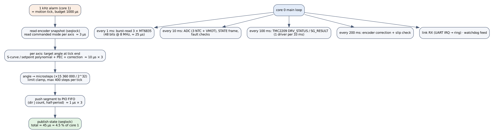
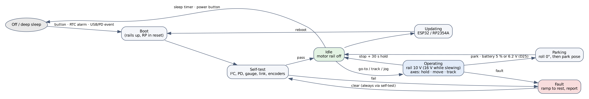
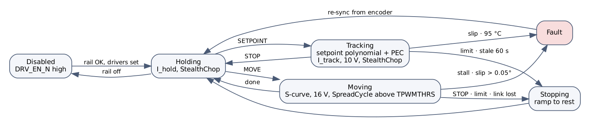
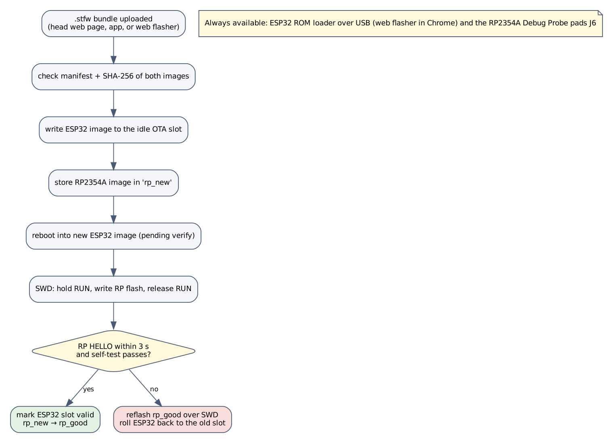

# Phase 5 — Firmware

Star Tracker Project · Phase 5 · revision A · branch `phase-5-firmware`

**Status (23 November 2026):** stages 1–7 written; all firmware builds; 29 of 29 host tests, 18 of 18 protocol tests against the simulator and 40 of 40 source checks pass. **Nothing has run on a real board yet.** Decisions Q44–Q51 are pending approval.

## 1. Where things stand

- **Architecture** (this section and section 3) and **decisions** Q44–Q51, carried on with the recommended option.
- **Bring-up firmware** for both processors, covering Stages B–D of the Phase 4 plan from a menu on the serial console and the OLED (section 4).
- **RP2354A motion firmware** (section 5) and **ESP32-S3 system firmware** with Alpaca, LX200, WebSocket and BLE (section 6).
- **Simulator and tests** (section 7): the real motion core and Head model on simulated axes, served over the real protocols.
- **Release** (section 8): a GitHub Actions workflow started by hand, a web flasher page for Chrome, an update bundle for both processors, recovery paths.
- **Gauge and PD configuration** (section 9).
- **What is not finished** is listed plainly in section 10.

| Path | Contents |
|---|---|
| `firmware/common` | link protocol, generated pin table, web page |
| `firmware/rp2354a` | motion firmware, bring-up tests, RAM flash loader |
| `firmware/esp32s3` | system firmware, bring-up menu |
| `firmware/sim` | simulator |
| `firmware/tests` | unit, integration and protocol tests, results |
| `firmware/tools` | generators, bundle maker, web flasher, final check |
| `firmware/config` | gauge settings |
| `.github/workflows/firmware.yml` | build and test workflow (manual start) |

## 2. Decisions

D1–D61 are fixed and followed. The questions below are not covered by them; the work carries on with the recommended option for each, marked **pending approval** until Bruno answers.

| # | Question | Recommended, used in the firmware |
|---|---|---|
| Q44 | Toolchains and language | ESP-IDF 5.5 (C++17) on the ESP32-S3, Pico SDK 2.3 (C11) on the RP2354A. Motion logic, maths and protocol handlers are portable C/C++ so the PC simulator builds the same source. Rust was looked at and not taken: its BLE, HTTP and OTA stacks are less mature |
| Q45 | RP2354A core and PIO split | Core 1 runs only a hard 1 kHz motion tick (profiles, tracking, PEC, step planning). Core 0 runs the link, encoder reads at 1 kHz, the 5 Hz correction loop, the driver UART, safety and the ADC. PIO0: one state machine per axis that plays "N steps in this millisecond" segments. PPS and LINK_SYNC edges are time-stamped in a GPIO interrupt |
| Q46 | Link protocol | UART0 at 921 600 baud; COBS frames of type, sequence, payload and CRC-16/CCITT; messages of spec 7.1; head time in µs steered by the GNSS 1 PPS; a LINK_SYNC pulse every second followed by the time of that edge |
| Q47 | Closed loop and encoder calibration | Steppers driven open-loop with PEC (the gear train is the fine control); encoders give absolute position at power-up, a 5 Hz lost-motion correction with a ±2″ deadband and slip detection at 0.05°. Calibration: a table measured against motor steps over each axis's travel (harmonics plus a 0.5° residual grid). The MT6835's self-calibration needs 25 rpm or more for 64 turns, which the 300:1 output never reaches |
| Q48 | Mount models and pointing | Internal frame = the head's own axis angles; matrix kinematics with the wedge tilt and IMU level; alt-az (roll de-rotates the field, Alpaca Rotator) and EQ on the wedge (azimuth = RA, altitude = Dec, roll = framing). Saemundsson refraction with pressure and temperature; a seven-term pointing model fitted by least squares; J2000 ↔ JNow with precession, nutation and aberration |
| Q49 | Updates and recovery | Two ESP32 OTA slots with rollback; the ESP32 keeps the last good RP2354A image and rewrites it over SWD if the RP2354A fails to answer after an update; one `.stfw` bundle for both; the ESP32 keeps its USB pins on the built-in USB-serial so the web flasher can always recover it; no secure boot on prototypes |
| Q50 | PD controller configuration | Write each controller's configuration into its EEPROM once (bring-up Stage C, 4CC `FLad`/`FLwd`/`FLvy`); the ESP32 also holds both images and loads them over I²C (`PBMs`/`PBMc`) if a controller starts in patch-wait mode |
| Q51 | Small defaults | Access point "StarTracker-XXXX" with a password shown on the OLED; mDNS `startracker.local`; BLE pairing with a 6-digit code; settings in NVS; Alpaca on 32323, LX200 on 4030 |

Q42 and Q43 (Phase 4, how the board check is read) stay pending and do not touch the firmware.

### 2.1 Findings from the design files

Every pin, address and scale the firmware uses is generated from `hardware/electronics/mainboard/st-501.model.json` by `firmware/common/tools/gen_board.py`, which also compares the result with the hand-off tables of the Phase 4 document and stops on any difference. Result: **all 31 ESP32-S3 nets and 30 RP2354A nets match the hand-off.** Points the hand-off does not spell out, read from the design files:

| Item | What the design files say | What the firmware does |
|---|---|---|
| Port B enable | R29 (TPS25752 GPIO3 → `PORTB_EN`) is marked not fitted | ESP32 IO46 alone drives `PORTB_EN`; the generator stops if R29 is ever fitted |
| GNSS backup supply | MAX-M10S `V_BCKP` is tied to its 3.3 V feed `+3V3G` (ferrite from `+3V3`) | "GNSS in backup" (section 10.5) is the module's software backup mode (UBX-RXM-PMREQ); with the pack out it starts cold. `GNSS_RST` and `GNSS_SAFE` are test pads only |
| Driver current before set-up | VREF = 5VOUT × 4.7 k / (33 k + 4.7 k) = 0.623 V → 0.34 A RMS | Drivers stay disabled until set up; set-up writes `GCONF.I_scale_analog = 0` (internal reference, 1.35 A / 0.75 A full scale) |
| Debug pads J6 | TC2030 pin 6 carries `LINK_RX` (RP2354A TX) | A Debug Probe's UART input can listen to the link (binary frames); the RP2354A has no text console of its own, so its bring-up tests run from the ESP32 menu |
| RP2354A USB | Only on test pads TP45/TP46; BOOTSEL on TP47 through 1 k | "Drag a file onto its USB drive" needs wires on three test pads; the normal path is the ESP32 over SWD |
| OLED | R96/R97 fitted: module pin 1 = VCC | — (hardware only) |

## 3. Architecture


The firmware is two programs with one narrow link between them, as spec section 7 set out: the ESP32-S3 decides where the axes should be and when, the RP2354A puts them there on time and keeps them safe. The RP2354A never waits for the ESP32: if the link goes quiet it brings slewing axes to rest by itself and coasts tracking for 60 s.

### 3.1 Source layout

```
firmware/
  common/            shared by both processors and the simulator
    include/st_board.h     GENERATED pin, address and scale table (gen_board.py)
    include/st_link.h      link protocol: message types and payloads
    src/st_link.c          COBS + CRC-16 framing, byte-wise receiver
    tools/gen_board.py     reads st-501.model.json, checks it against the hand-off
  rp2354a/           motion processor (Pico SDK)
    motion/                portable motion core: profiles, tracking, PEC, encoder maps, safety (also in the simulator)
    src/                   hardware layer: PIO step generators, MT6835, TMC2209, motor rail, ADC, link, time base
    bringup/               bring-up tests run from the ESP32 menu
  esp32s3/           application processor (ESP-IDF)
    components/st_core     portable: astro, kinematics, pointing model, tracker, power policy, intervalometer
    components/st_proto    portable: Alpaca, LX200 and WebSocket JSON handlers
    components/st_hal      drivers: PD controllers, gauge, GNSS, RTC, IMU, magnetometer, OLED, buttons, LEDs, shutter
    components/st_net      Wi-Fi, HTTP/WebSocket server, LX200 TCP, discovery, mDNS, BLE
    components/st_sys      OTA, SWD flasher for the RP2354A, settings, bring-up menu
  sim/               PC simulator: the portable code above + simulated hardware + the real servers
  tests/             unit tests (maths, rates, budget, link) and protocol tests
  tools/             diagrams, bundle maker, gauge and PD configuration helpers
```

### 3.2 RP2354A: cores, PIO and timing



| Job | Where | Rate | Time used |
|---|---|---|---|
| Motion tick: messages from core 0, encoder samples, target angle per axis (S-curve, setpoint polynomial, PEC, correction), angle → microsteps, limit clamp, PIO segment; every 200th tick the 5 Hz loop | core 1, timer alarm | 1 kHz | estimated ≈ 0.2 ms (double-precision maths on the M33; to be measured on the board) |
| Encoder burst read, 3 × 48 bits at 8 MHz, CRC check, multi-turn unwrap | core 0 | 1 kHz | ≈ 25 µs |
| ADC: three thermistors and `VMOT_MON`; STATE frame to the ESP32 | core 0 | 100 Hz | ≈ 40 µs |
| TMC2209 status (`DRV_STATUS`, `SG_RESULT`), one driver per 33 ms | core 0 | 10 Hz per driver | UART at 115 200 baud |
| Encoder correction and slip check | core 0 | 5 Hz | < 50 µs |
| Link receive (UART interrupt into a ring buffer), watchdog | core 0 | continuous | — |

**Step generation.** Each axis uses one PIO0 state machine. Every millisecond core 1 works out how many microsteps the axis must make in the next millisecond (a 64-bit accumulator, so the average rate has no rounding error at all) and pushes one segment: direction, count and half-period. The state machine plays the pulses evenly over the millisecond and then waits for the next segment. Numbers (300:1 gearing, 200-step motors, 256 microsteps, D2/D23): 15 360 000 microsteps per output turn, 0.084″ per microstep; 8°/s (D42) = 341 333 steps/s = 342 steps per tick, period 2.93 µs (the TMC2209 accepts up to fCLK/2); sidereal = 178.3 steps/s, one step every 5.6 ms, placed on the 1 ms grid: worst timing error 1 ms × 15″/s = 0.015″.

**Shared data between the cores.** Core 1 owns the whole motion state. Core 0 hands it link messages through a single-producer queue and sensor samples through a sequence-locked block (writer bumps a counter before and after; reader retries if it changed); core 1 publishes STATE, the wanted rail level and the driver currents the same way. Nothing uses a lock that could make core 1 wait.

**Memory.** RP2354A: 520 KB SRAM, 2 MB flash. Motion image 38 KB, bring-up image 51 KB (measured); PEC tables 3 × 1 024 × int32 = 12 KB; encoder maps 3 × 721 × int16 = 4.3 KB. Flash: one image at offset 0. A second (A/B) slot on the RP2354A is not needed because the ESP32 keeps the last good RP2354A image and can always rewrite it (section 3.9).

### 3.3 ESP32-S3: tasks

| Task | Core | Priority | Rate | Job |
|---|---|---|---|---|
| `link` | 1 | 20 | event + 1 Hz sync | UART frames to and from the RP2354A, LINK_SYNC strobe, time sync |
| `tracker` | 1 | 18 | 10 Hz | target → head angles (astro, kinematics, pointing model) → SETPOINT with rate and acceleration; jobs |
| `power` | 1 | 12 | 2 Hz + `PWR_IRQ_N` | both PD controllers, charger (through port A), gauge, pack budget, low-battery park, sleep |
| `sensors` | 1 | 10 | GNSS 1 Hz, IMU 50 Hz, mag 10 Hz | time, position, level, tip-over watch (3° in 0.5 s), first heading |
| `ui` | 1 | 8 | 10 Hz | OLED, buttons (interrupt + 30 ms debounce), three LEDs |
| `shutter` | — | esp_timer | µs | focus and release outputs, intervalometer |
| `httpd` | 0 | 5 | event | Alpaca, web pages, WebSocket, update upload |
| `lx200`, `discovery`, `mdns`, `nimble` | 0 | 5 | event | protocols and radio |

The Head model (state, settings, faults) is one object behind a mutex; servers read a copy and post commands to a queue that the tracker task executes, so no network request ever blocks motion.

**Memory.** ESP32-S3-WROOM-1-N16R8: 16 MB flash, 8 MB PSRAM. Partitions: `nvs` 64 KB, `otadata`, `phy_init`, `ota_0` and `ota_1` 4 MB each, `rp_img` 1 MB (RP2354A images: last good and new), `pd_cfg` 64 KB (both PD images), `storage` 6.6 MB LittleFS (web UI, logs, PEC and encoder tables, star list), `coredump` 64 KB.

### 3.4 Link protocol

Defined once in `firmware/common/include/st_link.h` and used unchanged by both processors and the simulator.

| Item | Value |
|---|---|
| Physical | RP2354A UART0 GPIO0 TX / GPIO1 RX ↔ ESP32 IO18 RX / IO17 TX, 921 600 baud 8N1 (92 kB/s) |
| Frame | COBS( type · seq · payload ≤ 240 B · CRC-16/CCITT-FALSE little-endian ) followed by 0x00 |
| Units | angle int64 in 2⁻³² turn of the axis output (3.0 × 10⁻⁴ ″); rate int64 in 2⁻⁴⁰ turn/s; time uint64 µs of head time |
| Load | STATE 100 Hz × 120 B + SETPOINT 10 Hz × 90 B + heartbeats ≈ 14 kB/s, 15 % of the line |

| Message | Direction | Rate | Content |
|---|---|---|---|
| `HELLO` | both | after reset | protocol and firmware versions |
| `HEARTBEAT` | both | 10 Hz | uptime, error counters; 500 ms missing = link lost |
| `TIMESYNC` | ESP32 → RP | 1 Hz | head time of the LINK_SYNC edge just sent, time quality |
| `SETPOINT` | ESP32 → RP | 10 Hz | per axis: angle, rate, acceleration at time t; valid 500 ms |
| `MOVE` / `STOP` | ESP32 → RP | on demand | S-curve target with speed cap (8°/s, D42) / ramp or quick stop |
| `CFG_SET` / `CFG_GET` | ESP32 → RP | on demand | currents, limits, ratio, thresholds (keyed) |
| `TABLE` | ESP32 → RP | on demand | PEC and encoder-map chunks |
| `POWER` | ESP32 → RP | on change | motor rail request and the motion power budget |
| `TEST` / `TEST_RESULT` | both | bring-up | run an RP2354A bring-up test, pass/fail text |
| `STATE` | RP → ESP32 | 100 Hz | per axis: commanded and encoder angle, rate, current, StallGuard, temperature, mode, flags; rail; faults |
| `EVENT` | RP → ESP32 | on change | faults set and cleared, move done, limit, stall, slip, derate |

**Time.** The ESP32 keeps head time: GNSS time of week plus the 1 PPS edge captured in an interrupt (both on IO15), or the RTC (RV-3028 Unix counter) until a fix arrives. Once a second it raises LINK_SYNC (IO16) and records its own clock at the edge, then sends `TIMESYNC` with the head time of that edge. The RP2354A time-stamps the same edge (GPIO2 interrupt) and fits head time = a + b × local time over the last 16 pairs, which tracks its crystal's drift. The RP2354A's own PPS input (GPIO3) measures its crystal against GNSS directly and keeps the rate right if the ESP32 stops sending. Error budget: interrupt latency < 2 µs, so the clock term stays at the spec's 0.04″.

### 3.5 Closed-loop strategy and encoder calibration (Q47)

- **Fine control is the gear train.** Tracking is open-loop microstepping with PEC, exactly as the spec's error budget assumes (encoder loop noise 0.3″ is an allowance, not the control).
- **Encoders are the truth on a slow loop.** At power-up each axis takes its absolute angle from its encoder (multi-turn on azimuth is counted from the step count and confirmed by the encoder). Every 200 ms the motion core compares the averaged encoder angle (200 samples, which brings the MT6835's 0.0015° RMS noise down to about 0.4″) with the commanded angle; outside a ±2″ deadband it adds a small correction rate (limited to 1″/s while tracking) until they agree. This takes out the reducer wind-up at reversals (12–26″, spec 4.5).
- **Slip and stall.** A difference above 0.05° stops the axis, re-syncs the commanded angle from the encoder and reports (spec 7.3). StallGuard during slews stops, backs off 1° and reports.
- **Calibration.** The MT6835 is ±252″ non-linear out of the box (its own self-calibration would need ≥ 25 rpm for 64 turns; the output turns at 1.3 rpm at 8°/s). So each axis is mapped once: the motor steps slowly over the axis's whole travel (a full turn on azimuth), the gear train (accurate to ±20″, and periodic) is the reference; the encoder-minus-steps error is fitted with harmonics of the output angle (orders 1–8, which hold the magnet and mounting errors), and the residual is kept on a 0.5° grid. The map is stored on the ESP32 and sent to the RP2354A at start-up. The reducer's own periodic error averages out over the many wave-generator turns in the travel.
- **Bandwidth.** The MT6835 bandwidth register is set lower than the default (BW = 3) because the shaft never moves faster than 8°/s; the D48 noise test reports the spread at the setting used.

### 3.6 Mount models, coordinates and pointing (Q48)

- **Head frame.** The head's own axis angles (azimuth, altitude, roll) are the internal truth. The lens direction in the head frame is Rz(−az) · Ry(alt) · x̂.
- **Mount orientation.** One rotation matrix from the head frame to the local horizon (east, north, up): in alt-az it holds the tilt measured by the IMU and the azimuth offset found by alignment; on the wedge (D39) it holds the wedge tilt (latitude) and the polar-alignment error, so the azimuth axis is the polar axis.
- **EQ on the wedge.** Azimuth = hour angle, altitude = declination, roll = framing only (no field rotation).
- **Alt-az.** Azimuth and altitude track; roll de-rotates the field (the Alpaca Rotator reports and moves the same axis).
- **Rates.** The tracker evaluates head angles at t, t + 0.5 s and t + 1 s and sends angle, rate and acceleration for each axis 10 times a second, 200 ms ahead. This works for any mode and any wedge tilt, includes refraction changing with altitude, and keeps the RP2354A free of astronomy.
- **Coordinates.** J2000 catalogue → JNow with IAU 1976 precession, the leading terms of IAU 1980 nutation and annual aberration (all better than 1″); apparent → observed with Saemundsson refraction scaled by pressure and temperature (defaults 1010 hPa, 10 °C, set from the app); UT1 = UTC + DUT1 (setting, default 0). LX200 and Alpaca (EquatorialSystem = topocentric) use JNow. Sun and Moon from low-precision series (Sun 0.01°, Moon 0.05°, topocentric for the Moon); lunar and solar tracking follow the body's own motion, not a fixed rate.
- **Pointing model.** Seven terms in head-angle space: two index offsets, collimation, axis non-perpendicularity, two tilts of the first axis, and tube flexure. Fitted by least squares from sync points (1–2 points: index only; 3–5: plus tilts; 6 or more: all seven). Plate-solve syncs from the apps add points.

### 3.7 Power management

| Job | How |
|---|---|
| Pack state | BQ40Z50 over SMBus at 100 kHz: voltage, current, state of charge, temperature, status, cell voltages, every 2 s |
| Charging | the TPS25751D (port A) runs the BQ25792 itself (configured in its image); the ESP32 reads the charger through the controller (4CC `I2Cr`) and trims the charge current to 3 A above 35 °C inside the head (Phase 4 thermal check) |
| Port A sourcing | allowed while the pack is above 20 % |
| Port B (camera) | `PORTB_EN` high enables the TPS55288; the TPS25752A negotiates 5 V or 9 V at 3 A |
| Pack budget (section 10.7) | allowed power = 6 A × pack voltage; motion gets what is left after port B, port A sourcing and 1.2 W of logic, sent to the RP2354A as `POWER.motion_budget_mw`. If a cold full-current slew and a 27 W camera load coincide, the slew current is lowered first, then port B is re-advertised at 15 W |
| Low battery (D25) | 5 % or 6.2 V: finish the current exposure (5 min at most), park roll at 0° (P5 holds only within ±43°), park, sleep |
| Sleep | drivers off, rail off, RP2354A held in reset, GNSS software backup, ESP32 deep sleep with ext1 wake on IO1, IO2, IO4, IO5, IO6, IO21 |


### 3.8 State machines and safety





| Event | Detected by | Response |
|---|---|---|
| Link heartbeat missing 500 ms | RP2354A | slewing axes ramp to rest; tracking continues on the last setpoint for 60 s, then stops |
| Setpoint older than its validity | RP2354A | extrapolate with the last rate until the 60 s coast ends |
| Soft limit, payload envelope (D40) or tripod limit | RP2354A (clamp in the motion tick) | ramp to rest at the limit, `EVENT` |
| Encoder and commanded angle differ > 0.05° | RP2354A | stop the axis, re-sync from the encoder, report |
| StallGuard during a slew | RP2354A | stop, back off 1°, lower the speed by itself (D42), report |
| Driver `DIAG` / over-temperature / short | RP2354A | disable the drivers, fault |
| Motor thermistor > 80 °C / > 95 °C | RP2354A | lower the current / stop the axis |
| `VMOT` below 14.0 V on the 16 V level or 8.8 V on the 10 V level (Phase 4 monitor calc) | RP2354A | stop, rail off, report |
| IMU tilt changes > 3° in 0.5 s | ESP32 | STOP quick on all axes |
| Pack at 5 % or 6.2 V | ESP32 | finish exposure, park, sleep |
| Buttons 1 and 4 held 1 s | ESP32 | ramp all axes to rest and hold |
| RP2354A core 1 tick stalls | RP2354A watchdog (100 ms) | reset; drivers are disabled by the pull-up on `DRV_EN_N` during reset |
| Update fails or new firmware does not start | ESP32 | keep or return to the previous images (section 3.9) |

A cleared fault always goes back through the self-test, never straight to tracking.

### 3.9 Updates and recovery (Q49)



The ESP32 must never switch its USB pins away from the built-in USB-serial/JTAG: with no boot button on the board, that peripheral's reset-into-loader is what lets the web flasher recover a dead ESP32. The RP2354A cannot be bricked by an update because the ESP32 keeps a last good copy and can always rewrite it over SWD; the Debug Probe on J6 overrides everything.

### 3.10 Error handling

- Every driver returns a status; failures increment a counter shown on the bring-up and service screens and reported in `faults` over the WebSocket.
- I²C transactions retry twice, then mark the device missing; the head keeps running without it where it can (no IMU = no tip watch, shown as a warning).
- Faults are latched with a code, axis and value, logged to a ring in LittleFS (last 500) and shown on the OLED.

## 4. Bring-up firmware (ready before the boards arrive)

One test image per processor, built from the same source as the real firmware so the drivers that pass bring-up are the drivers that fly.

| Image | File in the workflow's artifacts | What it does |
|---|---|---|
| ESP32-S3 bring-up | `st-esp32s3-bringup-full.bin` (load with the web flasher, section 8) | A menu on the USB serial console (port A) and on the OLED with the four buttons (2/3 move, 4 runs, 1 aborts). Runs the ESP32-side tests and relays the RP2354A tests. Carries the RP2354A bring-up image and writes it over SWD (menu item L), so a Debug Probe is not needed |
| RP2354A bring-up | `st_rp2354a_bringup.uf2` / `.bin` (written by the ESP32 menu, or by a Debug Probe on J6) | The motion firmware plus the test runner. Blinks the heartbeat LED at 2 Hz; answers `TEST` messages from the ESP32 with text lines and a PASS / FAIL |

**Using it.** Connect port A to a computer, open any serial terminal at any speed (it is the chip's own USB, so the speed does not matter; the Arduino IDE's Serial Monitor or PuTTY both work, point and click), press Enter. Or use only the OLED and the buttons. Every test prints its numbers, the limit it was judged against, and PASS or FAIL; `s` prints a summary.

| Menu | Plan step | Test | Pass / fail limit |
|---|---|---|---|
| 1 | B3 | VSYS through IO7 | 7.1–7.6 V with the 7.4 V bench supply (plan 7.3–7.4 V at TP3 plus the ADC's ±2 %); the other rails are read by hand at the test pads listed |
| 2 | B7 | Main I²C scan; battery SMBus | 0x20, 0x21, 0x30, 0x52, 0x6A present (0x3C optional); 0x0B reported |
| 3 | B8 | GNSS bytes, NAV-PVT, 1 PPS | three PPS edges within 5 minutes |
| 4 | B | Clock: time, power-on flag, backup register | clock answers; offers to set the backup switchover and trickle charge (see 5.4) |
| 5 | B | IMU WHO_AM_I, acceleration; magnetometer ID, field | 0x70 and \|a\| 0.9–1.1 g; 0x30 and \|B\| 0.15–0.8 G |
| 6 | B | OLED test pattern | answers at 0x3C and you confirm the pattern |
| L | B6 | Write the RP2354A bring-up image over SWD | written, CRC-verified, the RP2354A answers on the link |
| 7 | B6 | Link HELLO | RP2354A answers with the same protocol version |
| 8 | B | PIO step generators | 10 pulses queued on GPIO16/18/20, no FIFO overflow (scope the pins) |
| 9 | C1 | Motor rail 10 V and 16 V | 9.5–10.5 V and 15.5–16.5 V on VMOT_MON; ripple by oscilloscope |
| a | C2 | 16 V under the 10 Ω load, 60 s | 16.04 V ± 0.2 V min and max |
| b | C3 | Port A: controller mode, contract, charger through `I2Cr` | 15 or 20 V contract and the charger answers |
| c | C3 | Gauge: voltage, current, state of charge, temperature, cells, status | 5.8–8.5 V, −20…60 °C, no safety flags |
| d | C4 | Port B enable, contract | you confirm 5 V and 9 V held 3 A for one minute on the PD tester |
| e | C5 | Four buttons, three LEDs | each button seen; each LED confirmed |
| f | C6 | Shutter and focus opto-couplers | you confirm the meter beeps |
| P | C | Write both PD configuration EEPROMs (Q50) | written and verified with `FLvy` |
| g | D2 | Encoder read-out with status bits and CRC | 10 of 10 readings with good CRC, no warning |
| h | D2 | Thermistors | 5–45 °C (room); open and short reported |
| i | D3 | Driver UART: IOIN version, set-up written and counted (IFCNT) | three drivers answer version 0x21 and accept set-up |
| j | D3 | Step slowly, encoder follows | encoder moves the commanded amount within 2 %, same direction |
| k | D4 | Sidereal tracking 10 min, CSV of encoder against command | informational: RMS and peak-to-peak printed; keep the log (first periodic-error number) |
| m | D5 | Ten slews at 8°/s equivalent | encoder agrees with the steps within 0.05° (×300 on the bench), DIAG never high |
| n | D6 | Encoder at full current vs zero current | difference ≤ 10″ |
| o | D8 | Encoder noise, 1 000 readings (D48) | ≤ 10.8″ RMS (twice the datasheet's 0.0015°), no weak-field flag, no CRC error |
| p | D8 | One slow revolution of the magnet (D48) | no reversal, no jump > 0.05°, no flat spot, no weak-field flag |

The bench set-up of Stage D (bare motor with the magnet on its shaft) is chosen by answering "yes" to "magnet on the bare motor shaft?"; the tests then expect 300 times the output angle and switch the motion core's own encoder checks off for the test.

## 5. RP2354A motion firmware

Source: `firmware/rp2354a/` (Pico SDK 2.3.1). `motion/motion.c` is the portable motion core (also run by the simulator); `src/` is the hardware layer.

| Part | File | What it does |
|---|---|---|
| Step generation | `src/stepgen.pio`, `src/hw_stepgen.c` | One PIO0 state machine per axis; a segment per millisecond; STEP high ≥ 120 ns, DIR set ≥ 53 ns before the first edge |
| Planner | `motion/motion.c` | Jerk-limited, re-targetable S-curve (8°/s, 4°/s², 8°/s³ by default); stops are planned to the jerk-limited stopping point |
| Tracking | `motion/motion.c` | Follows the ESP32's setpoint polynomial (angle, rate, acceleration at a time) with feed-forward plus a 50 ms catch-up; PEC by motor angle over three motor turns (862 s, spec 4.4) |
| Encoders | `src/hw_encoder.c` | MT6835 burst read (0xA003) of angle, status and CRC-8 (x⁸+x²+x+1); multi-turn unwrap; linearisation map (8 harmonics + 0.5° grid); bandwidth set to 3 each start-up, nothing written to the chip's EEPROM |
| Correction and slip | `motion/motion.c` | 5 Hz: mean of 200 (plan − encoder) samples; outside ±2″ a correction slews in at 1″/s while tracking, 30″/s while holding; > 0.05° = slip: stop, re-sync, report |
| Drivers | `src/hw_tmc2209.c` | One-wire UART with echo handling and CRC; every write counted through IFCNT; GCONF 0x1C0 (internal reference, UART on, MRES from register), CHOPCONF 0x10000053 (+ vsense), PWMCONF 0xC10C0024 (23.4 kHz), TPOWERDOWN 20; current picked per mode with vsense = 1 up to 0.70 A, rounded up; StealthChop at all speeds by default with SpreadCycle and StallGuard thresholds settable (tuned in Stage D) |
| Motor rail | `src/hw_rail.c` | MOTOR_PWR_EN → 5 ms → BOOST_EN → 10 ms → VMOT must read 9–11 V; VM_SEL high only while an axis slews and for 0.5 s after (D43); under-voltage stop at 14.0 V / 8.8 V |
| Limits | `motion/motion.c` | Altitude −10…+95° (params.py), roll per payload (sent by the ESP32), azimuth unlimited (D19); clamped inside the 1 kHz tick, sticky flags until the next command |
| Thermal | `motion/motion.c` | Above 80 °C the current drops to 70 %; above 95 °C the axis stops (Phase 4 10.7, spec 7.3) |
| Power budget | `motion/motion.c` | Slew current × √(budget / 20.1 W), not below 0.77 × (keeps the −20 °C torque margin of 1.48 above 1.1) |
| Link and time | `src/hw_link.c`, `src/hw_time.c` | UART0 at 921 600 with an interrupt ring; LINK_SYNC and PPS time-stamped in an interrupt; head time fitted over 16 pairs |
| Safety | `src/main.c` | Watchdog 100 ms fed only while core 1 ticks; drivers off (pull-up on DRV_EN_N) during any reset |

Default currents come from `docs/calc/phase4_results.json` (20 °C: azimuth 0.83 A slew / 0.32 A track, altitude and roll 0.45 / 0.18 A; holding 0.25 / 0.15 A); the ESP32 interpolates towards the −20 °C values (1.26 / 0.75 A and 0.89 / 0.63 A) from the inside temperature.

## 6. ESP32-S3 system firmware and protocols

Source: `firmware/esp32s3/` (ESP-IDF 5.5.6). Portable parts (`st_core`, `st_proto`) also build into the simulator.

| Part | Where | Notes |
|---|---|---|
| Wi-Fi | `st_app/net.cpp` | Access point `StarTracker-XXXX` with a password derived from the chip's MAC, shown on the OLED; joins your network once set over BLE |
| Web page | `common/web/index.html` | Status, go-to, jog, roll, intervalometer, update upload; Day/Night toggle |
| Alpaca | `st_proto/alpaca.cpp` | Telescope (ITelescopeV4) and Rotator (IRotatorV4), management API, discovery on UDP 32227; port 32323 and also port 80 |
| LX200 | `st_proto/lx200.cpp` | TCP 4030; high/low precision; :GR :GD :GA :GZ :Sr :Sd :MS :CM :Q :Mn/s/e/w :RG/C/M/S :Mg :U :GVP and site/time commands |
| WebSocket | `st_proto/wsapi.cpp` | `ws://<head>/ws/v1`, section 6.1 |
| BLE | `st_app/ble.cpp` | Service 5354524b-0100-4d2a-9b1e-000000000001: Wi-Fi set-up (write, encrypted), status (read/notify), command (stop, park); passkey pairing with the code on the OLED |
| UI | `st_app/app.cpp` | Four pages (sky position, axes and GNSS, network and BLE code, payload); button 4 = the page's action; buttons 1+4 held 1 s = stop all; button 1 held 3 s = night mode (red LED only, dimmest display, D7) |
| Power | `st_app/app.cpp`, `st_core/head.cpp` | Gauge every 0.5 s, both PD controllers, charge current 3 A above 35 °C inside, pack budget, low-battery park |
| Sensors | `st_hal/sensors.cpp` | GNSS (UBX NAV-PVT, PPS-anchored UTC, position on the first fix), clock (UNIX counter), IMU tip-over watch, magnetometer |
| Shutter | `st_core/head.cpp`, `st_app/app.cpp` | Intervalometer: count, exposure, interval, focus lead, delay; 10 ms resolution |
| RP2354A programming | `st_sys/swd.cpp`, `rp2354a/flashstub` | Bit-banged SWD at about 400 kHz, RAM flash loader, CRC check |
| Updates | `st_app/ota.cpp` | Section 3.9 and 8.3 |

### 6.1 WebSocket JSON API v1 (for the Phase 6 apps)

`ws://<head>/ws/v1` (simulator: `ws://localhost:8080/ws/v1`). Every request: `{"v":1,"id":<number>,"op":"<op>","args":{...}}`; every reply carries the same `id` and `"ok":true` or `"ok":false,"err":{"code":...,"msg":...}`. Error codes: `limit`, `parked`, `invalid`, `state`, `notimpl`, `parse`, `error`. The head pushes `{"v":1,"ev":"state",...}` five times a second.

| op | args | Effect |
|---|---|---|
| `goto` | `ra_h`, `dec_d`, `epoch` (`"J2000"` default or `"JNow"`) · or `az_d`, `alt_d` · or `body`: `"sun"`/`"moon"` | Slew, then track (RA/Dec, Sun, Moon) or hold (alt/az) |
| `sync` | `ra_h`, `dec_d`, `epoch` | Adds a pointing-model point (plate-solve result) |
| `track` | `on` (bool), `rate` (`sidereal`, `lunar`, `solar`, `king`) | Tracking on/off and rate |
| `stop` | — | Ramp every axis to rest, tracking off |
| `park` / `unpark` / `park.set` | — | Park (roll to 0° first), leave park, store the current pose as park |
| `jog` | `axis` (0 az, 1 alt, 2 roll), `dps` (0 stops) | Manual move up to 8°/s; tracking resumes on the new position |
| `guide` | `dir` (`n`,`s`,`e`,`w`), `ms` | Pulse guide at the guide rate |
| `rotator.pa` / `rotator.roll` | `pa_d` / `roll_d` | Image position angle (alt-az de-rotation) / roll axis angle |
| `align.clear` | — | Clear the pointing model |
| `time.set` | `unix_s` | Head time when there is no GNSS |
| `config.get` / `config.set` | keys: `lat`, `lon`, `elev_m`, `pressure_hpa`, `temp_c`, `refraction`, `mode` (`altaz`/`eq`), `wedge_deg`, `payload` (1–5), `wedge_fitted`, `pier_extension`, `roll_derotate`, `slew_dps`, `guide_rate`, `name` | Settings |
| `ivm.start` / `ivm.stop` | `count` (0 = endless), `exposure_s`, `interval_s`, `focus_s`, `delay_s` | Intervalometer on the shutter port |
| `state` | — | One state event on demand |
| `pec.*`, `job.*`, `cal.*` | — | Reserved; answer `notimpl` in this version |

State event fields: `t` (UTC), `mode` (`idle`, `slewing`, `tracking`, `moving`, `parking`, `parked`), `frame`, `tracking`, `parked`, `axes.{az,alt,roll}.{pos_d, enc_d, rate_dps, i_ma, load, temp_c, flags}`, `radec.{ra_h, dec_d}` (J2000) and `ra_now_h`, `dec_now_d`, `rot_d`, `altaz.{az_d, alt_d}`, `batt.{soc, v, temp_c, ext, motion_budget_w}`, `motor.{vmot, rail, faults, link}`, `model.{points, rms_as}`, `ivm.{running, done, count}`, `faults` (latest messages).

Alpaca notes: RA/Dec are JNow (`EquatorialSystem` = topocentric); `AlignmentMode` 0 alt-az or 1 polar (wedge); the roll axis is the Rotator, not `MoveAxis(2)`; synchronous slews return when the slew has finished; `SideOfPier`, `FindHome`, `SyncToAltAz` and aperture/focal length are not implemented (allowed for this mount type).

## 7. Simulator and test results

**Simulator** (`firmware/sim`, built by the workflow; `StarTrackerSim.exe` on Windows). It runs the real motion core on three simulated axes (step counting, ±20″ reducer periodic error twice per wave-generator turn, 12″ lost motion, encoder noise 5.4″ RMS), the real link framing between the two halves, the real Head model, and the real Alpaca, LX200, WebSocket and discovery servers. Start it, then point N.I.N.A. (Alpaca discovery), Stellarium (Telescope control → Meade LX200 → TCP localhost:4030), ConformU or the web page (http://localhost:8080) at it. Options: `--speed`, `--eq`, `--lat`, `--lon`, `--payload`.

**Unit and integration tests: 29 of 29 pass** (`firmware/tests/unit_results.txt`).

| Test | Result |
|---|---|
| Link: CRC-16 check value 0x29B1; 2 000 random frames round-trip; corrupted frame rejected | pass; STATE frame 124 bytes = 13.5 % of the line at 100 Hz |
| GMST, Meeus example 12.a | pass (within 0.01 s) |
| Apparent place of θ Persei, Meeus 23.a | pass: −0.17″ in RA, −0.21″ in Dec |
| Sun (Meeus 25.a) / Moon (Meeus 47.a) | pass: Moon 0.0009° / −0.0002° |
| Refraction: Bennett 58″ at 45°, 34.5′ at the horizon; exact inverse | pass; Saemundsson and Bennett agree to 3.7″ |
| Kinematics round trip; EQ: Dec = altitude, sidereal moves only the polar axis | pass |
| Roll de-rotation over ±5.7 h | pass: position angle held to 10⁻¹⁴° (roll needs −93…+33°) |
| Pointing model, 24 points with 5″ noise | pass: all seven terms within 15″, fit 7.3″ RMS |
| Pack budget against the Phase 4 cases; low battery 5 % / 6.2 V | pass: 27 W camera at 6.0 V leaves 7.8 W, a slew then re-advertises port B at 15 W |
| Intervalometer timing | pass |
| 90° slew at 8°/s | pass: exactly 3 840 000 microsteps, 12.8 s, peak 8.02°/s, no overshoot |
| Re-targeted move and 0.01° move | pass |
| 600 s sidereal with the encoder loop | pass: output 0.65″ RMS from ideal with 12″ lost motion in the gear model |
| Soft limit; link loss during a slew; slip of 0.2° | pass: stops at 95.000°; ramps to rest; re-synced to within 0.001° |
| Go-to and 10 min tracking, alt-az and EQ (Capella) | pass: commanded pointing within 0.01″; encoder vs true output within 20″ (noise + periodic error) |
| Roll de-rotation 30 min in the full simulation | pass: image angle held to < 0.001° |
| Below-horizon go-to and payload roll limit refused | pass |
| Battery at 4 % | pass: finishes, parks, roll at 0° |
| Alpaca flow, LX200 Stellarium sequence, WebSocket API (in-process) | pass |

**Protocol tests against the running simulator: 18 of 18 pass** (`firmware/tests/proto_results.md`): Alpaca discovery, connect, transaction IDs, synchronous slew (returns when finished, 0.01″ on target), error 0x401, axis rates, Rotator, HTTP 400 for unknown members; LX200 :GR/:GD formats, :Sr/:Sd, :MS refusal below the horizon, ACK; WebSocket upgrade, `config.get`, state events.

**Final check: 40 of 40** pins, addresses, register values, scales and timings agree with their sources (`firmware/tools/check_all.py`, report `firmware/tests/check_report.md`). Every ESP32-S3 and RP2354A pin comes from the schematic model and matches the hand-off.

**Builds:** RP2354A motion 38 KB, bring-up 51 KB, flash loader 10 KB (Pico SDK 2.3.1, gcc 13.2, no warnings). ESP32-S3 system 1.33 MB (68 % of the 4 MB slot free), bring-up 372 KB (ESP-IDF 5.5.6, no warnings).

**Not run here:**
- **ConformU** could not be downloaded in this workspace; it runs in the workflow (`test-reports` artifact). Its findings will need a pass of fixes.
- **Stellarium and N.I.N.A.** are desktop programs. The LX200 test replays Stellarium's command sequence, and N.I.N.A. talks Alpaca, which the protocol tests cover. Connect them to the simulator once to confirm.

## 8. Loading and updating, point and click

### 8.1 Getting the files
1. On github.com open the repository, click **Actions**, pick **Firmware** on the left, click **Run workflow** (branch `main` once this pull request is merged), then **Run workflow** again.
2. When the run shows a green tick (about 15 minutes), open it and download **esp32s3-images-and-flasher** (and **simulator-windows** if you want the simulator). Unzip.

### 8.2 First load of a new board (ESP32-S3)
1. Double-click `web-flasher.html` from the unzipped folder; it opens in Chrome or Edge.
2. Plug port A of the board into the computer. Click **Connect to the head** and pick the new serial port.
3. Under "Load a complete image" click **Choose file**, pick `st-esp32s3-bringup-full.bin`, click **Write complete image**. The bar fills; the board restarts into the bring-up menu.
4. If the board does not appear as a serial port (a blank module should), use the J5 pads with a Tag-Connect cable and a USB-serial adapter as section 10.4 of the Phase 4 document says, then repeat.

### 8.3 RP2354A
- **From the ESP32 (normal):** bring-up menu item **L** writes the RP2354A bring-up image. The system firmware writes the motion image by itself on its first start, and after every update.
- **With a Debug Probe on J6:** load `st_rp2354a_bringup.elf` from the Raspberry Pi Pico extension in VS Code (its "Flash" button), no typing needed.
- **Dragging a file:** possible only with wires on TP45/TP46 (USB) and TP47 shorted to ground at power-up. The board shows up as a drive; drag `st_rp2354a_bringup.uf2` onto it.

### 8.4 PD configuration and the gauge
1. Make the two PD images with TI's tool (section 9). In the web flasher, under "Load the USB-C PD configuration images", pick port A's and port B's files and click **Write PD configuration**.
2. In the bring-up menu run **P**: each image goes into its controller's EEPROM through the controller and is verified.
3. Set the gauge in bqStudio with an EV2400 on the battery's blade connector (section 9.2).

### 8.5 Normal updates
1. Join the head's Wi-Fi (or your own network after BLE set-up) and open http://192.168.4.1.
2. Under **Update** pick `star-tracker-update.stfw` and click **Update the head**.
3. The head restarts, writes the RP2354A over SWD and checks that it answers.
   - **If it answers:** the new ESP32 image is marked good.
   - **If it does not:** the old RP2354A image is written back and the ESP32 returns to its previous slot.

### 8.6 Recovery
The ESP32's built-in USB loader always works, because the firmware never takes the USB pins away from it. Repeat 8.2 with `st-esp32s3-system-full.bin`.

## 9. Battery gauge and PD controller configuration

### 9.1 TPS25751D (port A) and TPS25752A (port B)
The configuration images can only be made with TI's own application customization tool for each controller (a browser tool linked from the TPS25751 and TPS25752 product pages on ti.com; TRM section 5.1 "PD Controller Application Customization"). It asks a series of questions and then saves a binary for the EEPROM. These are the answers for this head:

| Setting | Port A, TPS25751D | Port B, TPS25752A |
|---|---|---|
| Power role | Dual-role: sink by default, source on request | Source only |
| Sink capabilities | 5 V 3 A, 9 V 3 A, 15 V 3 A, 20 V 2.25 A (45 W) | — |
| Source capabilities | 5 V 3 A from the pack (phone or camera) | 5 V 3 A (from the 5 V rail through PP5V), 9 V 3 A (TPS55288) |
| Battery charger | BQ25792 on the controller's I²C, 2 cells, 4 A charge, 8.4 V | — |
| DC/DC | — | TPS55288 on the controller's I²C (0x74), enable on its EN pin |
| Dead battery | Negotiate high voltage (ADCIN1 = 7, ADCIN2 = 0 as strapped) | — |
| I²C target address | 0x20 | 0x21 |
| Interrupt mask on I2Ct_IRQ | PlugInsertOrRemoval, NewContract, PowerStatusUpdate, Error | same |
| 15 W fallback | — | 5 V 3 A + 9 V 1.67 A, written by the firmware into Transmit Source Capabilities (0x32) when the pack budget calls for it (Phase 4 rule), if the tool does not offer a second set |

Save each generated binary (port A and port B) and load them as in 8.4. The firmware never needs the images to run: if an EEPROM is blank, the controller waits in patch mode and the ESP32 loads the image from its pd_cfg partition at start-up. Until that has happened, an empty pack charges at 5 V only.

### 9.2 BQ40Z50-R2 for the 2S2P Molicel P50B pack
All settings are in `firmware/config/bq40z50-r2-p50b.csv`, with the class, subclass and name as bqStudio shows them:
- **Cell count and capacity:** 2 cells in series; design capacity 10 000 mAh / 7 200 cWh / 7 200 mV.
- **Charging:** 4.20 V per cell at 4 A (1 A below 10 °C); 250 mA pre-charge and taper.
- **Protections:** cell under-voltage 2.7 V, over-voltage 4.30 V; charge over-current 6 A, discharge 8 A, short 10 A; charge 0–50 °C, discharge −20–60 °C.
- **LEDs:** thresholds 20/40/60/80 %, with threshold 5 at 100 % because only four LEDs are fitted (section 5.3 of the Phase 4 document).

The settings are entered point and click:
1. bqStudio → **Data Memory**.
2. Type each name from the file in the search box and enter its value.
3. **Chemistry** → pick Molicel INR-21700-P50B.
4. **Export** a golden file.
5. Run one learning cycle (charge, relax, discharge at C/5, relax, charge) as TI's guide describes.

If the P50B is not in bqStudio's chemistry list (TI's forum shows other users asking for it), log one relaxation and discharge and submit it to TI's GPCCHEM tool. It returns the closest chemistry ID.

## 10. What is not finished or not tested

Nothing here has run on a real board, and none of it is described as working on the head. What was tested, and how, is in section 7.

| Item | State |
|---|---|
| Both firmwares on hardware | Built only. Bring-up Stages B–D will be the first real test |
| SWD programming of the RP2354A from the ESP32 | Written from the ADIv6 and Armv8-M specifications and OpenOCD's RP2350 settings. **Untested.** The Debug Probe is the fallback |
| PD controller patch load / EEPROM write | Written from TI's TRM (PBMs/PBMc, FLad/FLwd/FLvy). Untested; the images must first be made with TI's tool |
| Status-register bit positions of the TPS2575x (plug, role) and the BQ25792 register map | From the TRM / data sheet, to be confirmed in Stage C (the bring-up menu prints the raw values) |
| MT6835 CRC initial value and the BW register position | From the data sheet; bring-up test g shows the CRC rate on the first board |
| Encoder calibration routine (the step-referenced map of Q47) | The motion core applies a map sent as `TABLE` messages. The ESP32 routine that measures it (`cal.*`) is **not written yet** |
| PEC training (`pec.*`) and motion jobs (`job.*`: panorama, time-lapse, Holy Grail) | Not written. The motion core already plays a PEC table |
| Satellite and comet tracking from TLE or rates | Not written |
| mDNS (`startracker.local`) | Not included: the ESP-IDF mdns component comes from Espressif's registry, which this workspace cannot reach. Add it in the workflow build. Alpaca discovery works without it |
| ConformU, Stellarium, N.I.N.A. | See section 7 |
| Windows simulator build | In the workflow but never compiled here (`continue-on-error`) |
| StallGuard threshold, SpreadCycle switching speed | Defaults off; to be tuned from the Stage D slew logs |
| Magnetometer heading for a first pointing estimate | Read, but not yet turned into an azimuth offset (needs the local declination) |
| 15 W re-advertising on port B | The decision is made in firmware; switching the PDO set needs the second PDO set in the port B image and the TPS25752 command to apply it, which is not written yet |

## 11. Open questions

| # | Question | Recommendation (used, pending approval) |
|---|---|---|
| Q44–Q51 | Section 2 | As in section 2 |
| Q42, Q43 | Phase 4 board-check wording | Unchanged by this phase |

## 12. Sources

- MagnTek MT6835 data sheet rev 1.3 (SPI commands, angle registers, status bits, CRC, calibration speed range, noise): <https://uploadcdn.oneyac.com/attachments/files/brand_pdf/magntek/79/27/MagnTek-MT6835.pdf>
- Texas Instruments TPS25751 Technical Reference Manual SLVUCR8 (register map, 4CC tasks, patch bundle, EEPROM tasks): <https://www.ti.com/lit/pdf/SLVUCR8>; TPS25751A TRM SPMU379: <https://www.ti.com/lit/pdf/spmu379>; patch loading note SLVAFV8: <https://ti.com/document-viewer/lit/html/SLVAFV8/GUID-370B5533-7F00-47C4-9FEB-2342E974CCEC>
- Micro Crystal RV-3028-C7 Application Manual (backup register, trickle charger with Schottky diode, EEPROM update, countdown timer): <https://cdn.sparkfun.com/assets/2/1/d/6/c/rv-3028-c7-app-manual.pdf>
- TI gauge chemistry selection: GPCCHEM <https://www.ti.com/tool/gpcchem>; chemical ID process SLUUCW4 <https://www.ti.com/document-viewer/lit/html/SLUUCW4/GUID-FC3510FF-FA8F-4E7F-82C9-BAE2E89B8D6B>; forum thread on the P50B <https://e2e.ti.com/support/power-management-group/power-management/f/power-management-forum/1323308/>
- ASCOM ConformU: <https://github.com/ASCOMInitiative/ConformU>; ASCOM conformance page <https://www.ascom-standards.org/COMDeveloper/Conformance.htm>; Alpaca API <https://ascom-standards.org/api/>
- RP2350 debug access (core 0 AP at 0x2000, ADIv6): OpenOCD rp2350 configuration as quoted on the openocd-devel list <https://www.mail-archive.com/openocd-devel@lists.sourceforge.net/msg17636.html>
- Versions checked on 23 November 2026 from the projects' GitHub tags: ESP-IDF v5.5.6 (v6.1.1 also exists), Pico SDK 2.3.1, ConformU v4.5.3, cJSON v1.7.18
- Meeus, *Astronomical Algorithms*, 2nd ed. (worked examples used as test references); TMC2209 data sheet (Trinamic/ADI); u-blox M10 interface description; ST LSM6DSV and MEMSIC MMC5983MA data sheets; Espressif ESP32-S3-WROOM-1 data sheet; Raspberry Pi RP2350 data sheet

