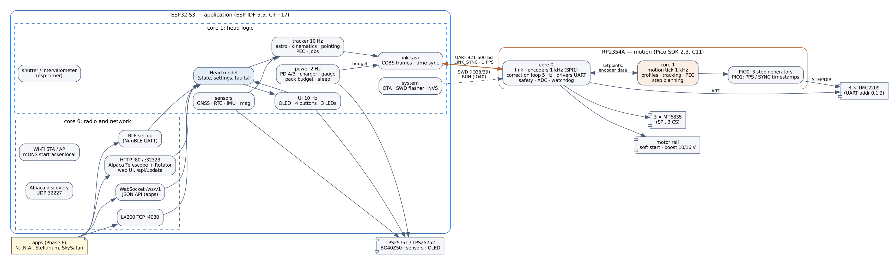
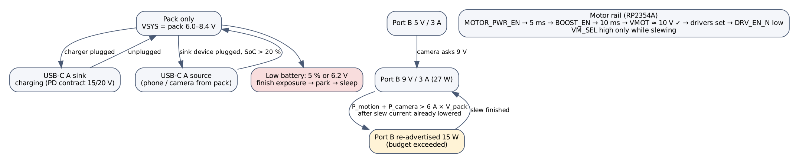

# Phase 5 — Firmware

Star Tracker Project · Phase 5 · revision A (in progress) · branch `phase-5-firmware`

<!-- STATUS -->

## 1. Where things stand

<!-- WHERE -->

## 2. Decisions

D1–D61 are fixed and followed. The questions below are not covered by them; the work carries on with the recommended option for each, marked **pending approval** until Bruno answers.

| # | Question | Recommended, used in the firmware |
|---|---|---|
| Q44 | Toolchains and language | ESP-IDF 5.5 (C++17) on the ESP32-S3, Pico SDK 2.3 (C11) on the RP2354A. Motion logic, maths and protocol handlers are portable C/C++ so the PC simulator builds the same source. Rust was looked at and not taken: its BLE, HTTP and OTA stacks are less mature |
| Q45 | RP2354A core and PIO split | Core 1 runs only a hard 1 kHz motion tick (profiles, tracking, PEC, step planning). Core 0 runs the link, encoder reads at 1 kHz, the 5 Hz correction loop, the driver UART, safety and the ADC. PIO0: one state machine per axis that plays "N steps in this millisecond" segments. PPS and LINK_SYNC edges are time-stamped in a GPIO interrupt |
| Q46 | Link protocol | UART0 at 921 600 baud; COBS frames of type, sequence, payload and CRC-16/CCITT; messages of spec 7.1; head time in µs steered by the GNSS 1 PPS; a LINK_SYNC pulse every second followed by the time of that edge |
| Q47 | Closed loop and encoder calibration | Steppers driven open-loop with PEC (the gear train is the fine control); encoders give absolute position at power-up, a 5 Hz lost-motion correction with a ±2″ deadband and slip detection at 0.05°. Calibration: a table measured against motor steps over each axis's travel (harmonics plus a 0.5° residual grid). The MT6835's self-calibration needs 25 rpm or more for 64 turns, which the 300:1 output never reaches |
| Q48 | Mount models and pointing | Internal frame = the head's own axis angles; matrix kinematics with the wedge tilt and IMU level; alt-az (roll de-rotates the field, Alpaca Rotator) and EQ on the wedge (azimuth = RA, altitude = Dec, roll = framing). Saemundsson refraction with pressure and temperature; a seven-term pointing model fitted by least squares; J2000 ↔ JNow with precession, nutation and aberration |
| Q49 | Updates and recovery | Two ESP32 OTA slots with rollback; the ESP32 keeps the last good RP2354A image and rewrites it over SWD if the RP2354A fails to answer after an update; one `.stfw` bundle for both; the ESP32 keeps its USB pins on the built-in USB-serial so the web flasher can always recover it; no secure boot on prototypes |
| Q50 | PD controller configuration | Write each controller's configuration into its EEPROM once (bring-up Stage C, 4CC `FLad`/`FLwd`/`FLvy`); the ESP32 also holds both images and loads them over I²C (`PBMs`/`PBMc`) if a controller starts in patch-wait mode |
| Q51 | Small defaults | Access point "StarTracker-XXXX" with a password shown on the OLED; mDNS `startracker.local`; BLE pairing with a 6-digit code; settings in NVS; Alpaca on 32323, LX200 on 4030 |

Q42 and Q43 (Phase 4, how the board check is read) stay pending and do not touch the firmware.

### 2.1 Findings from the design files

Every pin, address and scale the firmware uses is generated from `hardware/electronics/mainboard/st-501.model.json` by `firmware/common/tools/gen_board.py`, which also compares the result with the hand-off tables of the Phase 4 document and stops on any difference. Result: **all 31 ESP32-S3 nets and 30 RP2354A nets match the hand-off.** Points the hand-off does not spell out, read from the design files:

| Item | What the design files say | What the firmware does |
|---|---|---|
| Port B enable | R29 (TPS25752 GPIO3 → `PORTB_EN`) is marked not fitted | ESP32 IO46 alone drives `PORTB_EN`; the generator stops if R29 is ever fitted |
| GNSS backup supply | MAX-M10S `V_BCKP` is tied to its 3.3 V feed `+3V3G` (ferrite from `+3V3`) | "GNSS in backup" (section 10.5) is the module's software backup mode (UBX-RXM-PMREQ); with the pack out it starts cold. `GNSS_RST` and `GNSS_SAFE` are test pads only |
| Driver current before set-up | VREF = 5VOUT × 4.7 k / (33 k + 4.7 k) = 0.623 V → 0.34 A RMS | Drivers stay disabled until set up; set-up writes `GCONF.I_scale_analog = 0` (internal reference, 1.35 A / 0.75 A full scale) |
| Debug pads J6 | TC2030 pin 6 carries `LINK_RX` (RP2354A TX) | A Debug Probe's UART input can listen to the link (binary frames); the RP2354A has no text console of its own, so its bring-up tests run from the ESP32 menu |
| RP2354A USB | Only on test pads TP45/TP46; BOOTSEL on TP47 through 1 k | "Drag a file onto its USB drive" needs wires on three test pads; the normal path is the ESP32 over SWD |
| OLED | R96/R97 fitted: module pin 1 = VCC | — (hardware only) |

## 3. Architecture



The firmware is two programs with one narrow link between them, as spec section 7 set out: the ESP32-S3 decides where the axes should be and when, the RP2354A puts them there on time and keeps them safe. The RP2354A never waits for the ESP32: if the link goes quiet it brings slewing axes to rest by itself and coasts tracking for 60 s.

### 3.1 Source layout

```
firmware/
  common/            shared by both processors and the simulator
    include/st_board.h     GENERATED pin, address and scale table (gen_board.py)
    include/st_link.h      link protocol: message types and payloads
    src/st_link.c          COBS + CRC-16 framing, byte-wise receiver
    tools/gen_board.py     reads st-501.model.json, checks it against the hand-off
  rp2354a/           motion processor (Pico SDK)
    motion/                portable motion core: profiles, tracking, PEC, encoder maps, safety (also in the simulator)
    src/                   hardware layer: PIO step generators, MT6835, TMC2209, motor rail, ADC, link, time base
    bringup/               bring-up tests run from the ESP32 menu
  esp32s3/           application processor (ESP-IDF)
    components/st_core     portable: astro, kinematics, pointing model, tracker, power policy, intervalometer
    components/st_proto    portable: Alpaca, LX200 and WebSocket JSON handlers
    components/st_hal      drivers: PD controllers, gauge, GNSS, RTC, IMU, magnetometer, OLED, buttons, LEDs, shutter
    components/st_net      Wi-Fi, HTTP/WebSocket server, LX200 TCP, discovery, mDNS, BLE
    components/st_sys      OTA, SWD flasher for the RP2354A, settings, bring-up menu
  sim/               PC simulator: the portable code above + simulated hardware + the real servers
  tests/             unit tests (maths, rates, budget, link) and protocol tests
  tools/             diagrams, bundle maker, gauge and PD configuration helpers
```

### 3.2 RP2354A: cores, PIO and timing


| Job | Where | Rate | Time used |
|---|---|---|---|
| Motion tick: messages from core 0, encoder samples, target angle per axis (S-curve, setpoint polynomial, PEC, correction), angle → microsteps, limit clamp, PIO segment; every 200th tick the 5 Hz loop | core 1, timer alarm | 1 kHz | estimated ≈ 0.2 ms (double-precision maths on the M33; to be measured on the board) |
| Encoder burst read, 3 × 48 bits at 8 MHz, CRC check, multi-turn unwrap | core 0 | 1 kHz | ≈ 25 µs |
| ADC: three thermistors and `VMOT_MON`; STATE frame to the ESP32 | core 0 | 100 Hz | ≈ 40 µs |
| TMC2209 status (`DRV_STATUS`, `SG_RESULT`), one driver per 33 ms | core 0 | 10 Hz per driver | UART at 115 200 baud |
| Encoder correction and slip check | core 0 | 5 Hz | < 50 µs |
| Link receive (UART interrupt into a ring buffer), watchdog | core 0 | continuous | — |

**Step generation.** Each axis uses one PIO0 state machine. Every millisecond core 1 works out how many microsteps the axis must make in the next millisecond (a 64-bit accumulator, so the average rate has no rounding error at all) and pushes one segment: direction, count and half-period. The state machine plays the pulses evenly over the millisecond and then waits for the next segment. Numbers (300:1 gearing, 200-step motors, 256 microsteps, D2/D23): 15 360 000 microsteps per output turn, 0.084″ per microstep; 8°/s (D42) = 341 333 steps/s = 342 steps per tick, period 2.93 µs (the TMC2209 accepts up to fCLK/2); sidereal = 178.3 steps/s, one step every 5.6 ms, placed on the 1 ms grid: worst timing error 1 ms × 15″/s = 0.015″.

**Shared data between the cores.** Core 1 owns the whole motion state. Core 0 hands it link messages through a single-producer queue and sensor samples through a sequence-locked block (writer bumps a counter before and after; reader retries if it changed); core 1 publishes STATE, the wanted rail level and the driver currents the same way. Nothing uses a lock that could make core 1 wait.

**Memory.** RP2354A: 520 KB SRAM, 2 MB flash. Motion image 38 KB, bring-up image 51 KB (measured); PEC tables 3 × 1 024 × int32 = 12 KB; encoder maps 3 × 721 × int16 = 4.3 KB. Flash: one image at offset 0. A second (A/B) slot on the RP2354A is not needed because the ESP32 keeps the last good RP2354A image and can always rewrite it (section 3.9).

### 3.3 ESP32-S3: tasks

| Task | Core | Priority | Rate | Job |
|---|---|---|---|---|
| `link` | 1 | 20 | event + 1 Hz sync | UART frames to and from the RP2354A, LINK_SYNC strobe, time sync |
| `tracker` | 1 | 18 | 10 Hz | target → head angles (astro, kinematics, pointing model) → SETPOINT with rate and acceleration; jobs |
| `power` | 1 | 12 | 2 Hz + `PWR_IRQ_N` | both PD controllers, charger (through port A), gauge, pack budget, low-battery park, sleep |
| `sensors` | 1 | 10 | GNSS 1 Hz, IMU 50 Hz, mag 10 Hz | time, position, level, tip-over watch (3° in 0.5 s), first heading |
| `ui` | 1 | 8 | 10 Hz | OLED, buttons (interrupt + 30 ms debounce), three LEDs |
| `shutter` | — | esp_timer | µs | focus and release outputs, intervalometer |
| `httpd` | 0 | 5 | event | Alpaca, web pages, WebSocket, update upload |
| `lx200`, `discovery`, `mdns`, `nimble` | 0 | 5 | event | protocols and radio |

The Head model (state, settings, faults) is one object behind a mutex; servers read a copy and post commands to a queue that the tracker task executes, so no network request ever blocks motion.

**Memory.** ESP32-S3-WROOM-1-N16R8: 16 MB flash, 8 MB PSRAM. Partitions: `nvs` 64 KB, `otadata`, `phy_init`, `ota_0` and `ota_1` 4 MB each, `rp_img` 1 MB (RP2354A images: last good and new), `pd_cfg` 64 KB (both PD images), `storage` 6.6 MB LittleFS (web UI, logs, PEC and encoder tables, star list), `coredump` 64 KB.

### 3.4 Link protocol

Defined once in `firmware/common/include/st_link.h` and used unchanged by both processors and the simulator.

| Item | Value |
|---|---|
| Physical | RP2354A UART0 GPIO0 TX / GPIO1 RX ↔ ESP32 IO18 RX / IO17 TX, 921 600 baud 8N1 (92 kB/s) |
| Frame | COBS( type · seq · payload ≤ 240 B · CRC-16/CCITT-FALSE little-endian ) followed by 0x00 |
| Units | angle int64 in 2⁻³² turn of the axis output (3.0 × 10⁻⁴ ″); rate int64 in 2⁻⁴⁰ turn/s; time uint64 µs of head time |
| Load | STATE 100 Hz × 120 B + SETPOINT 10 Hz × 90 B + heartbeats ≈ 14 kB/s, 15 % of the line |

| Message | Direction | Rate | Content |
|---|---|---|---|
| `HELLO` | both | after reset | protocol and firmware versions |
| `HEARTBEAT` | both | 10 Hz | uptime, error counters; 500 ms missing = link lost |
| `TIMESYNC` | ESP32 → RP | 1 Hz | head time of the LINK_SYNC edge just sent, time quality |
| `SETPOINT` | ESP32 → RP | 10 Hz | per axis: angle, rate, acceleration at time t; valid 500 ms |
| `MOVE` / `STOP` | ESP32 → RP | on demand | S-curve target with speed cap (8°/s, D42) / ramp or quick stop |
| `CFG_SET` / `CFG_GET` | ESP32 → RP | on demand | currents, limits, ratio, thresholds (keyed) |
| `TABLE` | ESP32 → RP | on demand | PEC and encoder-map chunks |
| `POWER` | ESP32 → RP | on change | motor rail request and the motion power budget |
| `TEST` / `TEST_RESULT` | both | bring-up | run an RP2354A bring-up test, pass/fail text |
| `STATE` | RP → ESP32 | 100 Hz | per axis: commanded and encoder angle, rate, current, StallGuard, temperature, mode, flags; rail; faults |
| `EVENT` | RP → ESP32 | on change | faults set and cleared, move done, limit, stall, slip, derate |

**Time.** The ESP32 keeps head time: GNSS time of week plus the 1 PPS edge captured in an interrupt (both on IO15), or the RTC (RV-3028 Unix counter) until a fix arrives. Once a second it raises LINK_SYNC (IO16) and records its own clock at the edge, then sends `TIMESYNC` with the head time of that edge. The RP2354A time-stamps the same edge (GPIO2 interrupt) and fits head time = a + b × local time over the last 16 pairs, which tracks its crystal's drift. The RP2354A's own PPS input (GPIO3) measures its crystal against GNSS directly and keeps the rate right if the ESP32 stops sending. Error budget: interrupt latency < 2 µs, so the clock term stays at the spec's 0.04″.

### 3.5 Closed-loop strategy and encoder calibration (Q47)

- **Fine control is the gear train.** Tracking is open-loop microstepping with PEC, exactly as the spec's error budget assumes (encoder loop noise 0.3″ is an allowance, not the control).
- **Encoders are the truth on a slow loop.** At power-up each axis takes its absolute angle from its encoder (multi-turn on azimuth is counted from the step count and confirmed by the encoder). Every 200 ms the motion core compares the averaged encoder angle (200 samples, which brings the MT6835's 0.0015° RMS noise down to about 0.4″) with the commanded angle; outside a ±2″ deadband it adds a small correction rate (limited to 1″/s while tracking) until they agree. This takes out the reducer wind-up at reversals (12–26″, spec 4.5).
- **Slip and stall.** A difference above 0.05° stops the axis, re-syncs the commanded angle from the encoder and reports (spec 7.3). StallGuard during slews stops, backs off 1° and reports.
- **Calibration.** The MT6835 is ±252″ non-linear out of the box (its own self-calibration would need ≥ 25 rpm for 64 turns; the output turns at 1.3 rpm at 8°/s). So each axis is mapped once: the motor steps slowly over the axis's whole travel (a full turn on azimuth), the gear train (accurate to ±20″, and periodic) is the reference; the encoder-minus-steps error is fitted with harmonics of the output angle (orders 1–8, which hold the magnet and mounting errors), and the residual is kept on a 0.5° grid. The map is stored on the ESP32 and sent to the RP2354A at start-up. The reducer's own periodic error averages out over the many wave-generator turns in the travel.
- **Bandwidth.** The MT6835 bandwidth register is set lower than the default (BW = 3) because the shaft never moves faster than 8°/s; the D48 noise test reports the spread at the setting used.

### 3.6 Mount models, coordinates and pointing (Q48)

- **Head frame.** The head's own axis angles (azimuth, altitude, roll) are the internal truth. The lens direction in the head frame is Rz(−az) · Ry(alt) · x̂.
- **Mount orientation.** One rotation matrix from the head frame to the local horizon (east, north, up): in alt-az it holds the tilt measured by the IMU and the azimuth offset found by alignment; on the wedge (D39) it holds the wedge tilt (latitude) and the polar-alignment error, so the azimuth axis is the polar axis.
- **EQ on the wedge.** Azimuth = hour angle, altitude = declination, roll = framing only (no field rotation).
- **Alt-az.** Azimuth and altitude track; roll de-rotates the field (the Alpaca Rotator reports and moves the same axis).
- **Rates.** The tracker evaluates head angles at t, t + 0.5 s and t + 1 s and sends angle, rate and acceleration for each axis 10 times a second, 200 ms ahead. This works for any mode and any wedge tilt, includes refraction changing with altitude, and keeps the RP2354A free of astronomy.
- **Coordinates.** J2000 catalogue → JNow with IAU 1976 precession, the leading terms of IAU 1980 nutation and annual aberration (all better than 1″); apparent → observed with Saemundsson refraction scaled by pressure and temperature (defaults 1010 hPa, 10 °C, set from the app); UT1 = UTC + DUT1 (setting, default 0). LX200 and Alpaca (EquatorialSystem = topocentric) use JNow. Sun and Moon from low-precision series (Sun 0.01°, Moon 0.05°, topocentric for the Moon); lunar and solar tracking follow the body's own motion, not a fixed rate.
- **Pointing model.** Seven terms in head-angle space: two index offsets, collimation, axis non-perpendicularity, two tilts of the first axis, and tube flexure. Fitted by least squares from sync points (1–2 points: index only; 3–5: plus tilts; 6 or more: all seven). Plate-solve syncs from the apps add points.

### 3.7 Power management

| Job | How |
|---|---|
| Pack state | BQ40Z50 over SMBus at 100 kHz: voltage, current, state of charge, temperature, status, cell voltages, every 2 s |
| Charging | the TPS25751D (port A) runs the BQ25792 itself (configured in its image); the ESP32 reads the charger through the controller (4CC `I2Cr`) and trims the charge current to 3 A above 35 °C inside the head (Phase 4 thermal check) |
| Port A sourcing | allowed while the pack is above 20 % |
| Port B (camera) | `PORTB_EN` high enables the TPS55288; the TPS25752A negotiates 5 V or 9 V at 3 A |
| Pack budget (section 10.7) | allowed power = 6 A × pack voltage; motion gets what is left after port B, port A sourcing and 1.2 W of logic, sent to the RP2354A as `POWER.motion_budget_mw`. If a cold full-current slew and a 27 W camera load coincide, the slew current is lowered first, then port B is re-advertised at 15 W |
| Low battery (D25) | 5 % or 6.2 V: finish the current exposure (5 min at most), park roll at 0° (P5 holds only within ±43°), park, sleep |
| Sleep | drivers off, rail off, RP2354A held in reset, GNSS software backup, ESP32 deep sleep with ext1 wake on IO1, IO2, IO4, IO5, IO6, IO21 |



### 3.8 State machines and safety


| Event | Detected by | Response |
|---|---|---|
| Link heartbeat missing 500 ms | RP2354A | slewing axes ramp to rest; tracking continues on the last setpoint for 60 s, then stops |
| Setpoint older than its validity | RP2354A | extrapolate with the last rate until the 60 s coast ends |
| Soft limit, payload envelope (D40) or tripod limit | RP2354A (clamp in the motion tick) | ramp to rest at the limit, `EVENT` |
| Encoder and commanded angle differ > 0.05° | RP2354A | stop the axis, re-sync from the encoder, report |
| StallGuard during a slew | RP2354A | stop, back off 1°, lower the speed by itself (D42), report |
| Driver `DIAG` / over-temperature / short | RP2354A | disable the drivers, fault |
| Motor thermistor > 80 °C / > 95 °C | RP2354A | lower the current / stop the axis |
| `VMOT` below 14.0 V on the 16 V level or 8.8 V on the 10 V level (Phase 4 monitor calc) | RP2354A | stop, rail off, report |
| IMU tilt changes > 3° in 0.5 s | ESP32 | STOP quick on all axes |
| Pack at 5 % or 6.2 V | ESP32 | finish exposure, park, sleep |
| Buttons 1 and 4 held 1 s | ESP32 | ramp all axes to rest and hold |
| RP2354A core 1 tick stalls | RP2354A watchdog (100 ms) | reset; drivers are disabled by the pull-up on `DRV_EN_N` during reset |
| Update fails or new firmware does not start | ESP32 | keep or return to the previous images (section 3.9) |

A cleared fault always goes back through the self-test, never straight to tracking.

### 3.9 Updates and recovery (Q49)


The ESP32 must never switch its USB pins away from the built-in USB-serial/JTAG: with no boot button on the board, that peripheral's reset-into-loader is what lets the web flasher recover a dead ESP32. The RP2354A cannot be bricked by an update because the ESP32 keeps a last good copy and can always rewrite it over SWD; the Debug Probe on J6 overrides everything.

### 3.10 Error handling

- Every driver returns a status; failures increment a counter shown on the bring-up and service screens and reported in `faults` over the WebSocket.
- I²C transactions retry twice, then mark the device missing; the head keeps running without it where it can (no IMU = no tip watch, shown as a warning).
- Faults are latched with a code, axis and value, logged to a ring in LittleFS (last 500) and shown on the OLED.

<!-- REST -->
