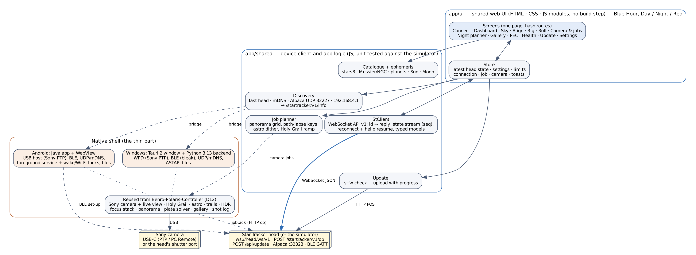
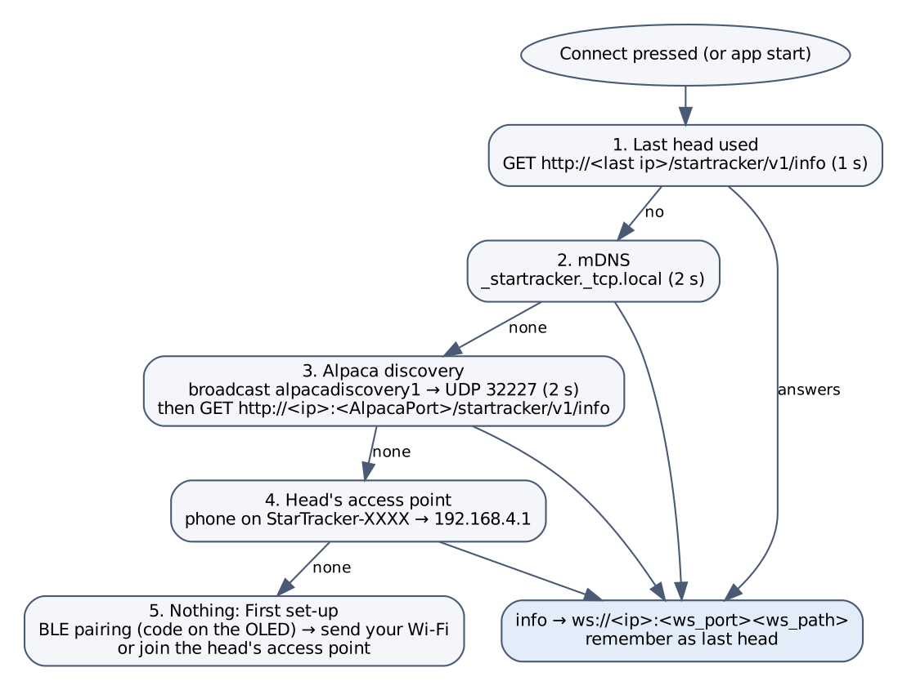
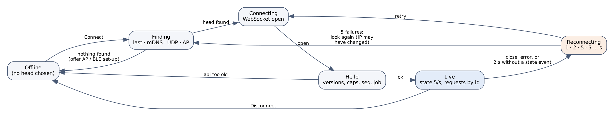
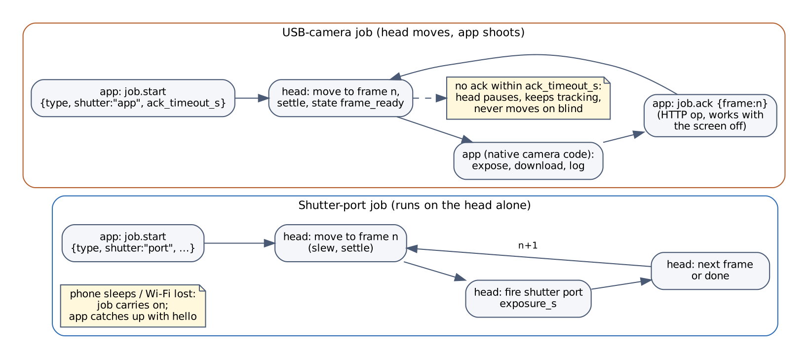
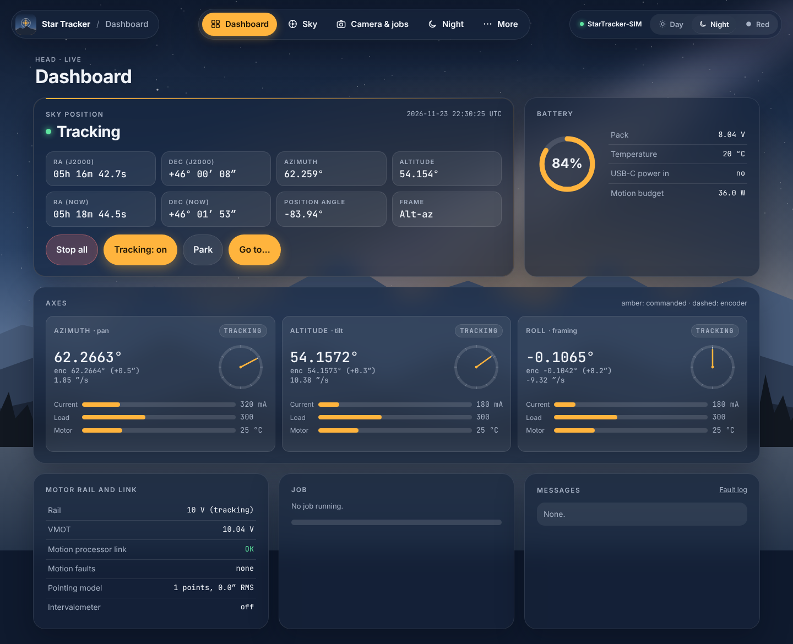
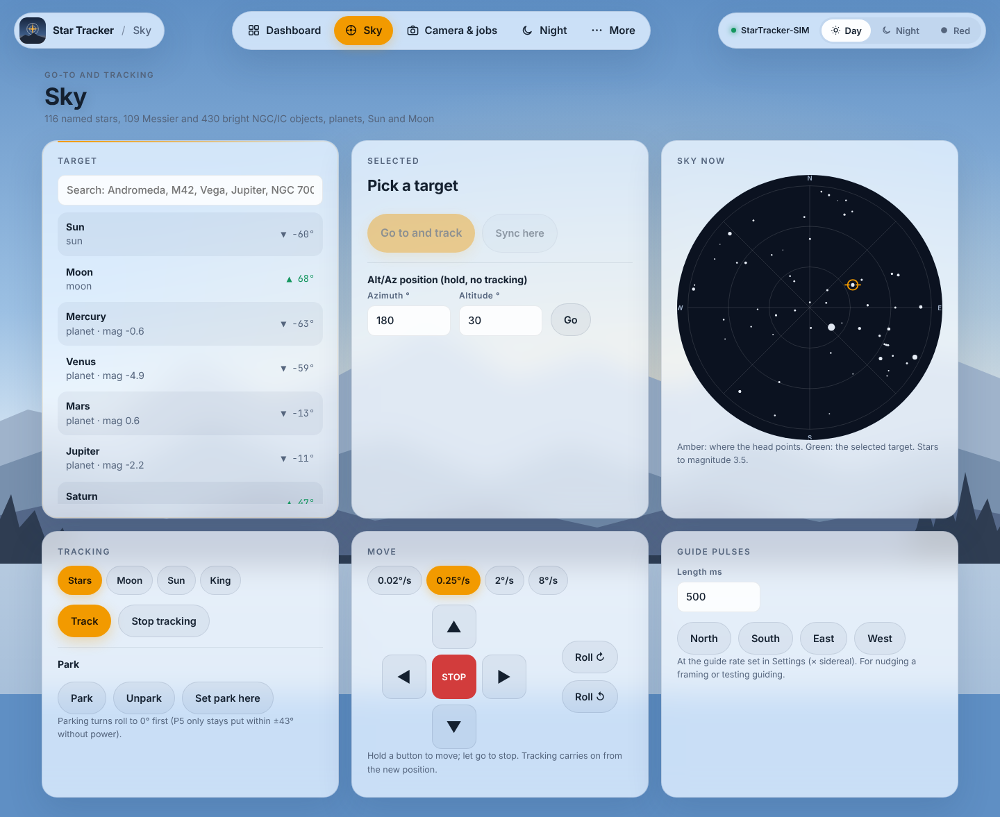
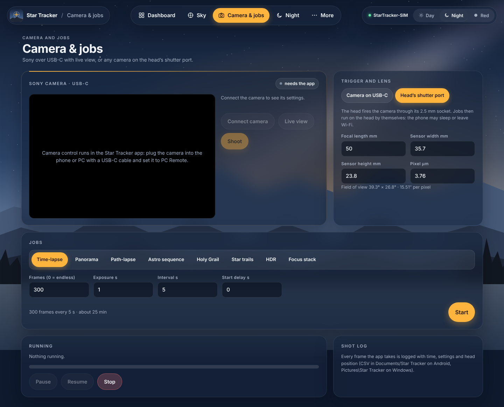
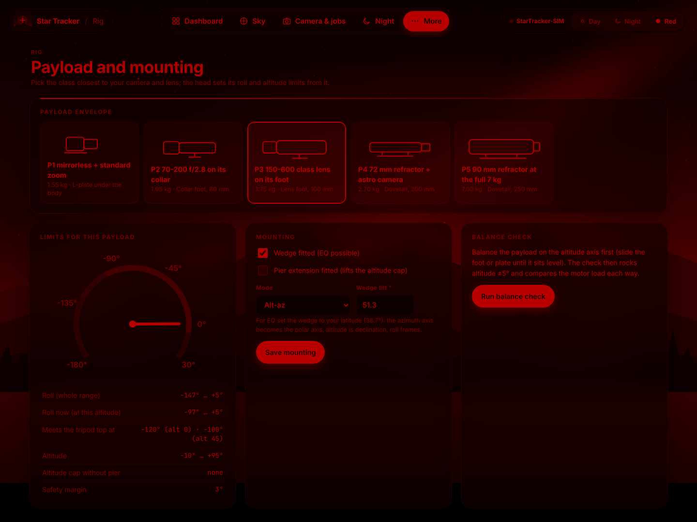
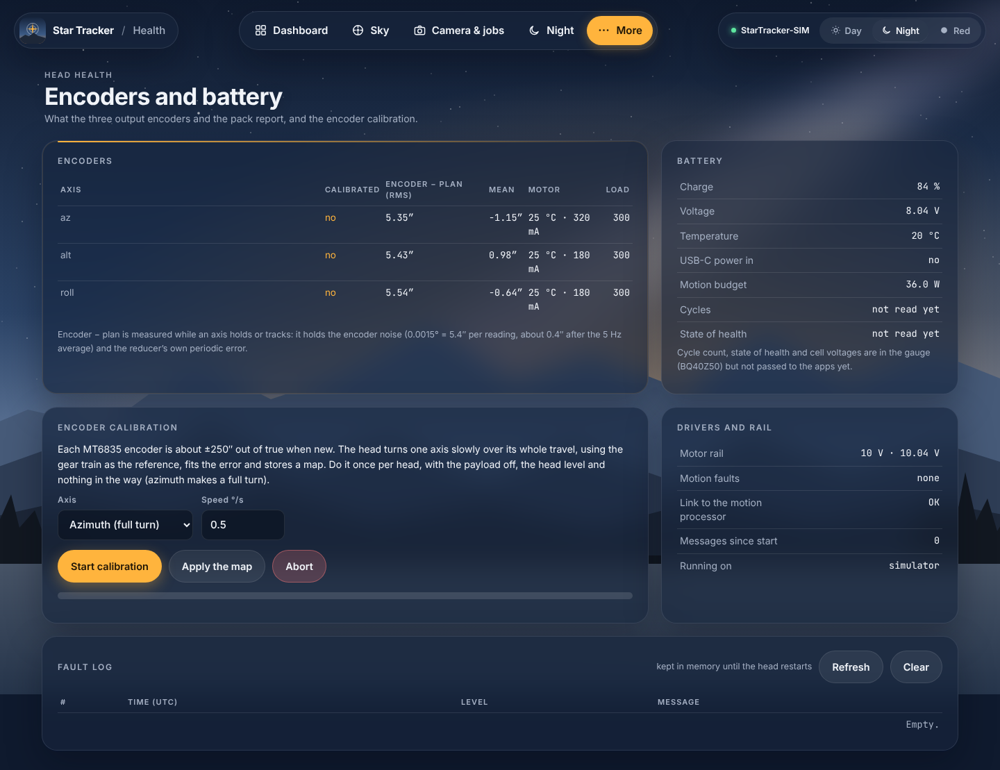
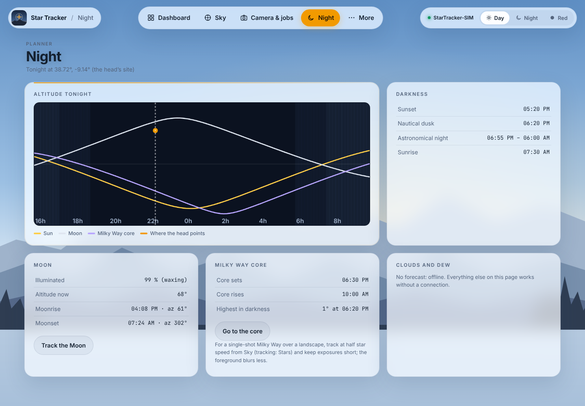

# Phase 6 — Apps

Star Tracker Project · Phase 6 · revision A · branch `phase-6-apps` (from `phase-5-firmware`; PR 10 was not merged when the phase started)

**Status (23 November 2026):** the device client, the shared UI (13 screens in Day, Night and Red), API 1.1 on the head and in the simulator, the Android shell, the Windows shell and the workflow are written. **38 of 38** device-client and end-to-end tests pass against the simulator, plus **39 of 39** screen renders, **33 of 33** Windows-backend tests (reused camera code, plate solver, head client), **47 of 47** checks of the apps against the firmware source, and the firmware's own **29 of 29** and **18 of 18**. **Nothing has run on a real head.** The APK and the Windows installer have **not been built yet**: this workspace has no Android SDK and no Windows, so the first build happens in the workflow (section 7). **Push to GitHub was refused at the start** (section 9): all work is committed on the branch in the workspace and waits for access. Decisions D72–D77 were approved on 23 November ("Approve Q44–Q57").

## 1. Where things stand

| Stage | State |
|---|---|
| 1 Architecture and decisions | Done: this document, sections 2–4; diagrams in `docs/img/06-*.svg/.png` (`app/tools/diagrams.py`) |
| 2 Device client `app/shared` | Done and tested against the simulator (section 6) |
| 3 Shared UI `app/ui` | 13 screens, Blue Hour with Day / Night / Red, screenshots of each (section 5) |
| 4 Firmware additions | API 1.1 in the portable code (simulator-tested); ESP32-only routes, mDNS, NVS store and BLE UUID written, not compiled here |
| 5 Android shell `app/android` | Written (Java, WebView, BLE, UDP/mDNS, foreground service, reused Sony camera code). Syntax-checked only; first compile in the workflow |
| 6 Windows shell `app/windows` | Tauri 2 window + Python backend; the backend runs and its tests pass on Linux; WPD camera and the installer build only on Windows (workflow) |
| 7 Tests | Section 6 |
| 8 Release | The workflow "Firmware and apps" builds everything and gathers it in one artifact (section 7) |

| Path | Contents |
|---|---|
| `app/shared` | device client `stclient.js`, models `models.js`, discovery, `.stfw` check and upload, BLE payloads, native bridge, catalogue, job planners, polar alignment |
| `app/ui` | the one page with every screen (`index.html`, `app.js`, `screens/*.js`), Blue Hour CSS and fonts, `theme.js`, `win-bridge.js` |
| `app/android` | Android app (Gradle, Java): `MainActivity`, `StNative`, `HeadClient`, `camera/` (reused) |
| `app/windows` | `shell/` (Tauri 2) and `backend/` (Python 3.13: server, `st_bridge`, `head_client`, reused camera and solver code, tests) |
| `app/tests` | Node tests against the simulator |
| `app/tools` | diagrams, catalogue generator, screenshots, API check |
| `app/PROGRESS.md` | notes for carrying on in a new chat |

## 2. Decisions

D1–D71 are fixed and followed. The six questions of this phase were approved as recommended on 23 November 2026 and are D72–D77 in the decisions log.

| # | Topic | Decision |
|---|---|---|
| D72 (Q52) | Native shells | Benro-Polaris-Controller's stack: Android = Java app with the shared UI in a WebView (Chaquopy dropped); Windows = Tauri 2 + Python 3.13 backend. The UI is plain HTML/CSS/JS modules, no build step |
| D73 (Q53) | Where jobs run | The head moves, the camera shoots. Shutter-port jobs run on the head alone; USB-camera jobs: the head waits at each frame for `job.ack` and pauses (still tracking) if the app goes quiet |
| D74 (Q54) | Plate solving | The reused hinted solver on both platforms; ASTAP `astap_cli` with D05 on Windows; a deeper catalogue for the Android solver for 300–600 mm |
| D75 (Q55) | Discovery and connection | Last head → mDNS → Alpaca UDP 32227 → 192.168.4.1, confirmed by `/startracker/v1/info`; BLE for first set-up; reconnect 1/2/5 s and `hello` |
| D76 (Q56) | API 1.1 | Section 4 and `docs/05-firmware.md` section 6.2 |
| D77 (Q57) | Defaults | "Star Tracker", `pt.brunomonte.startracker`, alongside the Benro app; Android 10+, Windows 10/11 x64; fixed signing key in the repo |

## 3. Architecture

### 3.1 Layers

1. **Shared UI** (`app/ui`): one page, hash routes (`#/sky`), so the one WebSocket survives every change of screen. A small store holds the latest head state, settings, limits, the connection and the job; screens subscribe to it and unsubscribe when left.
2. **Shared logic** (`app/shared`): the device client, discovery, update, BLE payloads, catalogue, job planners, polar alignment. Plain ES modules that run unchanged in the Android WebView, the Windows window and Node (the tests).
3. **Native shell**: only what a web page cannot do: UDP and mDNS discovery, BLE, USB (the Sony camera), keeping a job alive with the screen off, files, location. Android: `StNative.java`; Windows: `st_bridge.py`. Both answer `native(method, args)` from `app/shared/native.js`.
4. **Reused code** (D12): the Sony PTP camera, live view, Holy Grail, astro sequence, star trails, HDR, focus stack, the hinted plate solver, gallery and shot log from Benro-Polaris-Controller, unchanged except that they talk to the head through `HeadClient` instead of the Polaris driver.

### 3.2 The device client (`app/shared/stclient.js`)

- **Requests by id**: `request(op, args)` returns a promise of the reply's `result`, or rejects with `StError {code, msg}` carrying the head's error code (`limit`, `parked`, `invalid`, `state`, `notimpl`, …) or the client's (`timeout`, `offline`). Requests are checked against the models first, with the same limits the firmware uses.
- **State stream**: five events a second, normalised by `parseState` (every field present and typed; unknown fields kept apart so a newer head never breaks an older app). The stream is also the heartbeat: two seconds without an event = link lost.
- **Reconnect and resume**: 1, 2, 5, 5 … s; on every (re)connect a `hello` gives the API version, the head's op list, the event `seq` and the running job, so the app catches up. A 1.0 head is detected (`hello` refused) and handled.
- **Typed helpers** for every op in `docs/05-firmware.md` sections 6.1 and 6.2; `httpOp()` for the one-shot HTTP transport.

### 3.3 Discovery and connection

Alpaca discovery only reports the Alpaca port, so every candidate is confirmed with `GET /startracker/v1/info` (served on port 80 and on 32323), which gives the WebSocket port and path. The last head is tried first; the simulator on the same PC answers too.

### 3.4 Camera and head together (D73)

- **Shutter-port jobs** (`job.start` with `shutter: "port"`, or the intervalometer): the head moves and fires its 2.5 mm socket by itself. The phone may sleep or leave Wi-Fi; on return, `hello` and `job.status` show where it got to.
- **USB-camera jobs** (`shutter: "app"`): the native camera code (Java on Android, Python on Windows) starts the head job, then for each frame waits for `waiting_ack`, shoots and downloads, and sends `job.ack` over `POST /startracker/v1/op`, which works with the screen off where the WebView's WebSocket does not. If the app stops answering, the head pauses after `ack_timeout_s`, keeps tracking and logs why; it never moves on blind.
- **Camera-only jobs** (Holy Grail ramping, HDR, focus stack) run in the reused camera code; the head can hold, track, or glide a path-lapse meanwhile.
- **Android with the screen off**: a foreground service (type `connectedDevice`) with a partial wake lock and a Wi-Fi lock runs while any job runs.

### 3.5 Native bridges

| Call | Android (`StNative.java`) | Windows (`st_bridge.py`) | Browser |
|---|---|---|---|
| `discoverAlpaca` | UDP broadcast + multicast lock | UDP broadcast (+ localhost) | — |
| `discoverMdns` | `NsdManager` `_startracker._tcp` | `zeroconf` | — |
| `bleScan` / `bleConnect` / `bleWrite` / `bleRead` | `BluetoothLeScanner`, `BluetoothGatt`; the OS pairing dialog asks for the OLED code | `bleak`; Windows pairing dialog | — |
| `keepAwake` | foreground service, wake + Wi-Fi locks | `SetThreadExecutionState` | — |
| `location` | `LocationManager` | (none: type it in Settings) | browser geolocation |
| `setHead` | `HeadClient.setBase` for the camera code | `head_client.set_base` | — |
| camera | `window.CameraNative` (reused `CameraBridge.java`) + `startHeadJob` | same methods at `/bridge/camera/*` (`win-bridge.js`) | "needs the app" |

The Android pages are served from `https://appassets.androidplatform.net/` so ES modules load; `ws://` and `http://` to the head on the local network are allowed (mixed content, clear text). The head sends CORS headers.

### 3.6 Reused from Benro-Polaris-Controller (D12)

| Module | From | What changed |
|---|---|---|
| Blue Hour CSS, fonts, scene, Day/Night/Red | `ui.css`, `theme.js`, `fonts/` | Header; the frame moved into `app.js` (13 screens, a "More" menu); `st.css` adds the new parts |
| Night planner maths | `sun.js`, `moon.js` | None (in `app/ui/vendor`) |
| Sony camera, live view, jobs | `camera/*.java`, `desktop/polaris_desktop/sony.py` and friends | Package renamed; `PolarisClient` → `HeadClient` (same method names, answered by the head); new `startHeadJob` |
| Plate solver | `PlateSolver.java`, `plate_solver.py`, `stars8.bin` | None; tests unchanged and passing |
| Gallery, shot log, alerts, Holy Grail, median | as named | Folder names "Star Tracker" |
| Not reused | `assets/abp` (ogecko's driver), the Polaris BLE protocol, `PolarisService`, Chaquopy | — |

### 3.7 Offline

Everything works without the internet: catalogue (116 named stars, 109 Messier, 430 NGC/IC to V 10, from PyEphem and OpenNGC, generated into `catalog_data.js`), planets (Astronomy Engine, bundled), the Night planner, plate solving. Only the cloud and dew forecast (Open-Meteo) needs a connection, and says so when it has none.

## 4. API 1.1 (designed with the firmware, D76)

The full table is in `docs/05-firmware.md` section 6.2; the apps' models are `app/shared/models.js`. In short: `hello`, `limits.get`, `faults.get` / `faults.clear`, `health.get`, `pec.*` (status, record, stop, play, save, clear, get), `job.*` (start, pause, resume, stop, status, ack), `cal.status`, `cal.encoder.*` (start, apply, abort), `cal.balance`, `update.status`; `seq`, `job`, `pec`, `cal` in the state event; `GET /startracker/v1/info`, `POST /startracker/v1/op`, CORS; mDNS services; the BLE service UUID in the scan response.

**Where the code and the Phase 5 document disagreed (the code wins; reported here):**

| Finding | Effect | Now |
|---|---|---|
| The `state` op answered with an event that had no `id` | A client waiting by id never got its reply | Answered with its `id`; the client also handles a 1.0 head |
| `time.set` stored an offset that nothing read | Time sent by the app never reached the head's clock | `Head::on_set_time` → `clock_set_unix` on the head, the clock in the simulator |
| RP2354A: the setpoint age was unsigned while setpoints are stamped 200 ms ahead | The "setpoint stale" fault bit was always set | Signed age (`motion.c`) |
| Simulator: a client vanishing mid-send killed it (SIGPIPE, Linux/macOS) | Tests and screenshots failed at random | SIGPIPE ignored |
| `config.get` also returns `park_az`, `park_alt`; `mode` can be `fault`; `track` without `on` turns tracking on | Documented | Section 6.1 of the firmware document |

## 5. Screens

Every screen has the Day / Night / Red switch in the top bar (Red = D7's night mode: everything multiplied by dim red). Screenshots are from the simulator tracking Capella; all 39 are in `docs/img/06-screens/` (`<screen>-day.png`, `-night.png`, `-red.png`).

| Screen | What it does |
|---|---|
| Connect | Finds heads (last, mDNS, Alpaca, access point), connect by address, BLE Wi-Fi set-up with the OLED code, send phone location and time |
| Dashboard | Sky position (J2000 and now, alt/az, position angle), the three axes (commanded and encoder angles, rate, current, load, temperature, flags), battery, motor rail, link, model, job, messages; Stop / Tracking / Park |
| Sky | Catalogue search, sky chart, go-to (RA/Dec, alt/az, Sun, Moon), sync, tracking rates, park, hold-to-jog pad with four speeds and roll, guide pulses |
| Alignment | Three suggested stars spread in azimuth, sync by eye or plate solve, model points/RMS/terms, polar alignment from three solves with latitude-screw turns |
| Rig | The five payload envelopes, live roll limits and tripod clearance, wedge / pier / mode, balance check |
| Roll | Field de-rotation, framing by position angle or roll angle, limit warnings |
| Camera & jobs | Sony live view and settings, trigger choice (USB-C or shutter port), lens and sensor, eight job planners (time-lapse, panorama, path-lapse, astro, Holy Grail, star trails, HDR, focus stack), running job with pause/resume/stop |
| Night | Altitude chart (Sun, Moon, Milky Way core, the head), darkness, Moon, core, forecast |
| Gallery | Downloaded pictures by night; shot log |
| PEC | Record, chart, play, save, clear |
| Health | Encoder residuals, calibration with result and apply, battery, drivers and rail, fault log |
| Firmware | Bundle check, upload with progress, waiting for the head, version |
| Settings | Every `config.get`/`config.set` key, plus app preferences |

## 6. Test results

What was tested and how: the simulator (the real motion core, Head model and servers, `firmware/sim`) runs on this workspace; the apps' code talks to it over the real WebSocket and HTTP. Nothing has run on a head.

| Suite | Result | Covers |
|---|---|---|
| `app/tests/client.test.mjs` | 16 / 16 | hello and op list, 5 events/s with increasing `seq`, typed fields, `state` with id, config round trip, `time.set` reaching the clock, HTTP op, limits for P3 and P5, fault log, health, Alpaca discovery → info → WebSocket URL |
| `app/tests/services.test.mjs` | 9 / 9 | panorama on the shutter port to the end; pose outside the envelope refused; USB-camera path-lapse with acks over HTTP; no ack → pause → resume; astro with dither; PEC record/play; balance; altitude encoder calibration and apply; `.stfw` from `make_bundle.py` checked, uploaded with progress, damaged copy refused by app and head |
| `app/tests/e2e.test.mjs` | 7 / 7 | go-to Capella and 10 simulated minutes of tracking, alt-az (roll de-rotating) and EQ (only the polar axis at sidereal), worst 0.08″ and 0.09″ from the target; four syncs build the model; raw ±250″ encoder: the azimuth map holds 181.9″ RMS of the 181.8″ put in and leaves 14.8″ (the reducer's own error and noise, as intended); a shutter-port job carries on while the app is cut off for two simulated minutes, the app reconnects and `hello` shows the progress; battery-low park with roll at 0° |
| `app/tests/polar.test.mjs`, `jobs.test.mjs` | 7 / 7 | polar error recovered to 0.5′ from three synthetic solves; panorama grid, path-lapse keys, dither scale |
| Screens (`app/tools/screenshots.mjs`) | 39 / 39 | every screen in Day, Night and Red renders against the simulator with no script error |
| Windows backend (`pytest`) | 33 / 33 | the reused Sony job logic against a simulated camera, the plate solver (never wrong on synthetic fields), the head client against the simulator (slew, ack loop, errors) |
| API check (`app/tools/check_api.py`) | 47 / 47 | every op, argument, config key, state field, limit, unit, BLE UUID and bundle constant the apps use, against the firmware source (`app/api-check.md`) |
| Firmware (`st-tests`, `proto_test.py`) | 29 / 29, 18 / 18 | unchanged after the Phase 6 firmware changes |

**PEC in the simulator:** what is left to learn after the 5 Hz encoder loop is 1.2–1.4″ peak to peak (0.3″ RMS): the loop already removes the reducer's error above its ±2″ deadband. The number that matters comes from the prototype.

## 7. Build and install, point and click

### 7.1 Build everything
1. On github.com open **bmonte777/start-tracker-project**, click **Actions**, pick **Firmware and apps** on the left.
2. Click **Run workflow**, choose the branch **phase-6-apps** (or **main** once merged), click **Run workflow**.
3. When the run shows a green tick (about 30 minutes; the Windows job is the slowest), open it and download **star-tracker-release**. It holds `star-tracker-android.apk`, `star-tracker-windows-setup.exe`, the firmware images, `star-tracker-update.stfw`, `web-flasher.html` and both simulators. **app-test-reports** holds the test results and screenshots, including phone-size ones.

### 7.2 Android
1. Copy `star-tracker-android.apk` to the phone or tablet (USB cable, Google Drive, or e-mail to yourself) and tap it in **Files**.
2. If Android asks, allow your file app to **install unknown apps**, then tap **Install**. It installs next to the Benro app.
3. Open **Star Tracker**. Allow **location**, **nearby devices** (Bluetooth) and **notifications** when asked.
4. Plug the Sony in with a USB-C cable (camera set to **PC Remote**); tap **OK** when Android offers to open Star Tracker.

### 7.3 Windows
1. Double-click `star-tracker-windows-setup.exe`. If Windows says it protected your PC, click **More info**, then **Run anyway**. It installs for your user only.
2. Open **Star Tracker** from the Start menu. When Windows asks, **allow** it on private networks (discovery uses UDP).
3. For the camera: USB cable, camera on **PC Remote**.

### 7.4 Try it with the simulator (no head needed)
1. In the same run, the release folder has `StarTrackerSim.exe`. Double-click it (Windows may ask the firewall question: **Allow**).
2. In the Star Tracker app on the same PC: **More → Connect → Look again**; the simulator appears; click **Connect**.
3. On a phone: put the phone on the same Wi-Fi as the PC, open Connect, type the PC's address with `:8080` (shown in Windows **Settings → Network & internet → Wi-Fi → your network → IPv4 address**).

## 8. What is not finished or not tested

| Item | State |
|---|---|
| Everything on a real head | Not run: Phase 7 |
| GitHub | Push access refused at the start; work committed locally on `phase-6-apps`, not pushed, no pull request yet |
| APK and Windows installer | Not built yet (no Android SDK, no Windows here). Android Java syntax-checked only; the workflow's first run will show compile errors, if any |
| ESP32 additions (routes, CORS, NVS store, `update.status`, mDNS, BLE UUID) | Written, not compiled here |
| Sony camera through the new `startHeadJob` | Written on both platforms; the ack loop is tested against the simulator in Python, not with a camera |
| BLE Wi-Fi set-up | Written (Android, Windows); not tested: no head, no radio here |
| mDNS discovery | Written in the shells and the head; tested only through the fallback (Alpaca discovery) |
| ASTAP on Windows, deeper catalogue on Android (D74) | Not done: the reused hinted solver is in; the ASTAP download button and the Tycho-2 catalogue come next |
| Fault log in flash, gauge cycle count / state of health in `health.get` | RAM log only; gauge values reported as null |
| Balance check | Runs in the simulator, which has no load model, so it always reads balanced |
| A go-to in the simulator's first moments can be lost | Seen once; tests wait one second after start |
| Night planner, gallery and live view on a phone screen | Rendered at desktop size here; phone-size screenshots come from the workflow |

## 9. Open questions

| # | Question | Recommendation |
|---|---|---|
| — | GitHub access for this session (not a design decision) | On github.com: **Settings → Applications → Installed GitHub Apps → Claude → Configure → Repository access**, tick *start-tracker-project*. Then I push `phase-6-apps` and open the pull request |
| Q58 | Keep the fault log, PEC tables and encoder maps in the head's `storage` partition (LittleFS) instead of NVS / RAM | Yes, in the Phase 7 firmware pass: NVS is small for 3 maps + 3 tables and the fault log should survive a restart |
| Q59 | Pass the gauge's cycle count, state of health and cell voltages to the apps (`health.get`) | Yes, with Q58; a few lines in the power task |

## 10. Sources

- Benro-Polaris-Controller (shells, UI, camera, solver): <https://github.com/bmonte777/Benro-Polaris-Controller>
- Tauri 2 (version 2.12, CLI 2.12.6 on npm, 23 Nov 2026): <https://v2.tauri.app/blog/>
- Android Gradle Plugin release notes (9.x exists; the app stays on 8.13 with Gradle 8.14.3, which Bruno's app already builds with): <https://developer.android.com/build/releases/agp-9-2-0-release-notes>
- Android foreground service types (`connectedDevice` for USB, Bluetooth and network devices): <https://developer.android.com/guide/components/fg-service-types>
- ASTAP command-line solver (`astap_cli` v2026.05.03, `-f -ra -spd -fov -r -z`, D05/D20/D50 databases): <https://www.hnsky.org/astap.htm>
- Sony Camera Remote Command (PTP extension used by the reused camera code): <https://support.d-imaging.sony.co.jp/app/cameraremotecommand/l/index.php>
- Astronomy Engine 2.1.19 (planets, MIT): <https://www.npmjs.com/package/astronomy-engine>
- OpenNGC through PyOngc 1.2.2 (Messier, NGC, IC) and PyEphem 4.2.1 (named stars): <https://github.com/mattiaverga/OpenNGC>, <https://rhodesmill.org/pyephem/>
- Open-Meteo forecast API: <https://open-meteo.com/en/docs>
