<!-- Canopus user guide, operating chapters. Source of truth: the Docs artifact https://claude.ai/artifact/Gj22crYNNsjG5oRintECHD (exported 24 Nov 2026). Project copy: claude/10-user-guide.md. -->

# Canopus — User guide

Operating chapters · draft for the prototype · Nov 24, 2026

## About this guide

Canopus is a motorised 3-axis camera head for astrophotography and landscape work. It carries up to 7 kg, tracks the sky in alt-az or on its removable wedge (EQ), and works with the Canopus app on Android and Windows.

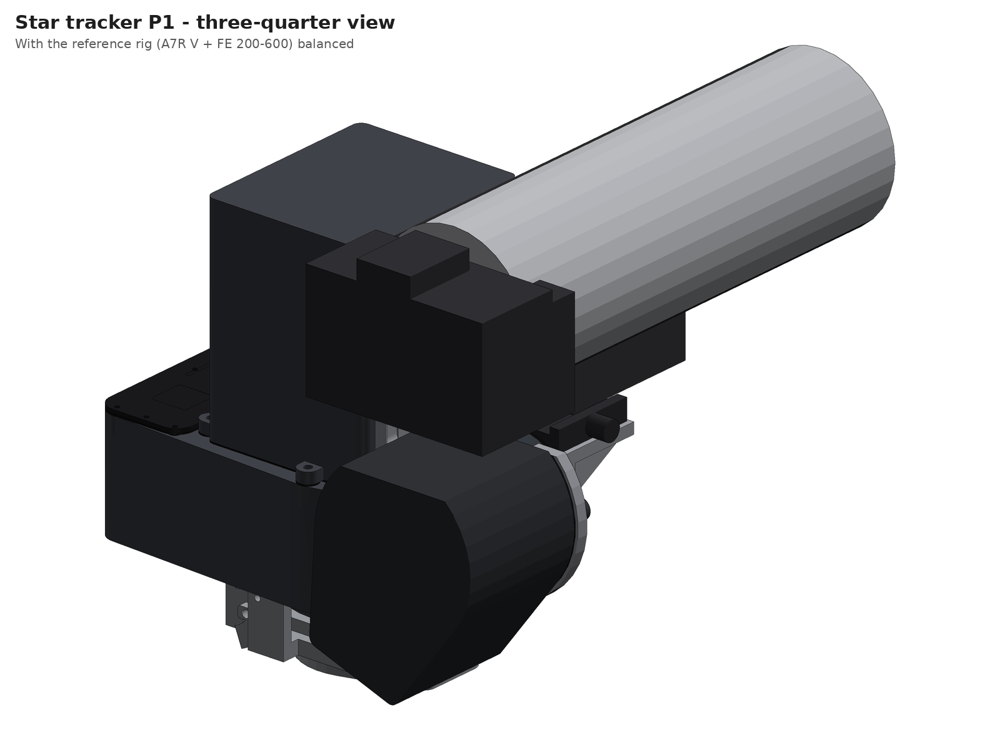

*Canopus on its wedge (CAD render of prototype P1; photos pending P1).*

This guide covers everyday operation. It was written from the firmware and app source and from the design documents, before any prototype was built.

- **Nothing here has run on real hardware yet.** Every feature described exists in the firmware and app and was tested in the simulator. The first prototype (P1) will confirm or correct it.
- **Marked *pending P1*:** photos, torque values, timings and anything that needs a built head. They are all listed in the last chapter.
- **Units:** metric. Angles are in degrees (°), arcminutes (′) and arcseconds (″).

**The three axes:**

| Axis | What it does | Range |
| --- | --- | --- |
| Azimuth | Turns the whole head round (pan). On the wedge it is the polar axis | Unlimited, no cable stop |
| Altitude | Tilts the arm up and down | −10° to +95° (soft limits) |
| Roll | Turns the camera about the lens axis, to frame or to cancel field rotation | Depends on the payload, see *Balance and the five payload types* |

## What is in the box

The final contents are decided with the packaging in Phase 8. This list follows the design and is a placeholder (*pending P1*).

| Item | Notes |
| --- | --- |
| Canopus head with Arca-Swiss clamp (60 mm) | 3/8"-16 socket underneath |
| Removable wedge | Fixed to the head with one coin-slot screw |
| Battery pack, 2S2P 21700 (7.2 V, about 72 Wh) | Tool-free, slides into the head |
| Hex keys 2, 2.5 and 3 mm | The only tools the head needs |
| USB-C cable(s) | For charging and the camera (*pending P1*: number and length) |
| Shutter cable, 2.5 mm jack | Camera end to suit your camera (*pending P1*) |
| Quick-start card with QR code to this guide | *Pending P1* |

You also need a sturdy tripod with a 3/8"-16 screw and, for camera control, the Canopus app on an Android phone or tablet (Android 10 or later) or a Windows 10/11 PC.

## Controls

The head runs without a phone: a small screen (OLED, 21 characters × 8 lines), four buttons and a status light let you track, park, check the network and pick the payload.

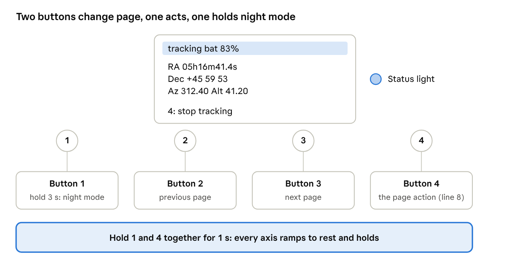

The button numbers are the firmware's. Their order on the front panel is *pending P1*.

**Screen pages.** Buttons 2 and 3 step through four pages. The top line of every page shows what the head is doing (idle, slewing, tracking, moving, parking, parked or FAULT) and the battery charge. Line 7 shows the newest message, if any.

| Page | What it shows | Button 4 |
| --- | --- | --- |
| 1 Sky | Where the lens points: RA and Dec (J2000), azimuth and altitude | Track here / stop tracking |
| 2 Axes | Roll angle, motor supply voltage, GNSS satellites ("PPS" when the time is locked) | Park / unpark |
| 3 Network | The head's Wi-Fi name and password, its IP address, the Bluetooth pairing code | — |
| 4 Payload | The payload type P1–P5 and whether the wedge is fitted | Next payload type |

**Status light.**

| Light | Meaning |
| --- | --- |
| Green, blinking | Tracking |
| Blue | Slewing (a fast move) |
| Red, steady | A fault: read the message on the screen or in the app |
| Off | Idle or parked |

**Night mode.** Hold button 1 for 3 s. The screen drops to its dimmest setting and the light shows red only, very dim: blinking while tracking, steady for a fault. Hold button 1 for 3 s again to leave night mode. The apps have the same idea in their Day / Night / Red switch.

## Charging and the pack's gauge

Charge from any USB-C PD charger on port A: the head runs and charges at the same time, up to 45 W.

**The two USB-C ports.**

| Port | What it does |
| --- | --- |
| A (power in) | Charges the pack and runs the head from a USB-C PD charger or power bank: 5, 9, 15 or 20 V, up to 45 W. Also the USB connection for updates |
| B (camera) | Powers your camera: 5 V or 9 V at 3 A (27 W). When the pack is cold and the motors need full power, the head may lower port B to 15 W for a moment |

**Charging.** Plug a USB-C PD charger into port A. The pack charges at up to 4 A to 8.4 V.

- Below 10 °C the pack charges slowly (1 A). It does not charge below 0 °C or above 50 °C.
- If the inside of the head is above 35 °C, the head lowers the charge current to 3 A.
- Time to full: *pending P1*.

**Reading the charge.**

- **On the head:** the top line of the screen shows the charge in percent on every page.
- **On the pack:** press the pack's button. Four lights show the charge in steps of 20, 40, 60 and 80 %. The button and lights are on the pack itself (photo *pending P1*).
- **In the app:** Health shows the charge, the pack's charge cycles, its state of health (green from 80 %, amber from 65 %) and both cell voltages. It warns when the two cells differ by more than 50 mV.

**How long it runs.** Calculated for the 2S2P pack (about 63 Wh usable at 20 °C); the prototype will measure it (*pending P1*).

| Use | Runtime |
| --- | --- |
| Idle, Wi-Fi on, motors off | 52 h |
| EQ tracking on the wedge, 20 °C | 34 h |
| Alt-az tracking, 20 °C | 25 h |
| Time-lapse or panorama, 20 °C | 16.9 h |
| Alt-az tracking and powering the camera, 20 °C | 7.9 h |
| Alt-az tracking, −20 °C | 7.2 h |

**Low battery.** At 5 % (or 6.2 V) the head shows "battery low: parking". It lets the current exposure finish (5 minutes at most), turns roll to 0°, parks and goes to sleep. Roll goes to 0° first because a 7 kg payload (P5) only stays put with the power off within ±43° of level.

**Swapping the pack.** The pack comes out without tools. The steps and photos are *pending P1*.

## First start, Wi-Fi and Bluetooth

The head makes its own Wi-Fi network, so it works in the field with no router: join it from your phone or PC, or give the head your home Wi-Fi once over Bluetooth.

**Switching on.** How the head is switched on and off is *pending P1*. When it starts, the screen shows "Canopus" and "starting...", then page 1.

**Position and time.** The head has its own GNSS receiver. Outdoors it takes its position from the first good fix (6 satellites or more) and locks its clock to the satellites; page 2 then shows "PPS". Indoors, or right after switching on, it may not know yet: open **Connect** in the app and press **Send my location** and **Send my time**.

**The head's own Wi-Fi.**

1. On the head, press button 3 until page 3 (Network) shows. It lists the network name **Canopus-XXXX** (XXXX is different for every head), the password and the address 192.168.4.1.
2. On your phone or PC, open the Wi-Fi settings and join **Canopus-XXXX** with that password.
3. Open the Canopus app and press **Look again** on Connect, or open http://192.168.4.1 in a browser for the head's own page.

**Your own Wi-Fi (set up over Bluetooth, once).** At home or on a site with Wi-Fi, the head can join that network instead.

1. In the app, open **Connect** and press **Search for heads over Bluetooth**.
2. Press **Pair** next to your head. Your phone or PC asks for a 6-digit code: it is on the head's page 3 ("BLE code").
3. Type your Wi-Fi name and password and press **Send Wi-Fi to the head**.
4. Page 3 now shows the address the head got on your network. The app finds it there by itself.

Bluetooth is only for this set-up and for an emergency stop or park; everything else goes over Wi-Fi.

**The head's own web page.** Any browser on the head's network can open http://192.168.4.1 (or the address on page 3). It shows the status and has go-to, jog, roll, the intervalometer, firmware update and a Day/Night switch. It is handy when the app is not installed.

## Installing and connecting the apps

The Canopus app runs on Android 10 or later and on Windows 10/11 (64-bit). It finds the head by itself and installs next to the Benro Polaris app if you have it.

**Getting the app.** Until there is a store listing, the app comes from the project's GitHub page: **Actions → Firmware and apps → Run workflow**, then download **canopus-release** from the finished run (about 30 minutes). It holds `canopus-android.apk`, `canopus-windows-setup.exe` and the firmware.

**Android.**

1. Copy `canopus-android.apk` to the phone or tablet (USB cable, Google Drive or e-mail) and tap it in **Files**.
2. If Android asks, allow your file app to **install unknown apps**, then tap **Install**.
3. Open **Canopus**. Allow **location**, **nearby devices** (Bluetooth) and **notifications** when asked.

**Windows.**

1. Double-click `canopus-windows-setup.exe`. If Windows says it protected your PC, click **More info**, then **Run anyway**. It installs for your user only.
2. Open **Canopus** from the Start menu. When Windows asks, **allow** it on private networks (the app looks for the head with network broadcasts).
3. For 300–600 mm lenses: **More → Settings → Plate solving for long lenses → Get ASTAP** (about 100 MB, once).

**Connecting.** Open **Connect** (under **More**). The app looks for heads in this order and connects to the first one that answers:

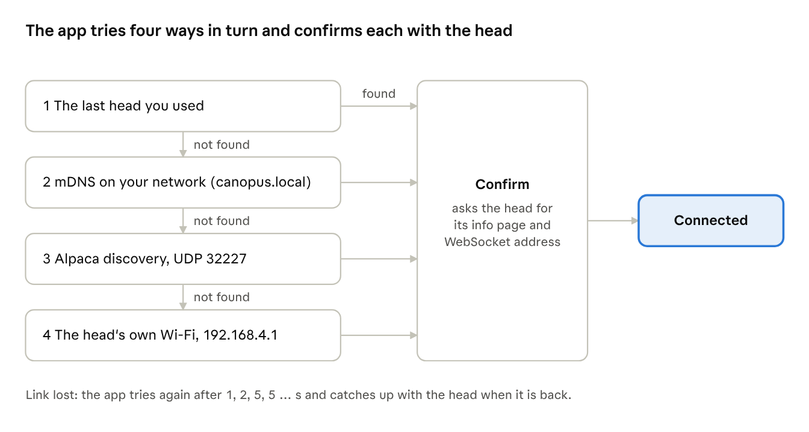

If your head is not listed, check that the phone is on the head's Wi-Fi (or the same network), then press **Look again**. You can also type the head's address (page 3 on the head).

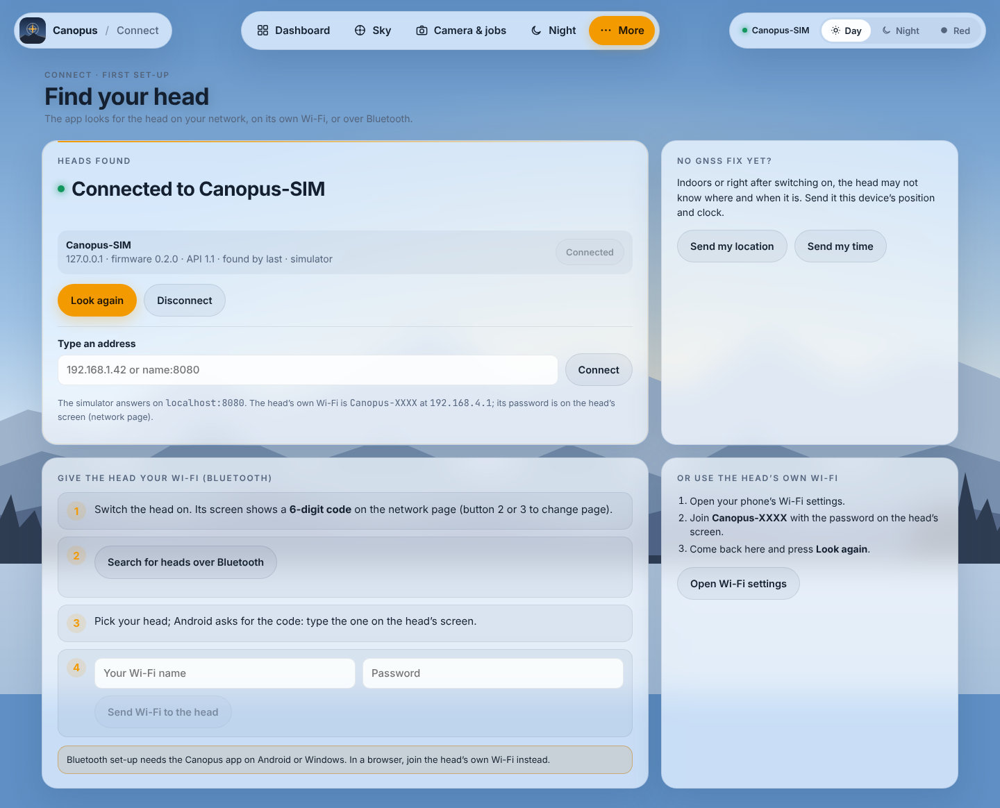

*The Connect screen (Day mode), connected to the simulator. Rendered from the app.*

**If the link drops.** Jobs that run on the head (moves with the shutter port) carry on, and the app shows how far they got when it reconnects. Jobs that shoot with the camera on USB-C pause at the next frame, with tracking kept, until the app is back.

**Day, Night and Red.** Every screen has a Day / Night / Red switch in the top bar. Red dims everything to deep red to keep your night vision.

**Try it without a head.** The release also holds the simulator (`StarTrackerSim.exe` on Windows). Start it on the PC, open Canopus, **More → Connect → Look again**, and connect to **Canopus-SIM**.

## Levelling

Level the tripod by eye or with its bubble before you start; the pointing model removes the small tilt that is left once you have three sync points.

1. Spread the tripod legs fully on firm ground and hang a bag from the centre hook if it has one.
2. Level the tripod top with its bubble, or use a levelling base under the head.
3. Screw the head (or the wedge) onto the tripod's 3/8"-16 screw.

- **Why it matters.** In alt-az the head turns about a vertical axis. A tilt of 1° moves go-tos by up to 1° until the pointing model has learned it (see *Pointing*).
- **The tilt watch.** The head's motion sensor watches for the tripod going over. If the head tilts more than 3° within half a second, every axis stops at once. Check the tripod before you carry on.
- **A bubble on the head itself** is *pending P1*.

## Alt-az set-up

For landscapes, panoramas and wide-field astro, leave the wedge at home and screw the head straight onto the tripod: it saves 0.62 kg and the head stands 30 mm lower.

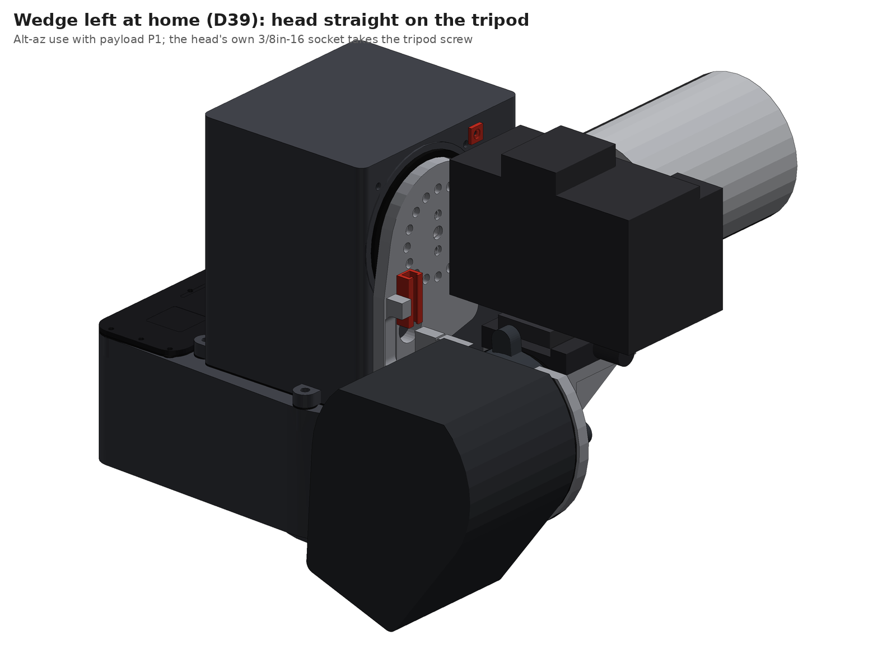

*Alt-az: the head straight on the tripod, wedge left at home (CAD render).*

1. Level the tripod (see *Levelling*) and screw the head on its 3/8"-16 socket.
2. Mount the camera on the Arca-Swiss clamp and balance it (see *Balance and the five payload types*).
3. In the app open **Rig**: pick the payload type, untick **wedge fitted**, set the mode to **Alt-az** and press **Save mounting**. On the head, page 4 shows the payload and "no wedge".
4. Make sure the head knows where and when it is (GNSS fix, or **Send my location** and **Send my time** in Connect).
5. Add two or three sync points (see *Pointing*). Then go-to and track.

**What moves in alt-az.** Azimuth and altitude follow the target. The field slowly turns in the frame; roll can turn the camera to cancel it (see *Tracking modes*). Alt-az tracking is calculated to stay within 5″ RMS over 5 minutes at 300 mm up to 60° altitude (*pending P1*).

## The wedge, latitude and polar alignment

For long lenses and long exposures, put the head on its wedge: the azimuth axis then points at the celestial pole, and the head tracks on that one axis like an equatorial mount.

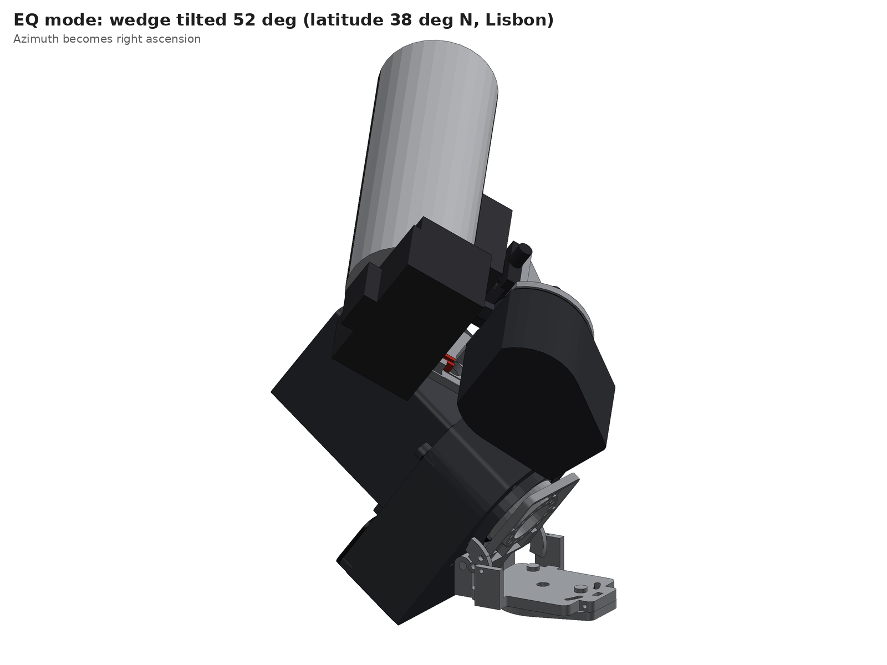

*EQ: the wedge tilts the azimuth axis up to the celestial pole (CAD render).*

**What changes on the wedge.** Azimuth becomes the hour-angle (polar) axis, altitude becomes declination, and roll only frames: there is no field rotation to cancel. Tracking on the wedge is calculated to stay within 3″ RMS over 5 minutes at 300 mm with PEC on and the polar axis within 2′ (*pending P1*).

**Fitting the wedge.** The head sits on two pins on the wedge's top plate and is held by one coin-slot screw from below.

1. Tilt the wedge to about 45° so you can reach under its top plate.
2. Stand the head on the two pins.
3. Turn the coin-slot screw up into the head's socket with a coin until it is firm.

It takes about a minute. Taking the wedge off is the same in reverse. Photos and the screw torque are *pending P1*.

**Setting the latitude.** The wedge tilts from 0° to 75°, for latitudes 15° to 90° north or south.

1. Loosen the two clamp knobs at the sides.
2. Tilt the wedge to your latitude (shown in the app's Rig screen). Turn the small latitude screw for the last part: one turn moves the tilt about 55′.
3. Tighten both knobs finger-tight.
4. In **Rig**: tick **Wedge fitted**, set the mode to **EQ (wedge)**, type the wedge tilt, press **Save mounting**.

Whether the wedge carries a latitude scale is *pending P1*.

**Polar alignment.** The app measures how far the polar axis is from the pole with three plate solves, and tells you how to correct it. It needs the camera on USB-C.

1. Point the polar axis roughly at the pole: north in the northern hemisphere, south in the southern.
2. In **Alignment**, press **Measure** and keep the tripod still. The head turns the polar axis to 0°, 30° and 60° and the app solves a frame at each.
3. The app shows the error in altitude as turns of the latitude screw, and in azimuth as which way to turn the head base or tripod.
4. Make the correction and press **Measure** again, until the error is within 2′. Then tighten the clamp knobs.

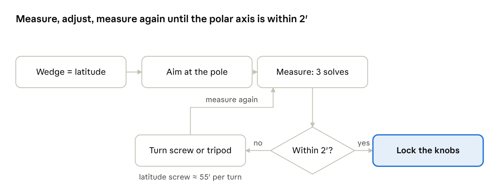

The wedge has no azimuth fine adjuster: turn the tripod, or a levelling base under the wedge, by the amount the app shows.

## Balance and the five payload types

Tell the head which of five payload types is closest to your kit: it sets its roll and altitude limits from that choice, so a long lens never swings into the tower or the tripod.

**Choosing the type.** In the app open **Rig** and tap the tile closest to your camera and lens, or on the head go to page 4 and press button 4 until the right type shows.

| Type | Stands for | Weight | Roll range (toward the tower / away) | Altitude cap without a pier extension |
| --- | --- | --- | --- | --- |
| P1 | Mirrorless body with a standard zoom, on an L-plate | 1.55 kg | +6° / −172° | none |
| P2 | Mirrorless with a 70–200 f/2.8, on its collar | 1.95 kg | +6° / −127° | none |
| P3 | Mirrorless with a 150–600 class zoom, on its foot | 3.75 kg | +5° / −147° | none |
| P4 | 72 mm refractor with an astro camera, on a dovetail | 2.70 kg | +12° / −147° | 65° without the wedge |
| P5 | 90 mm refractor at the full 7 kg, on a dovetail | 7.00 kg | +5° / −152° | 47° on the wedge, 38° without |

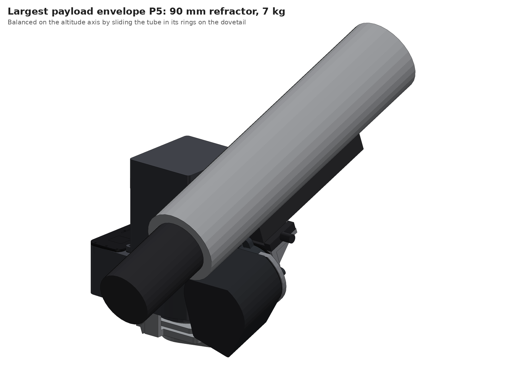

*Payload P5, a 90 mm refractor at the full 7 kg, balanced on the altitude axis (CAD render).*

- The roll ranges already keep 3° away from the hard stops. Near the horizon the head also keeps the lens clear of the tripod top, so the "away" range is shorter at low altitude. **Rig** shows the live limits for your payload and altitude.
- The altitude cap stops P4 and P5 from hanging into the tripod legs near the zenith. With a pier extension fitted, tick **Pier extension fitted** in Rig and the cap goes away.
- With the power off, every type stays put in altitude. In roll, P1 to P4 stay put at any angle; P5 only within ±43° of level, which is why the head turns roll to 0° before it parks or sleeps.

**Balancing.** Balance the payload on the altitude axis so the motor holds it with the least effort and it stays put with the power off.

1. With tracking off, slide the lens foot, L-plate or dovetail in the clamp until the camera stays level when you let go.
2. Tighten the clamp.
3. In **Rig** press **Run balance check**. The head rocks altitude ±5° and compares the motor load each way.
4. It answers **balanced**, **front-heavy: slide the payload back** or **rear-heavy: slide the payload forward**. Adjust and run it again.

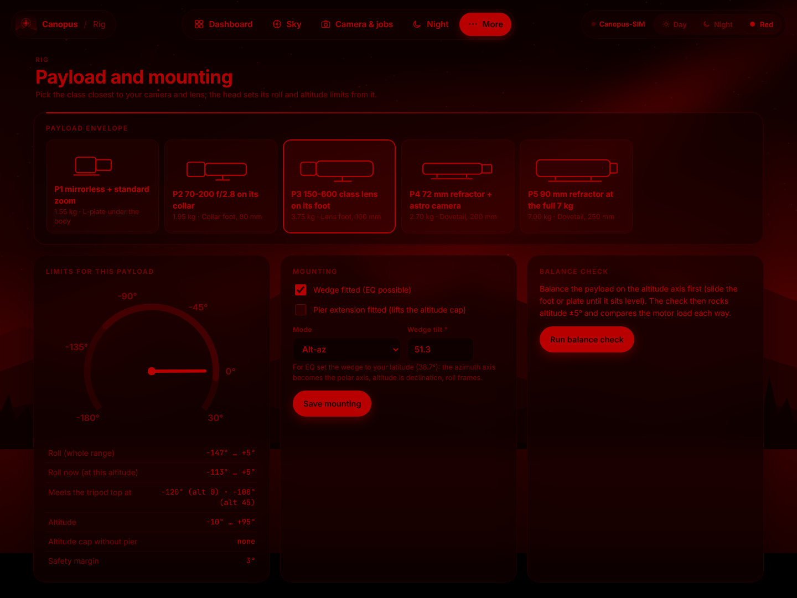

*The Rig screen (Red mode): payload types, live limits, mounting and the balance check. Rendered from the app against the simulator.*

Mounting a lens or telescope, with photos and clamp torque, is *pending P1*.

## Pointing: sync, plate solving and the pointing model

Each sync teaches the head where it really points; after three it corrects its own tilt, after six it fits all seven terms of its pointing model. Go-to is calculated to land within 2′ (2σ) after alignment, and within 20″ after one plate-solve correction (*pending P1*).

**Going to a target.** Open **Sky**: search the built-in catalogue (116 named stars, 109 Messier objects, 430 NGC/IC objects, the planets), or type RA/Dec (J2000) or azimuth/altitude, or pick the Sun or the Moon. The head slews at up to 8°/s and then tracks. With a heavy load it slows its slews by itself. The hold-to-jog pad moves any axis at four speeds.

**Aligning.** Open **Alignment**. It suggests three bright stars spread around the sky.

1. Press **Go to** next to the first star.
2. Centre it with the arrows on **Sky**, then come back and press **Centred: sync**. With the camera on USB-C you can use **Shoot, solve and sync** instead.
3. Do the same for the other two stars. **Pick other stars** offers new ones if one is behind a tree. If no bright star is between 25° and 75° up, use plate-solve syncs.

No camera on USB-C? Solve a frame in any solver (ASTAP, astrometry.net) and type its RA and Dec under **Plate-solve sync**, then press **Sync to this**.

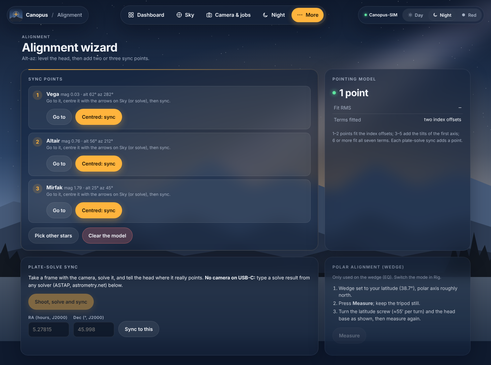

*The Alignment screen (Night mode): suggested stars, the pointing model, plate-solve sync and polar alignment.*

**What the model learns.**

| Sync points | What the head corrects |
| --- | --- |
| 1–2 | The two index offsets (where each axis's zero really is) |
| 3–5 | Also the two tilts of the first axis (the tripod not quite level, or polar error) |
| 6 or more | All seven terms: index ×2, collimation, axis non-perpendicularity, tilts ×2 and tube flexure |

Alignment shows the number of points and the fit RMS. Every plate-solve sync during the night adds a point. **Clear the model** starts again (do it after moving the tripod).

**Plate solving.** The solver runs offline in the app; no internet is needed.

- Wide fields (short lenses) solve with the built-in solver on both platforms.
- For 300–600 mm, Android uses a deeper star catalogue (stars to about magnitude 10.5). On Windows, install ASTAP once (Settings); for frames narrower than 7.5° (about 275 mm and longer on full frame) ASTAP is tried first.

**Refraction.** The head corrects for the atmosphere's bending near the horizon using pressure and temperature (1010 hPa and 10 °C unless you set them in **Settings**).

## Tracking modes and field rotation with the roll axis

The head tracks stars, the Moon or the Sun; in alt-az it can also turn the camera with roll so the stars keep their angle in the frame through a long sequence.

**Starting and stopping.** A go-to to a star, object, the Sun or the Moon starts tracking by itself. A go-to to an azimuth/altitude position holds still. Otherwise press **Track** on **Sky**, or button 4 on the head's page 1 ("track here"). If you jog the head while it tracks, it carries on tracking from the new position.

**Rates.** On **Sky**, under Tracking:

| Button | Rate | Use |
| --- | --- | --- |
| Stars | Sidereal | Stars, nebulae, galaxies |
| Moon | Follows the Moon's own motion | The Moon |
| Sun | Follows the Sun's own motion | The Sun, eclipses (always with a proper solar filter) |
| King | King rate, slightly slower than sidereal | Stars, with an allowance for the atmosphere (the standard King rate) |

**Field rotation in alt-az.** On an alt-az head the sky slowly turns in the frame as a target crosses the sky; long sequences show it as trails in the corners or a rotated stack. Roll can cancel it.

1. Open **Roll** and tick **Keep the field angle while tracking (alt-az)**.
2. **Hold the angle it has now** keeps the current framing. Or set a position angle under **Frame by position angle** (0° is north up, or type your own) and press **Turn to it**.
3. **Turn roll** turns the camera by hand: **Level (0°)**, **−15°**, **+15°**.

Roll stops at your payload's limit and reports it ("roll limit for P3 …"). Over a long night, plan the framing so the needed roll stays inside the limits shown in Rig.

**On the wedge** there is no field rotation: the option is greyed out and roll only frames.

**Guiding.** Sky has guide-pulse buttons (north, south, east, west) while tracking. Autoguiding software can send the same pulses through Alpaca (see *Alpaca and LX200*).

**Parking.** **Park** on Sky, or button 4 on the head's page 2. The head turns roll to 0° first, then goes to its park position. Unpark the same way.

## Encoder calibration and PEC training

Calibrate each axis's encoder once per head; train PEC on the axis that tracks when you want the smoothest long exposures. Both results are stored on the head and survive a restart.

**Why the head has encoders.** Each axis has a magnetic encoder on its output. At switch-on it tells the head exactly where every axis is, five times a second it takes out the small play at reversals (about 12–26″), and it catches a slipped axis. New encoders are about ±250″ out of true, so each one is mapped once.

**Encoder calibration (once per head, about 15 minutes per axis or less).**

1. Take the payload off, level the head, and make sure nothing is in the way: azimuth makes a full turn.
2. In the app open **Health → Encoder calibration**. Pick the axis. Leave the speed at 0.5 °/s.
3. Press **Start calibration**. The head turns that axis slowly over its whole travel, using its gears as the reference.
4. When it finishes, it shows how far out the encoder was and what is left after the map. Press **Apply the map** to keep it, or **Abort** to keep the old one.
5. Repeat for the other two axes.

At 0.5 °/s the full azimuth turn takes 12 minutes; altitude (105° of travel) takes about 3½ minutes. Health also shows, per axis, whether it is calibrated and how far the encoder and the commanded angle differ.

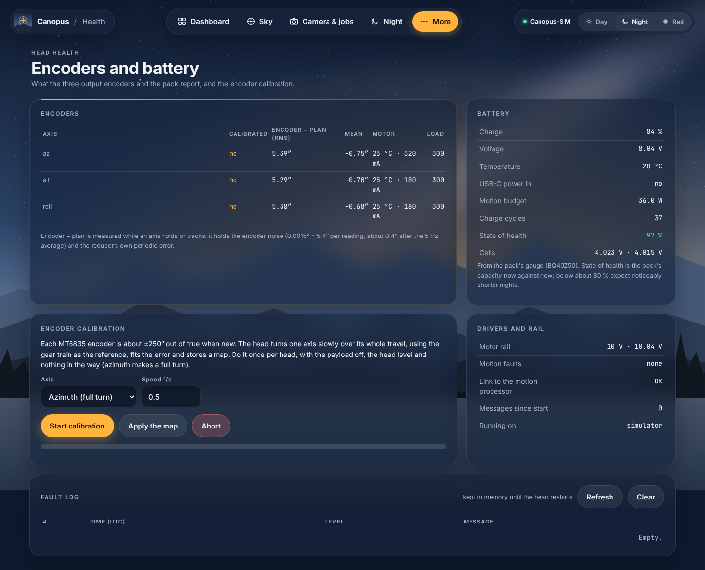

*The Health screen (Night mode): encoders, calibration, battery, drivers and the fault log.*

**PEC training (periodic error correction).** The strain-wave gear and the belt pulleys repeat a small error with every turn of the gear's input, once every 14.4 minutes at the sidereal rate. PEC learns it and plays the opposite back while tracking, on top of the encoder correction.

1. Go to a star near the meridian and the celestial equator and start tracking (**Sky**).
2. Open **PEC**. Pick the axis (on the wedge: **Azimuth / polar**) and the number of cycles (1–10; one cycle is about 14 minutes; 2 is the default).
3. Press **Record** and leave the head alone. The status shows the cycle it is on. If tracking stops, recording stops too.
4. When it says **Ready to play**, press **Play**. The chart shows the learned error.
5. Press **Save** to keep it after a restart. **Clear** deletes it.

How much PEC improves tracking on the real gears is *pending P1*: in the simulator the encoder loop already removed most of the error, leaving about 1.3″ peak to peak for PEC.

## Camera control (USB and shutter port) and jobs

The head moves and the app shoots: a job is a list of moves on the head and exposures from the camera. Jobs fired through the head's shutter port run on the head alone, so your phone can sleep or leave Wi-Fi.

**Two ways to fire the camera.**

| Trigger | How | Good for |
| --- | --- | --- |
| Camera on USB-C (Sony) | USB-C cable from the camera to the phone or PC; camera set to **PC Remote** | Live view, camera settings, exposure ramping, HDR, focus stacks; pictures downloaded to the app |
| Head's shutter port | 2.5 mm cable from the head's shutter socket to the camera's remote socket | Any camera with a wired remote; runs with no phone at all |

The head's USB-C port B can also power the camera (5 or 9 V, up to 27 W) with a suitable cable.

**Connecting a Sony on USB-C.** Set the camera to **PC Remote**, plug it in and, on Android, tap **OK** when Android offers to open Canopus. Then open **Camera & jobs** and press **Connect camera**. On Windows the camera connects through the same screen.

**The eight jobs.** Open **Camera & jobs**, pick the trigger (**Camera on USB-C** or **Head's shutter port**), set the lens and sensor, choose a job and press **Start**.

| Job | What it does | Main settings | Needs USB-C |
| --- | --- | --- | --- |
| Time-lapse | Shoots at a fixed interval, head still or tracking | Frames (0 = endless), exposure, interval, delay | No |
| Panorama | The head steps through a grid of positions and shoots at each | Azimuth and altitude range, overlap, exposure, settle time, portrait | No |
| Path-lapse | The head glides through positions you set while shooting a time-lapse | Keys (move with Sky's arrows, then **Add the head's position as a key**), frames, interval, exposure | No |
| Astro sequence | Tracked exposures, moving the frame a few pixels every few frames (dither) | Frames, exposure, gap, dither in pixels, dither every N frames | No |
| Star trails | Tracking off, a long run of exposures; with USB-C the app builds the blend live | Frames, exposure, gap | No |
| Holy Grail | Day-to-night exposure ramping from the camera's meter; the head can hold, track or glide | Frames, interval, longest shutter, ISO range, how much darker the night is | Yes |
| HDR | A bracket of exposures from the camera | Shots, EV step | Yes |
| Focus stack | Steps the lens focus between shots | Shots, step size, steps per shot | Yes |

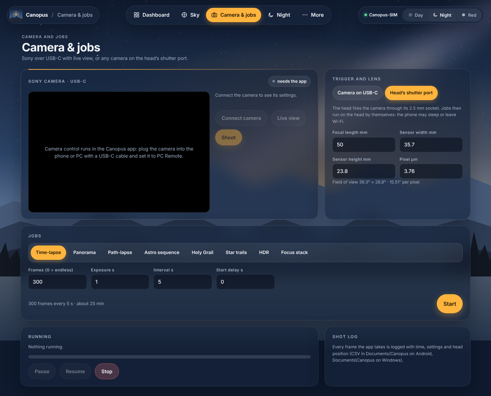

*Camera & jobs (Night mode): camera, trigger and lens, the job planners and the running job.*

Before anything moves, every position in a job is checked against your payload's limits; a job with a position outside them is refused. Start tracking on the target (**Sky**) before an astro sequence.

**While a job runs.** The running card shows the frame, the time left and the state. **Pause**, **Resume** and **Stop** work at any time. On Android, a notification keeps the job alive with the screen off.

**If the app goes quiet (USB-C jobs).** At each frame the head waits for the app to say the picture is taken. If no answer comes in time, the head pauses the job, keeps tracking and logs "job paused: no reply from the app …". It never moves on blind. Reconnect and press **Resume**.

**Head-only intervalometer.** The head's own web page (http://192.168.4.1) can also start the intervalometer on the shutter port.

**Where the files go.** Pictures downloaded from the camera: Pictures/Canopus on Android, Pictures\\Canopus on Windows (**Gallery** shows them by night). Every frame is logged with time, settings and head position in a shot log (CSV) in Documents/Canopus (Android) or Documents\\Canopus (Windows).

## Alpaca and LX200 for third-party software

The head itself is an ASCOM Alpaca telescope and rotator and an LX200 mount, so planetarium and capture programs connect straight to it over Wi-Fi, with no driver to install.

| Protocol | Address | What it offers | Programs |
| --- | --- | --- | --- |
| ASCOM Alpaca | Port 32323 (also 80); found by Alpaca discovery | Telescope **Canopus head** and Rotator **Canopus roll axis** | N.I.N.A. and other Alpaca clients |
| LX200 | TCP port 4030 | Position, go-to, sync, stop, move, guide, site and time | Stellarium (Telescope control → Meade LX200 → TCP) and other LX200 clients |

**N.I.N.A. (Alpaca).**

1. Join the head's Wi-Fi (or your own network after Bluetooth set-up).
2. In N.I.N.A. open **Equipment → Telescope**, pick the Alpaca device **Canopus head** from the discovered list and connect.
3. For field de-rotation in alt-az, connect **Canopus roll axis** under **Rotator**.

**Stellarium (LX200).** Open **Telescope control**, add a telescope, choose **Meade LX200** over **TCP**, host 192.168.4.1 (or the head's address on page 3), port **4030**.

**Good to know.**

- Positions over Alpaca and LX200 are in the coordinates of the date (JNow), as most programs expect.
- Alpaca reports the mount as alt-az or polar (on the wedge) from the mode set in Rig.
- Roll is the Rotator, not a third telescope axis.
- A slew requested and waited for returns when the slew has finished.
- Not offered (allowed for this kind of mount): side of pier, find home, sync in alt/az, aperture and focal length.
- Pulse guiding works over Alpaca at the guide rate set in **Settings**.

N.I.N.A. and Stellarium have been tried against the simulator's protocol tests only; connecting them to a real head is *pending P1*.

## Updates and recovery

One update file updates both processors in the head, and the head goes back to its previous firmware by itself if anything fails.

**Normal update (from the app).**

1. Get **canopus-update.stfw** from the project's GitHub page: **Actions → Firmware and apps →** the newest run → **canopus-release**.
2. Keep the head on power: USB-C on port A, or a charged pack.
3. In the app open **Firmware** (under **More**), pick the file. The app checks every part of it before anything is sent.
4. Press **Update the head**. A bar shows the upload. The head restarts, updates its motion processor and checks that it answers.
5. The app waits and shows the new version when the head is back.

**Without the app.** Open http://192.168.4.1 (or the head's address) in a browser, go to **Update**, pick **canopus-update.stfw** and click **Update the head**.

**If an update fails.** The head keeps two copies of its main firmware and a last good copy of the motion firmware. If the new firmware does not start, or the motion processor does not answer after the update, the head goes back to the previous versions by itself. The **Firmware** screen shows which copy is running and whether a roll-back is possible.

**Recovery with the web flasher.** If the head will not start at all, its USB loader always still works:

1. From the same GitHub release, double-click **web-flasher.html**; it opens in Chrome or Edge.
2. Connect port A to the computer with a USB-C cable. Click **Connect to the head** and pick the new serial port.
3. Under "Load a complete image" click **Choose file**, pick **st-esp32s3-system-full.bin** and click **Write complete image**.
4. When the bar is full the head restarts and rewrites its motion processor by itself.

Your settings, PEC tables, encoder maps and fault log are stored apart from the firmware. Whether they survive a full recovery write is *pending P1*.

## Every fault and warning the head can show, with what to do

The newest message shows on line 7 of the head's screen and in the app's Dashboard; every message also goes into the fault log (the newest 64, kept after a restart). The status light turns red while a motion fault is active (second table) or the link inside the head is lost.

**Where to look.** **Dashboard → Messages** shows the latest six. **Health → fault log** shows all of them with time and level; **Clear** empties it. After a fault the head runs its self-test again before it moves.

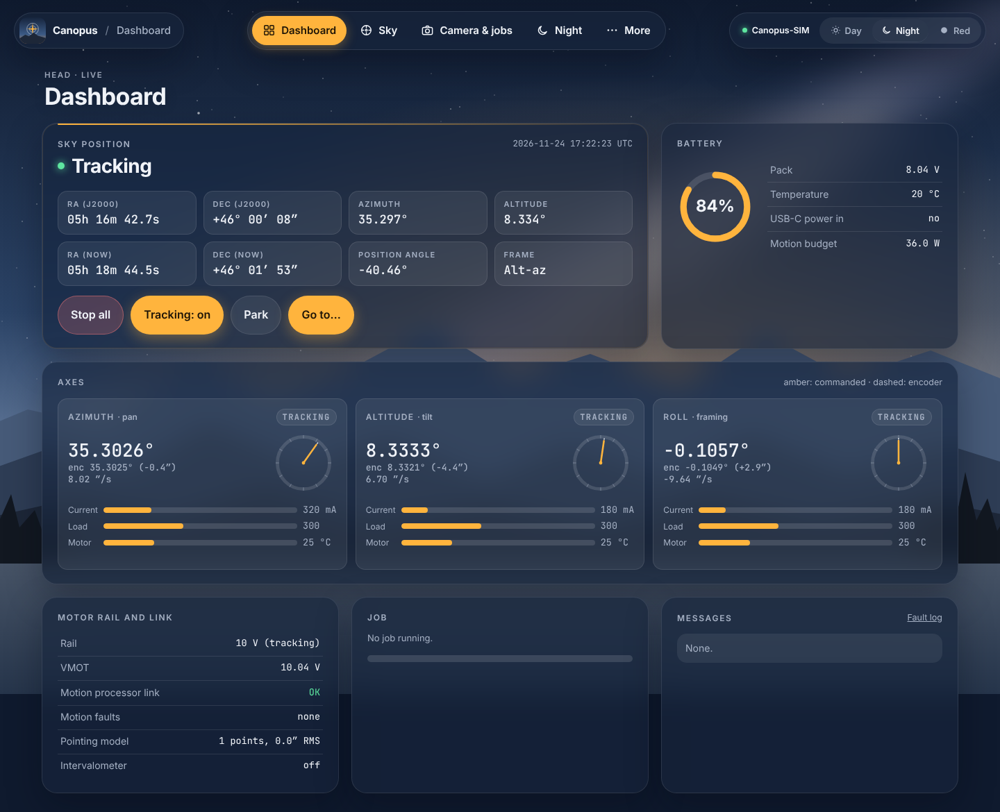

*The Dashboard (Night mode): axes, battery, motor supply, motion faults and messages.*

**Messages.** *Axis* is azimuth, altitude or roll.

| Message | Level | What happened | What to do |
| --- | --- | --- | --- |
| tracking stopped: altitude limit *N* | Warning | The target went below −10°, above 95°, or above your payload's altitude cap | Pick another target. For P4/P5 near the zenith, fit a pier extension and tick it in Rig |
| tracking stopped: roll limit for *payload* | Warning | De-rotation or framing needed more roll than your payload allows | Reframe (Roll), or check the payload type in Rig |
| *axis*: soft limit reached | Warning | The axis stopped at its limit | Move back the other way; check the payload type |
| *axis*: stall (StallGuard), backed off 1 deg | Fault | The motor met too much resistance in a fast move; it stopped, backed off 1° and slows its slews from now on | Look for a snagged cable or an obstruction; check balance and that the load is under 7 kg |
| *axis*: slip of *N* arcsec, re-synced from the encoder | Fault | The axis was more than 0.05° from where it should be (a knock, wind, or a load out of balance); the head took its true position from the encoder | Check balance and the clamp; plate-solve and sync if pointing is off |
| *axis* motor at *T* C: current lowered | Warning | The motor passed 80 °C; the head lowered its current. At 95 °C the axis stops | Let it cool; shade the head in the sun; check balance |
| motion fault 0x… (*axis*) | Fault | The motion processor set a fault bit; the Dashboard names it under **Motion faults** (table below) | See the table below |
| battery low: parking | Warning | The pack is at 5 % or 6.2 V: the head finishes the exposure, parks and sleeps | Charge, or swap the pack |
| PEC recording stopped: tracking was turned off | Warning | Tracking stopped during PEC training | Start tracking and record again |
| job paused: no reply from the app within *N* s: paused, tracking kept | Warning | A USB-camera job did not hear from the app | Reconnect the app and press **Resume** |

**Motion faults (Dashboard → Motion faults).**

| Name | What it means | What to do |
| --- | --- | --- |
| link lost | The two processors in the head stopped talking. Fast moves stop; tracking carries on for 60 s, then stops | Wait a moment; if it stays, switch the head off and on |
| VMOT low / VMOT high | The motor supply is outside its range; moving axes stop | Charge or swap the pack, or try another charger |
| driver UART | A motor driver is not answering | Restart the head; if it comes back, note the axis (Health) |
| driver over-temp / driver short | A motor driver protected itself | Switch off, let it cool, check the cartridge plug; contact support if it repeats |
| encoder | An encoder reading is bad | Restart; run the encoder calibration again; check the cartridge plug |
| motor over-temp | A motor reached 95 °C and its axis stopped | Let it cool; check balance |
| slip / stall / limit | As in the messages above | As above |
| setpoint stale | The motion processor has no fresh tracking command | Usually clears by itself; restart if it stays |
| tip-over | The head tilted more than 3° within half a second; every axis stopped | Check the tripod and level it again before you carry on |
| watchdog | The motion processor restarted itself | Check the axes are where they should be (go-to a star); report it if it repeats |
| power budget | Not enough power for the move | Charge or swap the pack; the head slows slews and may lower camera power |

**When a job ends early.** The job card shows the reason: *frame N: altitude/roll limit* (a position outside the limits), *head fault during the move*, *head parked*, *paused by the app* or *stopped by the app*.

**When a command is refused.** The app shows the head's answer: *limit* (outside the payload's limits), *parked* (unpark first), *invalid* (a value out of range), *state* (not possible right now, for example a guide pulse while not tracking) or *notimpl* (not available on this head).

## Limits and specifications

Figures are from the design calculations and the CAD of the first prototype; each will be measured on P1 (*pending P1*).

| Item | Value |
| --- | --- |
| Axes | Azimuth, altitude, roll; strain-wave gear with a 3:1 belt on each (about 300:1), magnetic encoder on every output |
| Payload | Up to 7 kg, in five payload types (P1–P5) |
| Weight (prototype) | Head 6.21 kg, wedge 0.62 kg, together 6.83 kg. Production target: head ≤ 5.1 kg, with wedge ≤ 5.75 kg |
| Azimuth range | Unlimited (no cable stop) |
| Altitude range | −10° to +95° |
| Roll range | Per payload type, from +12° / −147° (P4) to +6° / −172° (P1) |
| Wedge | Tilt 0–75° (latitudes 15–90° N and S); latitude screw about 55′ per turn; removable |
| Slew speed | Up to 8°/s from −20 to +40 °C |
| Tracking, EQ on the wedge | ≤ 3″ RMS over 5 min (calculated 2.2″) at 300 mm, PEC on, polar error ≤ 2′, wind ≤ 3 m/s |
| Tracking, alt-az | ≤ 5″ RMS over 5 min (calculated 2.7″), altitude ≤ 60° |
| Go-to | ≤ 2′ (2σ) after alignment; ≤ 20″ after one plate-solve correction |
| Settling after a slew | ≤ 2 s to within 2″ |
| Play at reversals | ≤ 10″ with encoder correction |
| Operating temperature | −20 to +40 °C |
| Water | IPX4 on the prototype, IPX6 in production |
| Battery | 2S2P Molicel P50B 21700, 7.2 V, about 10 Ah, about 72 Wh; tool-free swap; gauge on the pack |
| USB-C port A | Power in and charging, USB PD 5–20 V, up to 45 W; USB data for updates |
| USB-C port B | Camera power out, 5 V or 9 V at 3 A (27 W) |
| Shutter port | 2.5 mm jack, isolated focus and shutter |
| Wireless | Wi-Fi 2.4 GHz (own network or joins yours); Bluetooth LE for set-up |
| Protocols | ASCOM Alpaca Telescope + Rotator (port 32323 and 80, discovery UDP 32227), LX200 (TCP 4030), WebSocket for the apps |
| On the head | 1.3″ OLED (128 × 64), 4 buttons, status light with red night mode |
| Sensors | GNSS position and time, motion sensor (tilt watch), magnetometer, clock with a backup cell (about three months) |
| Camera side | Arca-Swiss clamp, 60 mm |
| Tripod side | 3/8"-16 socket (on the head and on the wedge) |
| Tools for service | 2, 2.5 and 3 mm hex keys; M3, M4, M5 screws only; each axis is a cartridge held by 4 screws and one plug |
| Apps | Android 10 or later; Windows 10/11, 64-bit |

## Care in cold, dew and rain

The head is built for cold, damp nights: it runs from −20 to +40 °C, and the prototype is splash-proof (IPX4); production heads will take water jets (IPX6).

**Cold.**

- The head keeps its full 8°/s slew speed down to −20 °C.
- The battery runs for less time: about 7 hours of alt-az tracking at −20 °C against 25 hours at 20 °C.
- The pack does not charge below 0 °C and charges slowly below 10 °C. Warm it up before charging.
- Plan longer nights with a spare pack.

**Dew.** The head has no heater. The **Night** screen shows the dew forecast for your site (it needs an internet connection; everything else in the app works offline). Wipe the screen window dry with a soft cloth after a damp night.

**Rain and splashes.**

|  | Prototype (IPX4) | Production (IPX6) |
| --- | --- | --- |
| Rated for | Splashing water from any direction | Powerful water jets from any direction |
| USB-C sockets | Not sealed: keep them out of the rain and covered | Sealed |

- Joints face down or sideways and the body has a drip edge, so water runs off.
- Do not open the battery door or covers while the head is wet. Let it dry before you store it.

**Heat and sun.** In a hot car or full sun the inside warms up: above 35 °C inside, the head charges more slowly, and a motor above 80 °C runs at lower current. Shade the head on hot days.

**Packing up.** Park the head before you switch it off: roll goes to 0° first, so a heavy payload cannot swing. Cleaning, storage charge and the full care schedule are in the maintenance guide (*pending P1*).

## Pending P1: every placeholder in one table

22 items in this guide wait for the first built prototype (P1) or for Phase 8 packaging.

| # | Chapter | What is missing | Comes from |
| --- | --- | --- | --- |
| 1 | What is in the box | Final contents, number and length of USB-C cables | Phase 8 packaging |
| 2 | What is in the box | Camera end of the shutter cable | P1, camera tests |
| 3 | What is in the box | Quick-start card with the QR code | Phase 8 packaging |
| 4 | Controls | Order of buttons 1–4 on the front panel; photo of the panel | P1 build |
| 5 | Charging | Time to full charge | P1 measurement |
| 6 | Charging | Photo of the pack's button and gauge lights | P1 build |
| 7 | Charging | Measured runtimes (the table is calculated) | P1 measurement |
| 8 | Charging | Swapping the pack: steps and photos | P1 build |
| 9 | First start | How the head switches on and off | P1 build and firmware |
| 10 | Levelling | Whether the head has its own bubble | P1 build |
| 11 | Alt-az set-up | Measured alt-az tracking accuracy | P1 measurement |
| 12 | Wedge | Measured EQ tracking accuracy | P1 measurement |
| 13 | Wedge | Fitting the wedge: photos and coin-screw torque | P1 build |
| 14 | Wedge | Latitude scale on the wedge | P1 build |
| 15 | Balance | Mounting a lens or telescope: photos and clamp torque | P1 build |
| 16 | Pointing | Measured go-to accuracy | P1 measurement |
| 17 | PEC | How much PEC improves tracking on real gears | P1 measurement |
| 18 | Alpaca and LX200 | N.I.N.A. and Stellarium on a real head | P1 test |
| 19 | Updates | Whether settings, PEC tables and encoder maps survive a full recovery write | P1 test |
| 20 | Specifications | Every figure measured on P1 (weights, speeds, accuracy, runtimes) | P1 measurement |
| 21 | Care | Cleaning, storage charge and the care schedule (maintenance guide) | Full Phase 9, after P1 |
| 22 | Whole guide | Photos of the real head (CAD renders stand in for now) | P1 build |
