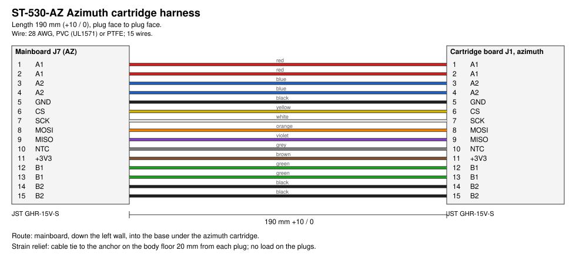
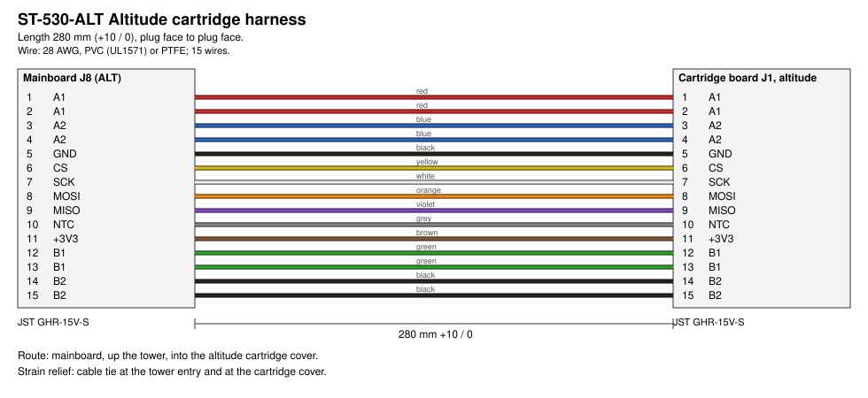
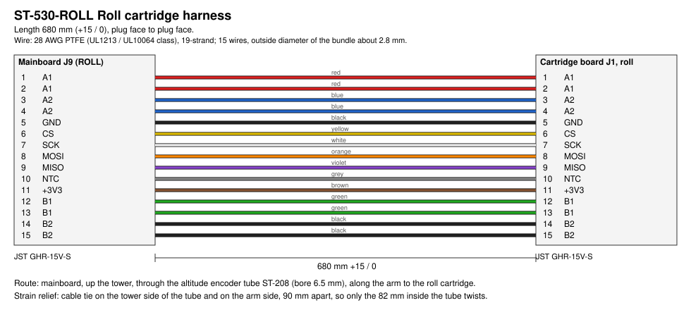
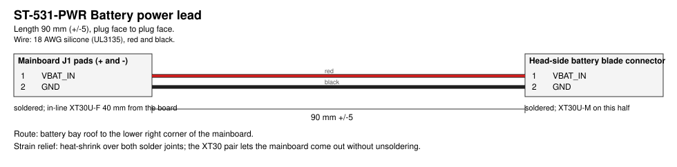
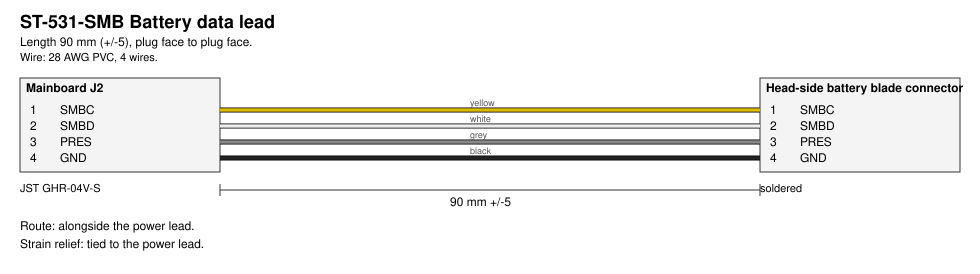
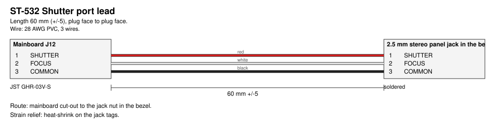

# Wiring harnesses

Generated by `harness.py`; edit the data there, not this file. Lengths of the three cartridge harnesses are measured
along the cable route in the Phase 3 CAD model; the three short leads are estimates to confirm on the first build.
Every plug is drawn with pin 1 at the top. Cartridge harnesses are wired 1:1 (pin 1 to pin 1).

## ST-530-AZ  Azimuth cartridge harness

- **Length:** 190 mm (+10 / 0)
- **Wire:** 28 AWG, PVC (UL1571) or PTFE; 15 wires
- **End A:** Mainboard J7 (AZ): JST GHR-15V-S
- **End B:** Cartridge board J1, azimuth: JST GHR-15V-S
- **Route:** mainboard, down the left wall, into the base under the azimuth cartridge
- **Strain relief:** cable tie to the anchor on the body floor 20 mm from each plug; no load on the plugs
- Fixed parts at both ends: no twist allowance needed.

| Pin (both ends) | Signal | What it does | Wire colour |
|---|---|---|---|
| 1 | A1 | motor phase A, start | red |
| 2 | A1 | second contact, same wire pair | red |
| 3 | A2 | motor phase A, end | blue |
| 4 | A2 | second contact | blue |
| 5 | GND | ground, also the shield between motor and SPI wires | black |
| 6 | CS | encoder chip select | yellow |
| 7 | SCK | encoder SPI clock | white |
| 8 | MOSI | encoder SPI data in | orange |
| 9 | MISO | encoder SPI data out | violet |
| 10 | NTC | motor thermistor | grey |
| 11 | +3V3 | encoder supply | brown |
| 12 | B1 | motor phase B, start | green |
| 13 | B1 | second contact | green |
| 14 | B2 | motor phase B, end | black |
| 15 | B2 | second contact | black |

## ST-530-ALT  Altitude cartridge harness

- **Length:** 280 mm (+10 / 0)
- **Wire:** 28 AWG, PVC (UL1571) or PTFE; 15 wires
- **End A:** Mainboard J8 (ALT): JST GHR-15V-S
- **End B:** Cartridge board J1, altitude: JST GHR-15V-S
- **Route:** mainboard, up the tower, into the altitude cartridge cover
- **Strain relief:** cable tie at the tower entry and at the cartridge cover
- A ready-made 305 mm lead set fits with 25 mm to spare.

| Pin (both ends) | Signal | What it does | Wire colour |
|---|---|---|---|
| 1 | A1 | motor phase A, start | red |
| 2 | A1 | second contact, same wire pair | red |
| 3 | A2 | motor phase A, end | blue |
| 4 | A2 | second contact | blue |
| 5 | GND | ground, also the shield between motor and SPI wires | black |
| 6 | CS | encoder chip select | yellow |
| 7 | SCK | encoder SPI clock | white |
| 8 | MOSI | encoder SPI data in | orange |
| 9 | MISO | encoder SPI data out | violet |
| 10 | NTC | motor thermistor | grey |
| 11 | +3V3 | encoder supply | brown |
| 12 | B1 | motor phase B, start | green |
| 13 | B1 | second contact | green |
| 14 | B2 | motor phase B, end | black |
| 15 | B2 | second contact | black |

## ST-530-ROLL  Roll cartridge harness

- **Length:** 680 mm (+15 / 0)
- **Wire:** 28 AWG PTFE (UL1213 / UL10064 class), 19-strand; 15 wires, outside diameter of the bundle about 2.8 mm
- **End A:** Mainboard J9 (ROLL): JST GHR-15V-S
- **End B:** Cartridge board J1, roll: JST GHR-15V-S
- **Route:** mainboard, up the tower, through the altitude encoder tube ST-208 (bore 6.5 mm), along the arm to the roll cartridge
- **Strain relief:** cable tie on the tower side of the tube and on the arm side, 90 mm apart, so only the 82 mm inside the tube twists
- Twist: the bundle turns +/-52.5 deg over 82 mm. Strand stretch = L (sqrt(1 + (r theta / L)^2) - 1) = 0.010 mm: negligible, but lay the 15 wires straight (not plaited) inside the tube and leave 5 mm of slack.
- PTFE insulation because the bundle slides on the tube wall at every altitude move; PVC would wear and stick.
- Longer than any ready-made lead (305 mm), so this one is crimped by hand or ordered from a cable maker.

| Pin (both ends) | Signal | What it does | Wire colour |
|---|---|---|---|
| 1 | A1 | motor phase A, start | red |
| 2 | A1 | second contact, same wire pair | red |
| 3 | A2 | motor phase A, end | blue |
| 4 | A2 | second contact | blue |
| 5 | GND | ground, also the shield between motor and SPI wires | black |
| 6 | CS | encoder chip select | yellow |
| 7 | SCK | encoder SPI clock | white |
| 8 | MOSI | encoder SPI data in | orange |
| 9 | MISO | encoder SPI data out | violet |
| 10 | NTC | motor thermistor | grey |
| 11 | +3V3 | encoder supply | brown |
| 12 | B1 | motor phase B, start | green |
| 13 | B1 | second contact | green |
| 14 | B2 | motor phase B, end | black |
| 15 | B2 | second contact | black |

## ST-531-PWR  Battery power lead

- **Length:** 90 mm (+/-5)
- **Wire:** 18 AWG silicone (UL3135), red and black
- **End A:** Mainboard J1 pads (+ and -): soldered; in-line XT30U-F 40 mm from the board
- **End B:** Head-side battery blade connector ST-609, P+ and P-: soldered; XT30U-M on this half
- **Route:** battery bay roof to the lower right corner of the mainboard
- **Strain relief:** heat-shrink over both solder joints; the XT30 pair lets the mainboard come out without unsoldering
- Carries up to 6 A (blade connector limit). 18 AWG: 21 mohm per metre, 0.011 V drop over 2 x 90 mm at 6 A.

| Pin (both ends) | Signal | What it does | Wire colour |
|---|---|---|---|
| 1 | VBAT_IN | pack +, pad marked + | red |
| 2 | GND | pack - | black |

## ST-531-SMB  Battery data lead

- **Length:** 90 mm (+/-5)
- **Wire:** 28 AWG PVC, 4 wires
- **End A:** Mainboard J2: JST GHR-04V-S
- **End B:** Head-side battery blade connector ST-609, signal blades: soldered
- **Route:** alongside the power lead
- **Strain relief:** tied to the power lead
- Half of a ready-made 4-way GH lead: cut in two and solder the free ends to the blade connector.

| Pin (both ends) | Signal | What it does | Wire colour |
|---|---|---|---|
| 1 | SMBC | pack SMBus clock | yellow |
| 2 | SMBD | pack SMBus data | white |
| 3 | PRES | pack-present, pulled to ground inside the pack | grey |
| 4 | GND | signal ground | black |

## ST-532  Shutter port lead

- **Length:** 60 mm (+/-5)
- **Wire:** 28 AWG PVC, 3 wires
- **End A:** Mainboard J12: JST GHR-03V-S
- **End B:** 2.5 mm stereo panel jack in the bezel: soldered
- **Route:** mainboard cut-out to the jack nut in the bezel
- **Strain relief:** heat-shrink on the jack tags
- The jack is isolated from the head's ground by the two optocouplers; do not join COMMON to the chassis.

| Pin (both ends) | Signal | What it does | Wire colour |
|---|---|---|---|
| 1 | SHUTTER | jack tip | red |
| 2 | FOCUS | jack ring | white |
| 3 | COMMON | jack sleeve | black |

## Motor leads (JST-PH 4-way to cartridge board J2)

Cut the motor's own leads to 80 mm, crimp JST SPH-002T-P0.5S contacts and push them into a PHR-4 housing in this order.
The two motor types have different colours for the same phase, so follow the table for the motor in hand.

**Altitude and roll: 17HE15-1504S (38 mm)**

| J2 pin | Phase | Motor lead colour |
|---|---|---|
| 1 | A1 | black (A+) |
| 2 | A2 | blue (A-) |
| 3 | B1 | green (B+) |
| 4 | B2 | red (B-) |

**Azimuth: 17HS19-2004S1 (48 mm)**

| J2 pin | Phase | Motor lead colour |
|---|---|---|
| 1 | A1 | black (A+) |
| 2 | A2 | green (A-) |
| 3 | B1 | red (B+) |
| 4 | B2 | blue (B-) |

If an axis runs backwards, swap nothing: direction is a firmware setting per axis.

## Motor thermistor (D46)

10 k B3950 bead on two 100 mm leads. Glue the bead to the motor body next to the lead exit with thermal epoxy, run the
leads with the motor leads and solder them to the two pads marked NTC on the underside of the cartridge board.
Polarity does not matter.

## Purchase list

| Item | Qty | Use | Maker | Part |
|---|---|---|---|---|
| JST GHR-15V-S housing | 6 | 2 per cartridge harness | JST | GHR-15V-S |
| JST GH pre-crimped lead, 28 AWG, 305 mm, socket to socket | 30 | azimuth and altitude harness: 15 each | JST | AGHGH28K305 |
| JST GH crimp contact (for the roll harness) | 40 | 30 needed + spares | JST | SSHL-002T-P0.2 |
| PTFE hook-up wire 28 AWG, 19-strand, 10 colours | 12 | metres; roll harness 15 x 0.68 m | generic | UL1213 28 AWG |
| JST GHR-04V-S lead, 4-way, ready-made 150 mm | 1 | battery data lead (cut in two) | JST | GHR-04V-S |
| JST GHR-03V-S lead, 3-way, ready-made 150 mm | 1 | shutter lead (cut in two) | JST | GHR-03V-S |
| JST PHR-4 housing | 3 | motor plug | JST | PHR-4 |
| JST PH crimp contact | 20 | 12 needed + spares | JST | SPH-002T-P0.5S |
| XT30U-F and XT30U-M pair | 1 | battery power lead | Amass | XT30U |
| Silicone wire 18 AWG, red and black | 1 | 0.25 m of each | generic | UL3135 18 AWG |
| NTC bead thermistor 10 k, B 3950, 1 %, 2 leads 100 mm | 3 | one per motor (D46) | generic | MF52-103 3950 |
| 2.5 mm stereo panel jack, threaded nose | 1 | shutter port | CUI / generic | PJ-2.5 panel |
| Cable ties 2.5 x 100 mm, heat-shrink 2 / 4 / 6 mm, Kapton tape | 1 | set | generic | - |
